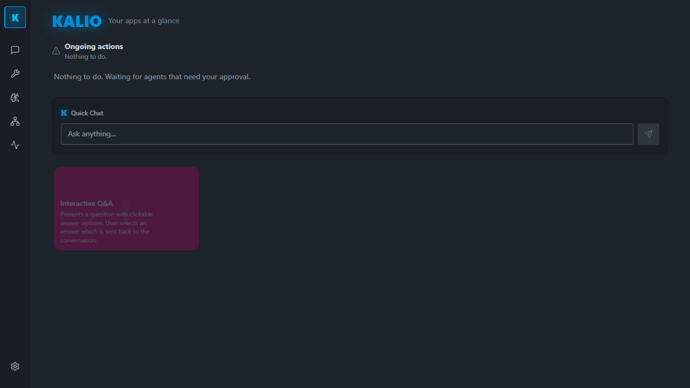
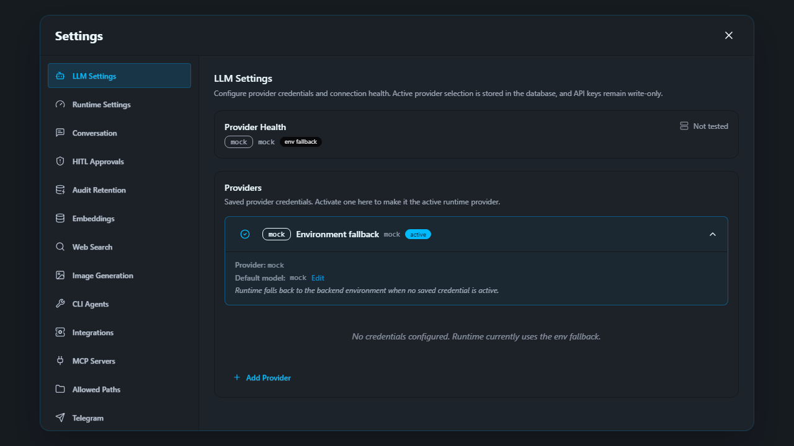

# QA run 1 — Devin ACP through Kalio

Date: 2026-09-26  
Verdict: BLOCKED — stable QA is running and Devin can be rechecked, but the required paid/live CLI-agent readiness gate failed. No Devin task prompt was sent.

## Target and safety boundary

- Kalio checkout: C:\Users\Radomiej\.codex\worktrees\5a7e\kalio-forever.
- QA UI/API: http://localhost:5288/ and http://localhost:3316/api.
- Stable QA data root: %LOCALAPPDATA%\kalio-forever-qa (observed as C:\Users\Radomiej\AppData\Local\kalio-forever-qa); database kalio-qa.db, workspace workspaces.
- Lifecycle: repository start-qa.ps1/stack-manager launcher. The dev-servers MCP inventory had no registered managed QA service or session; this is not a Windows service.
- Provider: mock/mock, source env. Settings → LLM Settings showed “No credentials configured. Runtime currently uses the env fallback.”
- Intended project directory: E:\Projekty\home-site; checked empty before this run. No project was created and no files were written.
- Browser: Codex in-app browser, viewport 1280×720.
- Devin: CLI 3000.11.1, executable devin.exe, 634 model IDs. The current devin models list marked exact model swe-2-high as [Free].
- Native Devin filesystem, web, and terminal toggles remained off. No bridge token was generated, no project trust/allowlist was changed, and no host session was active.

## Acceptance matrix

| AC | Requirement | Status | Evidence / remaining |
|---|---|---|---|
| AC-01 | Stable QA responds on the requested profile | PASS | UI loaded on localhost:5288 and API health returned ok; fixed QA profile, API port 3316, not dev or prod. |
| AC-02 | Effective app LLM mode is known | PASS | API /api/llm/config and Settings showed mock/mock, source env; no saved credentials. |
| AC-03 | Devin CLI and free SWE-2 model are available | PARTIAL | UI Recheck returned Online / Logged in / ACP available, version 3000.11.1, 634 models; swe-2-high was marked [Free] by the current CLI catalog. Initial UI state was Checking/Unavailable; no active host or selected Devin project profile was present. |
| AC-04 | Exact user project is safe to use | PASS | E:\Projekty\home-site was observed empty and remains untouched. |
| AC-05 | Required live/CLI readiness gate passes | BLOCKED | Executed with KALIO_API_BASE_URL=http://127.0.0.1:3316/api: node scripts/agentflow-paid-readiness.mjs --static-only. Four blockers: provider is mock; config source is env; no saved live credential exists; active credential is not set. The repo checklist gates paid/live CLI-agent runs; [Free] does not waive it. |
| AC-06 | Devin creates the React site through Kalio | BLOCKED / NOT RUN | No prompt, host, file write, or terminal operation occurred. |
| AC-07 | Generated project builds and passes desktop/mobile checks | BLOCKED / NOT RUN | No generated files exist to build or preview. |
| AC-08 | QA screenshots and report are saved | PARTIAL | Dashboard and mock-provider screenshots are in assets/. The final Integrations view was verified with CUA, but screenshot-to-file capture failed on an unavailable Details locator; no third file is claimed. |
| AC-09 | Earlier cmd.exe burst is safely attributed | BLOCKED / PARTIAL | Previous bounded snapshot found 25 cmd.exe: 17 direct codex MCP launchers, 5 Context7 children, 2 Chrome native hosts, 1 OpenClaw launcher; later count-only snapshot reached 53 during diagnostics. Devin was not present then. This correlates the increase with Codex/tool diagnostics but does not identify every owner/session or prove a leak. No process was killed; this attempt did not take another broad snapshot. |

## Issues and observations

### [P2] Devin integration status is transient on first load

The Integrations panel first showed Checking, then Unavailable/Unknown. A manual Recheck returned Online, Logged in, ACP available, CLI 3000.11.1, and 634 discovered IDs. This is one observed transient-to-success transition; root cause and repeatability after reload remain unverified. No Devin session was started.

### [P2] The requested live CLI-agent run is blocked by QA provider setup

Stable QA intentionally runs with the mock environment override and has no saved/active credential. The required static readiness check fails closed. I did not remove the mock override, activate a credential, or infer that Devin’s free catalog entry makes the repository gate optional.

### Process-burst attribution

Earlier evidence points at command launchers for Codex MCP integrations and Context7, not at a Devin process; it is insufficient to call this a Kalio, Devin, or specific-agent bug. My first screenshot script assumed a heading not exposed by the page and timed out; I stopped only that exact capture process. A later capture saved two screenshots but timed out on the Details locator and closed its browser in finally. There is no evidence either capture caused the earlier cmd.exe increase.

## Screenshots

The Integrations screen was inspected live, including the successful Recheck result and all three native-tool switches off. It was not saved as a report image after the screenshot locator failed.

## Next step

Keep stable QA isolated and unchanged. Before a Devin prompt, configure an explicitly approved saved QA provider through Kalio’s normal settings flow, rerun the readiness gate, and confirm it is green. Do not paste credentials into chat or silently remove the mock override. After readiness passes, resume through the UI at the exact approved target and retain per-action HITL approvals for fs_write and terminal_spawn.
