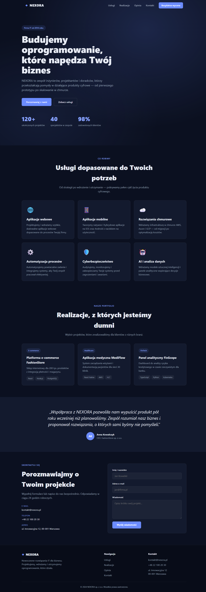
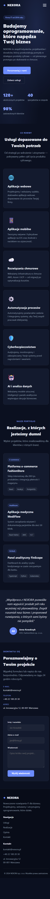
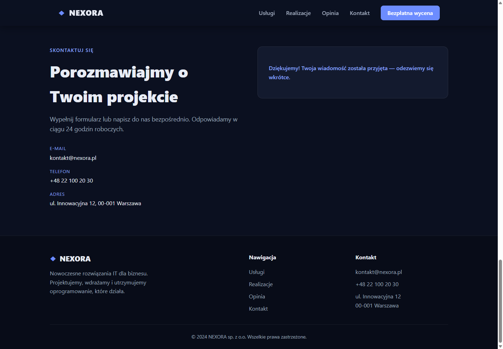

# QA run 15 — Home Site w Chrome, Kalio QA i analiza restartów Playwright

**Data:** 2026-09-27 (Europe/Warsaw)  
**Werdykt:** `CONDITIONAL`. Stabilne QA odpowiada, Home Site renderuje się w Chrome, nawigacja i lokalny formularz działają. Audyt ujawnił błędy dostępności. Nie wykonano nowego wywołania Devin; źródłowa naprawa Orchestratora nadal nie jest potwierdzona.

## Środowisko i granice

- Kalio stable QA: UI `http://localhost:5288/` zwróciło HTTP 200; API `http://127.0.0.1:3316/api/health` zwróciło `ok`. `/api/llm/config` zgłosiło `mock/mock`, source `env`. To provider aplikacyjnego czatu, nie wynik testu Devin ACP.
- Home Site: `http://127.0.0.1:4173/`, tytuł `NEXORA — Nowoczesne rozwiązania IT`. Strona została otwarta w profilu Chrome użytkownika; osobne sesje Chromium MCP posłużyły do testów 1440×1000 i 390×844 oraz zrzutów do raportu.
- Nie czytano ani nie zapisywano plików w `E:/Projekty/home-site` poza wcześniejszymi dowodami z istniejącej historii QA. Nie zmieniano kodu strony, konfiguracji Orchestratora ani definicji usług. Jedynymi nowymi artefaktami tego runu są ten raport i trzy zrzuty.
- Test formularza użył wyłącznie fikcyjnych danych na localhost. W historii QA handler był sprawdzony jako lokalny; bieżący test zakończył się lokalnym komunikatem, bez błędów konsoli ani zgłoszonego requestu sieciowego.

## Macierz akceptacji

| AC | Status | Dowód | Pozostało |
|---|---|---|---|
| AC-01 — Kalio QA po restarcie | PASS | UI HTTP 200, API `ok`, provider `mock/mock` z `env`. | Dowód lokalny; nie jest dowodem produkcyjnym ani Devin. |
| AC-02 — strona Home Site renderuje się w Chrome | PASS | Chrome MCP pokazał tytuł, hero, nawigację, usługi, realizacje, opinię, kontakt i stopkę. Zrzut widoku jest w narzędziu; pełnostronicowy dowód dołączono poniżej. | Bez wniosków o wdrożeniu/produkcji. |
| AC-03 — nawigacja i formularz | PASS | W Chrome kliknięcia `#uslugi` i `#kontakt` przewinęły do sekcji. Formularz z fikcyjnymi danymi zmienił się na komunikat `Dziękujemy!`; logi konsoli Chrome bez błędów, runtime signals Chromium: 0. | Formularz tylko demonstruje lokalne potwierdzenie; nie ma backendu wysyłki. |
| AC-04 — mobile 390×844 | PARTIAL | Hamburger otwiera i zamyka menu; kliknięcie „Usługi” przechodzi do `#uslugi` i zamyka menu. | Zamknięte linki menu nadal są osiągalne klawiaturą poza viewportem. |
| AC-05 — WCAG 2.1 AA | FAIL | Axe wykrył kontrast `3.07:1` białego tekstu na `#6c8cff` dla `.navbar__cta`, `.przycisk--glowny` i `.opinia__avatar`; na mobile także `.kontakt__przycisk`. | Poprawić kolor akcentu/tekstu i ponowić axe w desktop + mobile. |
| AC-06 — mobilny fokus przy zamkniętym menu | FAIL | Przy viewport 390 px focus audit osiągał linki menu o `x=425–494` i dalej, mimo `aria-label="Otwórz menu"`; poza ekranem pozostawały też kolejne pozycje panelu. | Ukryć/zablokować zamknięty panel w kolejności fokusu i drzewie dostępności; ponowić klawiaturowy test w Chrome. |
| AC-07 — zbyt małe linki stopki | FAIL | Layout audit zmierzył linki stopki: `45×21`, `68×21`, `46×21`, `54×21` px. | Powiększyć pole aktywne do zalecanego minimum 24×24 px i sprawdzić ponownie. |
| AC-08 — przyczyna spamowania procesami Playwright | PARTIAL | Logi zawierają `TS2688`, exit code 2 i jawne `Restart scheduled` w krótkich odstępach. Obecnie usługa ma `restartOnExit=false`. Agent odczytał, że `@types/node` jest już zainstalowane zgodnie z lockfile, a bieżące `tsc --noEmit` przechodzi. | Najbardziej prawdopodobna jest przejściowa niekompletna instalacja/dependency state; dokładnego zdarzenia inicjującego nie dowiedziono. |
| AC-09 — świeży Devin dispatch i natywna blokada | UNVERIFIED | Nie uruchamiano nowego Devin turnu. `mock/mock` dotyczy API LLM, nie dowodzi działania ani blokady natywnych narzędzi ACP. | Potrzebny kontrolowany run przez Kalio po odczycie aktualnego audytu/identyfikatorów dispatchu. |
| AC-10 — delegacje | PASS jako konsultacje | Sartre otrzymał zgłoszenie i wykonał odczytowy triage, bez zmian z powodu braku prawa zapisu do checkoutu Orchestratora. Luna Max (`gpt-6-luna`, `max`) zakończyła niezależną konsultację read-only. | Naprawa źródłowa wymaga autoryzowanego checkoutu Playwright. |

## Diagnoza restartów / poleceń CMD

W logach usługi `mcp-playwright-orchestrator` widać powtarzający się ciąg: `TS2688: Cannot find type definition file for 'node'` → `Managed service exited (code=2)` → `Restart scheduled`. W obserwowanym fragmencie zdarzenia następowały co około 4–5 sekund. To wskazuje na restartowanie zakończonego procesu przez managed-service supervisor, a nie na dowód, że Devin albo subagent ręcznie wysyłał dziesiątki poleceń CMD.

Stan odczytany teraz: PID `61072`, port `3333`, `autostart=true`, `restartOnExit=false`, historyczny `restartCount=427`. Agent Playwright nie zmienił plików ani ustawień; stwierdził, że bieżące `@types/node@24.12.4` zgadza się z lockfile i `tsc -p tsconfig.json --noEmit` kończy się kodem 0. Istnieje więc oznaka późniejszego odzyskania zależności, ale nie wiadomo, kto/co naprawiło stan `node_modules`. Licznik historyczny nie identyfikuje sprawcy ani nie dowodzi jednej ciągłej serii restartów. Nie ma dowodu przypisującego pętlę konkretnemu agentowi.

Luna Max zaleciła korelować PID/start time, efektywną politykę restartu, pełny log TS2688/exit oraz audit dispatchu na wspólnych timestampach. Nie ponawiać Devin `Run/Retry` bez wcześniejszego odczytu istniejącego audytu. To pozostaje zgodne z tym runem: nowego wywołania Devin nie było.

## Zrzuty

Pełna strona w desktopowym i mobilnym Chromium oraz stan po lokalnym submit:

## Priorytetowe findings

| Priority | Finding | Impact | Evidence | Resolution |
|---|---|---|---|---|
| P2 | Biały tekst na akcencie `#6c8cff` ma kontrast 3.07:1. | Główne CTA oraz avatar nie spełniają progu AA dla wykrytych tekstów. | Axe WCAG 2.1 AA: `.navbar__cta`, `.przycisk--glowny`, `.opinia__avatar`, mobile `.kontakt__przycisk`. | Skorygować kolor/tekst przez zatwierdzony workflow Kalio i powtórzyć test. |
| P2 | Zamknięte mobile menu pozostaje w kolejności fokusu poza ekranem. | Użytkownik klawiatury może trafić na niewidoczne linki. | Focus audit: focusowalne linki menu przy `x>390`, gdy menu jest zamknięte. | Stan zamknięty musi usuwać linki z fokusu/drzewa dostępności; sprawdzić open/close i nawigację z klawiatury. |
| P2 | Nie zamknięto świeżego Devin dispatchu ani testu negatywnego natywnych narzędzi. | Brak bieżącego end-to-end dowodu ACP/HITL. | W tym runie nie wysłano promptu Devin; obecny provider API to mock. | Najpierw skorelować istniejące audit/session IDs; dopiero potem kontrolowany run zgodny z QA gate. |
| P2 | Root cause historycznej pętli Orchestratora nie jest zamknięty. | Ponowny brak/incomplete `node_modules` może wrócić po instalacji/resecie. | TS2688 + exit 2 + restart schedule; obecnie watchdog restart wyłączony, a agent uzyskał green `tsc`. | Naprawa/udowodnienie wymaga autoryzowanego checkoutu i czystej walidacji startu/testów. |
| P3 | Linki stopki mają wysokość 21 px. | Mniejsze niż zalecany cel dotykowy i trudniejsze na mobile. | Pomiary z layout audit. | Zwiększyć padding/obszar hit-test i ponowić audit. |

## Granice dowodu

Run 15 potwierdza lokalne QA, rzeczywiste renderowanie w profilu Chrome, działanie anchorów i lokalnego stanu formularza oraz testy responsive w odizolowanym Chromium. Nie potwierdza nowego Devin SWE-2 dispatchu, egzekwowania odmowy natywnych narzędzi, naprawy źródłowej Orchestratora, produkcji ani pełnego testu screen-reader. Linear RAD-114 jest obecnie `In Progress`; statusu nie zmieniano.
