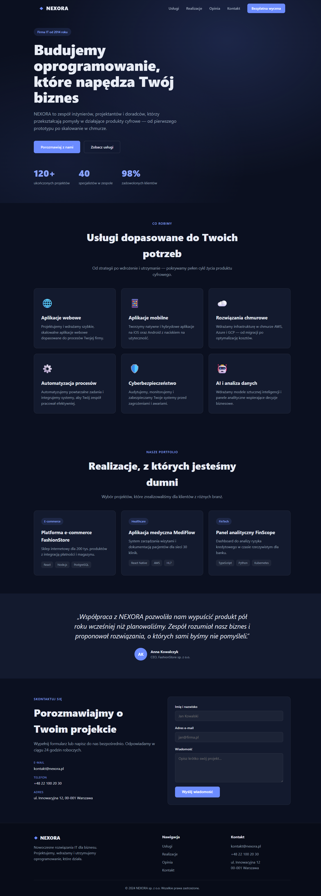
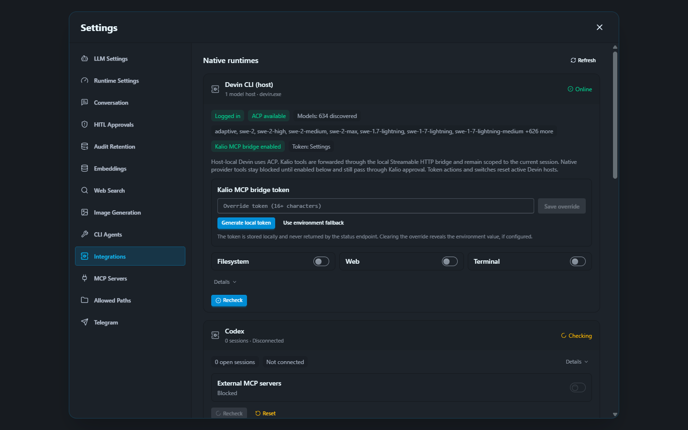

# QA Run 18 — Chrome smoke, Devin Kalio bridge, Playwright Orchestrator

- Data: 2026-09-27 (odczyty ok. 16:26–16:34 UTC; screenshot Settings captured 16:33 UTC)
- Checkout Kalio: `C:\Users\Radomiej\.codex\worktrees\5a7e\kalio-forever`
- Stan checkoutu: repo zawierało wcześniejsze zmiany; źródeł nie modyfikowano. Ten run dodał wyłącznie `docs/raports/qa-run-18/`.
- Stabilny QA: UI `http://localhost:5288/`, API `http://127.0.0.1:3316/`; profile `qa`, dane `C:\Users\Radomiej\AppData\Local\kalio-forever-qa`.
- Efektywny provider Kalio: `mock/mock`, source `env`; nie jest to informacja o rozliczeniu Devin CLI.
- Home Site: `http://127.0.0.1:4173/`, fikcyjna firma NEXORA.
- Przeglądarka: Chrome extension przez CUA do interakcji; osobna, izolowana sesja Chromium Playwright Orchestratora (viewport 1440×900) do snapshotów i zapisania PNG. Nie utożsamiać tych dwóch sesji.
- Zakres: sprawdzenie stabilnego QA, MCP, integracji Devina, jednego read-only narzędzia Kalio przez Devin oraz lokalnego flow Home Site. Nie restartowano usług ani nie zmieniano konfiguracji Devina.

## Wynik

| Obszar | Status | Dowód | Pozostało |
|---|---|---|---|
| Stabilny QA | PASS (punktowo) | Stack manager: API PID 9920 na `3316`, UI PID 23304 na `5288`; `/api/health` zwraca `{"status":"ok"}`. AppData QA root i DB `kalio-qa.db` potwierdzone. | To smoke, nie pełny regression gate. |
| Provider Kalio | PASS | `/api/llm/config`: `provider=mock`, `model=mock`, `source=env`. | Nie dowodzi modelu ani ceny Devin CLI. |
| Globalne MCP Kalio | PARTIAL | Settings → MCP Servers: `Connected 1/2`; `playwright-orchestrator` connected, 26 tools; `data-analyst` `fetch failed`. | Globalne połączenie Playwright nie oznacza dostępu Devina do tych narzędzi. Wyjaśnić Data Analyst oddzielnie. |
| Devin CLI / bridge | PASS (stan i jedno wywołanie) | Integrations po załadowaniu: Devin CLI `3000.11.1` Online, logged in, ACP available, 634 modeli, bridge Kalio enabled; dostępny model obejmuje `swe-2-high`. Istniejący chat Devin SWE-2 High zwrócił wynik jednego `fs_list` przez Kalio MCP dla `E:/Projekty/home-site/src`: `App.jsx`, `main.jsx`, `styles.css`. | Dowód dotyczy `fs_list`; nie uruchomiono nowego read/write w tym runie. `mock/mock` nie potwierdza darmowego użycia Devin. |
| Natywne narzędzia Devina | PASS — konfiguracja wyłączona; odmowa runtime niezweryfikowana | API settings i screenshot Integrations pokazują Filesystem/Web/Terminal wyłączone. Prompt canary zabraniał użycia narzędzi natywnych i narzędzia te nie zostały wywołane. | Nie wykonywano próby bezpośredniego wywołania wyłączonego narzędzia, więc sam mechanizm odmowy nie ma świeżego dowodu runtime. |
| Playwright MCP przypisany Devinowi | UNVERIFIED | Kalio globalnie widzi Orchestratora i jego 26 narzędzi; Run 18 nie wywoływał ich przez chat Devin ani nie zmieniał allow-listy persony. | Nie twierdzić, że Devin ma te narzędzia. Osobno sprawdzić bezpieczną allow-listę i HITL przed przypisaniem; nie udostępniać automatycznie wszystkich 26. |
| Home Site: render, nawigacja, formularz | PASS (desktop/local) | Świeża karta Chrome renderuje NEXORA; „Kontakt” zmienia URL na `#kontakt`; syntetyczne, nieprawdziwe dane wywołały lokalny komunikat „Dziękujemy!”. Handler jest lokalny — historyczna kontrola źródła w [Run 13](../qa-run-13/report.md) wykazała `preventDefault` + stan React, bez wysyłki sieciowej. | Brak testu mobile, keyboard-only i WCAG. Sukces formularza nie oznacza dostarczenia wiadomości. |
| Playwright Orchestrator — smoke | PASS (punktowo) | Izolowana sesja Chromium otworzyła NEXORA i ekran Integrations; runtime signals: `passed`, `findings=0`, bez zarejestrowanych błędów konsoli. Lista telemetrycznych requestów była pusta — nie jest to dowód, że aplikacja nie wykonała żadnych requestów. Sesję zamknięto. | Nie zastępuje testów integracji ani testu kontraktu handlera MCP. |
| Stan Integrations „Checking…” | P4 — stan przejściowy, brak potwierdzonej usterki | Pierwszy snapshot pokazał ładowanie; późniejszy screenshot z 16:33 UTC pokazuje Devin Online, ACP i 634 modele. | Nie zmierzono czasu ładowania; brak dowodu trwałego zawieszenia. |
| Test sukcesu handlera `browser_session_create` | BLOCKED | Agent Sartre ponownie odczytał dirty diff `E:\Projekty\mcp-playwrigh-master\tests\mcpServer.test.ts` i zatrzymał się, bo repo leży poza writable root. Nie edytował plików i nie uruchamiał testów. | Potrzebny checkout Orchestratora jako writable root; dodać wyłącznie test przekazania `headless=true` i serializacji efektywnego rekordu `headless=false`; uruchomić test docelowy oraz `npm run smoke:mcp-config`. |
| Licznik restartów usług | UNRESOLVED | Inventory: Playwright Orchestrator `:3333`, `autostart=true`, `restartOnExit=false`, historyczne `restartCount=427`; Kalio dev `3016/5188`, `autostart=false`, `restartOnExit=true`, licznik 26. W tym runie niczego nie restartowano. | Same liczniki nie wyjaśniają przyczyny ani nie dowodzą aktywnej pętli. Potrzebna osobna analiza istniejących logów. |
| Niezależny agent Luna Max | PASS — opinia otrzymana | Wątek `Luna Max — QA Chrome i Playwright`, model `gpt-6-luna`, reasoning `max`; niezależna ocena read-only potwierdziła rozróżnienie globalnego MCP, allow-listy Devina i wyłączonych narzędzi natywnych. | Luna również potwierdza, że Playwright przez Devin nie był testowany w Run 18. |

## Obrazy

## Priorytety

- [P2] Naprawić/wyjaśnić `data-analyst: fetch failed` w QA; nie wpływa to na potwierdzone połączenie Playwright.
- [P2] Odblokować test granicy MCP w repo `E:\Projekty\mcp-playwrigh-master` i uruchomić wskazane dwa gates. W tym zadaniu agent nie miał prawa zapisu do zewnętrznego checkoutu.
- [P2] Ustalić przyczyny historycznych restartów z logów, bez ubijania usług ani prowokowania restartu; osobno traktować licznik Kalio dev i Orchestratora.
- [P2] Jeśli wymagane jest potwierdzenie egzekwowania blokady natywnych narzędzi Devina, dodać bezpieczny test kontraktu/odmowy. Run 18 potwierdza wyłączoną konfigurację, nie próbę runtime.
- [P3] Nie uznawać 26 globalnych narzędzi Playwright za dostępne dla Devina bez jawnego, ograniczonego przypisania do persony i dowodu HITL.

## Granice dowodu

Run 18 potwierdza, że Devin SWE-2 High potrafił użyć `fs_list` przez bridge Kalio, a natywne Filesystem/Web/Terminal były skonfigurowane jako wyłączone. Nie sprawdzał ponownie `fs_read`/`fs_write`: [Run 13](../qa-run-13/report.md) zapisał historyczne `fs_read → zatwierdzony HITL fs_write → fs_read` z identycznym `package.json` 415 B — był to no-op; ścieżka odmowy HITL nadal nie była testowana. Nie potwierdza też, że Devin widzi Playwright MCP. Test kontraktu handlera jest zablokowany przez brak zapisu do repo Orchestratora. To lokalny smoke QA, nie pełny regression ani production gate.
