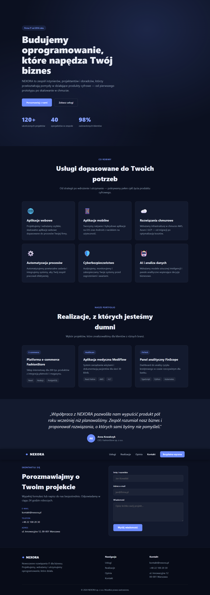
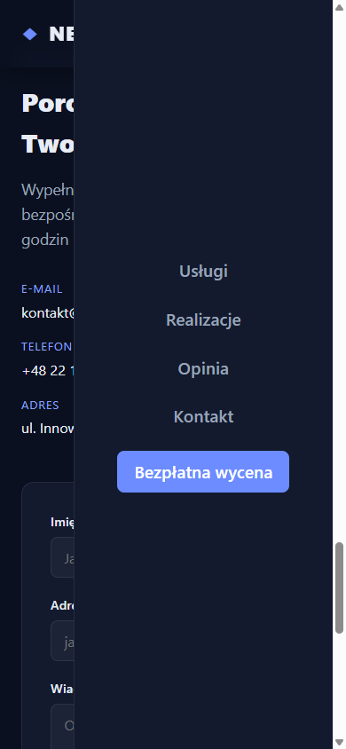
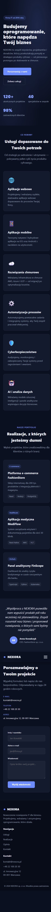
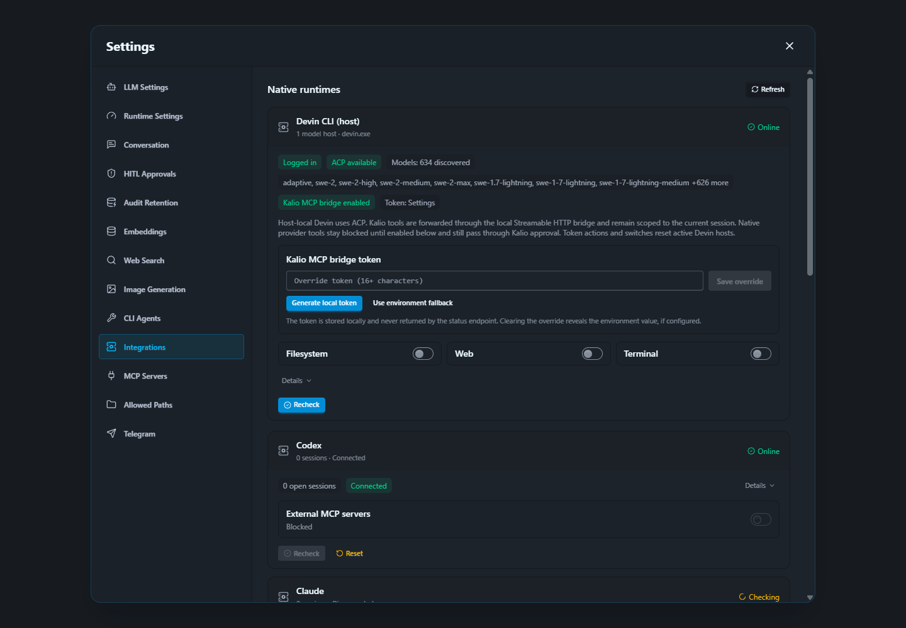

# QA Run 19 — Kalio MCP, Devin bridge and Home Site browser checks

- Data: 2026-09-27, obserwacje ok. 17:06–17:12 UTC.
- Checkout: `C:\Users\Radomiej\.codex\worktrees\5a7e\kalio-forever`.
- Stan checkoutu: zastano liczne zmiany użytkownika (m.in. kod runtime, konfiguracja MCP, `AGENTS.md`, `docs/agent-skills/kalio-manual-qa.md`, raporty i artefakty). Zachowano je; nie zmieniano źródeł aplikacji ani ustawień środowiska. Ten run dopisał raport, obrazy i dwie reguły do repozytoryjnej kopii skilla.
- Stabilny QA: UI `http://localhost:5288/`, API `http://127.0.0.1:3316/`, dane w `C:\Users\Radomiej\AppData\Local\kalio-forever-qa`.
- Efektywny provider Kalio: `mock/mock`, env fallback; Settings → LLM Settings pokazało brak zapisanych credentials.
- Testowany projekt: `E:\Projekty\home-site`, lokalny preview `http://127.0.0.1:4173/`.
- Przeglądarki: Chrome przez CUA do rzeczywistej interakcji formularza i Settings; odizolowane sesje Playwright Orchestratora do powtarzalnych snapshotów desktop/mobile i runtime signals. Nie utożsamiać tych sesji.

## Wyniki

| Obszar | Status | Dowód | Pozostało |
|---|---|---|---|
| Stabilny QA | PASS (smoke) | UI Kalio załadowane w Chrome; lokalny `GET /api/runtime/devin-cli/status` z API `:3316` odpowiedział. | Nie uruchamiano pełnego zestawu testów/regression. |
| Provider Kalio | PASS | Settings → LLM Settings: aktywny `mock` z env fallback, brak zapisanych provider credentials. | To nie określa taryfy/kosztu Devin CLI. |
| Devin CLI host/katalog | PASS (status API) | `devin.exe` 3000.11.1, authenticated, ACP dostępny, `modelCatalogStatus=ready`, katalog 634 modeli; host `swe-2-high` online. Po odświeżeniu osobnego widoku Integrations screenshot pokazuje Devin Online, bridge enabled i natywne przełączniki OFF. | UI wcześniej pozostawało w stanie „Checking”; odpowiedź status API była już zdrowa. Nie wykonano nowego promptu modelowego w tym runie. |
| Koszt SWE-2 | BLOCKED dla nowego wywołania | Oficjalna [strona cennika Devin](https://devin.ai/pricing) podaje darmowe użycie SWE-2 w Desktop/CLI do 10.10.2026 dla Pro i wyższych planów. Status API nie zwraca badge `[Free]` ani taryfy konta; `swe-2-high` nie zostało potwierdzone jako darmowe dla tej sesji. | Przed nowym wywołaniem zweryfikować badge/model i uprawnienie konta; nie zakładać, że każdy wariant/plan jest bezpłatny. |
| Globalne MCP Kalio | PARTIAL | Tools → MCP: `playwright-orchestrator` połączony, 26 narzędzi (`127.0.0.1:3333/mcp`); `data-analyst` ma `fetch failed` (`127.0.0.1:3000/mcp`). | Playwright jest już zarejestrowany; nie dodawano ponownie. Zbadać Data Analyst oddzielnie. |
| Dostęp Devina do narzędzi Kalio | PASS historycznie / niepowtórzony po restarcie | Bieżąca historia QA zawiera Devin `fs_list` przez Kalio w run 18. Run 13 dokumentuje `fs_read → zaakceptowany HITL fs_write` identycznego `package.json` (415 B) → `fs_read`, `bytesWritten=415`. | Odczyt/zapis nie zostały ponownie wykonane po obecnym restarcie, więc to dowód z poprzednich runów, nie świeży test. |
| Natywne narzędzia Devina | PASS — ustawienia; odmowa runtime niezweryfikowana | Settings → Integrations: Filesystem, Web i Terminal Devina wyłączone; screenshot pokazuje także włączony bridge Kalio. | Nie próbowano bezpośredniego obejścia blokady; nie twierdzić, że runtime deny był testowany. |
| Czy Devin widzi Playwright MCP | NO-GO / nieprzypisany | Globalny MCP jest widoczny w Kalio, ale `KalioMcpBridgeService.visibleTools()` odrzuca `domain === 'mcp'`; instrukcje bridge kierują Devinowi wrappery Kalio i zakazują fallbacku do provider-native tools. | Nie udostępniać raw 26 narzędzi. Luna Max rekomenduje mały, związany z bieżącym projektem/originem facade bez identyfikatorów sesji, resume/list/close, dowolnej nawigacji ani eval; dodać test bezpośredniej odmowy i korelację audytu. |
| Home Site — desktop/Chrome | PASS (lokalny UI) | W Chrome odczytano H1, usługi, portfolio, opinię, kontakt i stopkę. „Kontakt” ustawia `#kontakt`. Wypełnienie formularza danymi syntetycznymi (`qa@example.invalid`) pokazało „Dziękujemy!”; nie wpisano prawdziwych danych. | Formularz nie został sprawdzony jako realna dostawa wiadomości; to lokalny UI smoke. |
| Home Site — mobile | FAIL — P2 | Przy otwartym hamburgerze kliknięcie „Zamknij menu” w viewportowym Chromium 390×844 timeoutowało: nakładający się `<nav>` przechwytywał pointer. Kliknięcie linku „Kontakt” działało, ustawiło `#kontakt` i zamknęło menu. | Naprawić warstwowanie/pozycję toggle w Home Site przez dozwolony Kalio workflow, po potwierdzeniu darmowej sesji; potem sprawdzić otwarcie, zamknięcie togglem i linkiem oraz zrzut z tego samego buildu. |
| Runtime signals Home Site | PASS (zakres ograniczony) | Izolowany Orchestrator: status `passed`, `findings=[]`, brak błędów/nieudanych lub 4xx/5xx requestów. Pełna telemetryka obejmowała 200 lokalnych requestów ze współdzielonej sesji (także wcześniejsze UI Kalio), nie tylko Home Site. | W tym zbiorze był jeden wcześniejszy verbose Chromium warning: pole hasła poza `<form>` na stronie Kalio — nie jest błędem Home Site. |
| Test regresji serwera Orchestratora | BLOCKED | Agent Sartre potwierdził, że `E:\Projekty\mcp-playwrigh-master` nadal jest poza jego writable root; nie edytował repo ani nie uruchomił testów. Przygotował minimalny test przekazania `headless=true` do managera i serializacji efektywnego wyniku (`headless=false`). | Potrzebny autoryzowany checkout/root. Zachować zastany dirty test `tests/mcpServer.test.ts`; po dostępie uruchomić test docelowy i `npm run smoke:mcp-config`. Nie zmieniać watchdog/restart settings. |

## Screenshots

## Decyzje i pozostałe kroki

- Playwright Orchestrator jest już podpięty globalnie do Kalio; drugi wpis byłby duplikatem. Nie przypisywać Devinowi nieograniczonego zestawu 26 narzędzi.
- „Codex ma to narzędzie” nie oznacza, że Kalio ma odpowiadający endpoint/credential. Nie podłączano innych serwerów; `data-analyst` już ma błąd połączenia.
- [P2] Naprawić mobile close-toggle w `E:\Projekty\home-site` i powtórzyć test po buildzie. Bez ręcznego patchowania projektu poza Kalio.
- [P2] Dać agentowi/checkoutowi Orchestratora autoryzowany writable root, aby mógł zastosować i uruchomić minimalny regresyjny test; zachować cudze zmiany.
- [P2] Przed świeżym wywołaniem Devin potwierdzić `[Free]` dla dokładnego wariantu i taryfę konta; wtedy osobno odświeżyć testy `fs_read`/HITL `fs_write` w tym samym QA projekcie.
- [P3] Naprawić `data-analyst: fetch failed` albo jawnie pozostawić jako niedostępny.

## Granice dowodu

To jest lokalny manual QA smoke, nie pełne regression ani production proof. Potwierdza bieżący render, desktopową nawigację, lokalny formularz, konfigurację bridge’a i globalne połączenie Playwright MCP. Nie potwierdza świeżego Devin `fs_read`/`fs_write`, ceny bieżącej sesji `swe-2-high`, odmowy bezpośredniego native-tool call ani bezpiecznego dostępu Devina do Playwright — takiego dostępu celowo nie włączono.
