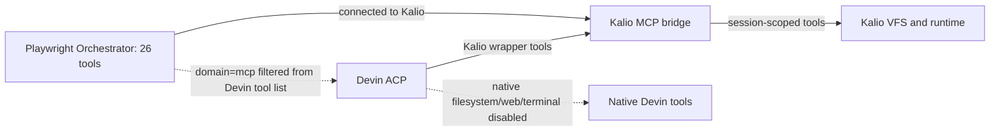

# QA Run 20 — stable Kalio QA, Devin bridge and Home Site mobile

- Date: 2026-09-27, observations approx. 17:29–17:43 UTC.
- Checkout: `C:\Users\Radomiej\.codex\worktrees\5a7e\kalio-forever`.
- Scope: read-only smoke of stable QA in the user's Chrome, current Devin/MCP settings, and the generated `E:\Projekty\home-site` UI. No Devin/LLM request, source edit, service restart, or Home Site edit was made.
- The checkout already contained unrelated dirty work and QA Run 19 artifacts. This run added only this report and its two screenshots.
- Stable QA UI: `http://localhost:5288/`; API: `http://127.0.0.1:3316/`; Home Site preview: `http://127.0.0.1:4173/`.
- Browser boundary: stable QA and the desktop Home Site page were inspected in the user's Chrome via CUA. Mobile `390×844` checks used a fresh isolated Playwright Orchestrator Chromium context; this is not a physical-device or Chrome-profile test.

## Results

| Area | Status | Evidence | Remaining |
|---|---|---|---|
| Stable QA after restart | PASS (smoke only) | `http://localhost:5288/` loaded in Chrome as Kalio; an independent read-only check reported API health `ok` on `:3316`. | No full regression suite was run. |
| Devin host and settings | PASS (configuration) | Settings → Integrations showed `devin.exe` Online, Logged in, ACP available, 634 models discovered, Kalio MCP bridge enabled; native Filesystem, Web and Terminal checkboxes were all off. | No live Devin tool-list or tool-call proof in this run. |
| Kalio provider | PASS (safe boundary) | Settings → LLM showed `mock` from environment fallback. No LLM/Devin prompt was sent. | The UI/status does not prove whether a particular Devin model is free for this account. |
| Kalio MCP catalog | PARTIAL | Settings → MCP Servers in Chrome showed `1/2` connected and 26 tools; `playwright-orchestrator` was connected, while `data-analyst` showed `fetch failed`. | Do not restart either service as part of this smoke. Diagnose Data Analyst separately. |
| Devin sees Kalio tools | UNKNOWN at live-session level | The current UI says bridge enabled. Read-only code review found the ACP source passes its tool list and `KalioMcpBridgeService.visibleTools()` filters external `domain === 'mcp'`; bridge tests assert that external Playwright tools are excluded. | A real Devin ACP session must still show `mcp_list_tools` and a successful scoped Kalio `fs_list`; no LLM run was made. |
| Devin native-tool blocking | PASS for settings/static policy; UNKNOWN for a live denial | Native Filesystem/Web/Terminal are off. The read-only review found disabled/unknown native categories rejected by permission handling and unit tests for defaults/classification. | No direct native tool was attempted; runtime denial and correlated audit remain unverified. |
| Raw Playwright MCP exposure to Devin | PASS (excluded by current bridge filter) | Kalio has 26 Playwright Orchestrator tools, but the bridge's external-MCP filter prevents forwarding that raw catalog into Devin's Kalio tool list. | Keep raw tools disconnected from Devin; a scoped facade would need ownership/origin limits and denial/audit tests first. |
| Home Site desktop render in Chrome | PASS (visual smoke) | Chrome accessibility tree contained the NEXORA title/H1, service cards, portfolio, contact and footer content at `127.0.0.1:4173/#kontakt`. | No new desktop form submission was made in this run. |
| Home Site mobile menu open | PASS | Isolated Chromium `390×844`: `Otwórz menu` changed to `Zamknij menu`; screenshot shows the open navigation panel covering the toggle area. | — |
| Home Site mobile menu close button | FAIL — P2 | Clicking `button[aria-label="Zamknij menu"]` timed out; Playwright reported `<nav aria-label="Nawigacja główna">` intercepting pointer events. | Fix layering/position of the close toggle in Home Site through the authorized Kalio workflow, then rerun. |
| Home Site mobile Escape close | FAIL — P2 | With the menu open, Escape returned `ok` but the next snapshot still exposed `aria-label="Zamknij menu"`. | Add/repair keyboard dismissal and recheck focus behavior. |
| Home Site mobile link close | PASS | Clicking the observed main-nav `Kontakt` link changed the URL to `#kontakt` and restored the button label `Otwórz menu`. | — |
| Home Site runtime signals | PASS (this isolated context) | Orchestrator reported `findings=[]`, no console/page errors and no failed or 4xx/5xx requests. | This does not prove production or real form delivery. |
| Playwright Orchestrator service test | BLOCKED — external checkout is not writable | Agent Sartre reconfirmed that `E:\Projekty\mcp-playwrigh-master` is outside its writable roots. No files changed and tests were not run. Its exact proposal is to assert `headless:true` is forwarded to `manager.createSession`, then deep-compare the MCP JSON against the effective manager record with `headless:false`. The returned session was `headless:false`, consistent with the force-visible policy; this is not being treated as a runtime defect. | Needs an authorized writable checkout before the agent can add the test and run `npm run test -- tests/mcpServer.test.ts` plus `npm run smoke:mcp-config`. Do not change force-visible, watchdog, autostart or restart policy. |

## Devin/MCP boundary

The current configuration is the intended split: Devin can be offered Kalio wrapper tools while its native Filesystem/Web/Terminal tools remain disabled. The raw Playwright catalog is available to Kalio but is not forwarded to Devin. This is configuration plus source/test evidence, not proof of a live Devin session. No direct native call was tried.

## Screenshots

A fresh Chrome screenshot of Settings → MCP Servers was captured during the run and shown in the task; the portable report assets above are the verified mobile-state captures.

## Tracking and remaining risks

- The `kalio-forever` Linear project currently reports Backlog. The related approval separation issue [RAD-127](https://linear.app/radkoworld/issue/RAD-127/rozdziel-approval-bridge-kalio-od-natywnych-narzedzi-devina) is Done; its requirement is that Kalio MCP approval stay separate from Devin native-tool permissions. Runtime proof is still incomplete here.
- The scoped external gateway issue [RAD-129](https://linear.app/radkoworld/issue/RAD-129/wystaw-scoped-external-mcp-gateway-dla-bare-codex-claude-i-devina) remains Backlog. Independent review flagged a [P2] boundary to close before broader exposure: the current bridge token is instance-scoped rather than cryptographically bound to a project/session. Do not expose raw Playwright tools meanwhile.
- The separate `mcp-playwrigh-master` Notion/Linear inventory is an `evidence-collected` snapshot from 2026-08-15, with its project in Backlog and no open issues in that snapshot. The repo's current agent report says the checkout is outside its writable root; no issue/status was changed.
- The Notion project page was fetched directly. Notion access discovery (`get_tool_access`) is unavailable in this tool set, so accepted Notion decisions and recent Agent Notes could not be searched or verified.
- The agent-requested Playwright test remains pending. The prior proposed target is `tests/mcpServer.test.ts`; once the exact checkout is writable, preserve its existing dirty test and run that focused test plus `npm run smoke:mcp-config`. Do not change `forceVisibleBrowsers`, autostart, watchdog, or restart settings.

## Priorities

| Priority | Finding/action | Impact | Evidence | Resolution |
|---|---|---|---|---|
| P2 | Mobile close toggle and Escape do not dismiss the menu | Mobile users can open but cannot use either close path; they must choose a nav link. | `390×844` click interception and post-Escape snapshot; screenshots in `assets/`. | Repair only through Kalio/Devin on `E:\Projekty\home-site`; build and repeat toggle, Escape, link, focus and screenshots on the same revision. |
| P2 | Live Devin allow/deny path is not re-proven | Settings/source tests cannot establish the tools actually advertised or denied by the current ACP session. | Fresh settings + independent source review; no live Devin call. | After exact free entitlement/readiness is confirmed, run one scoped read-only Kalio tool call and a separately audited native denial. |
| P2 | External MCP scope token is not project/session-bound | Broadening the bridge could allow cross-project or cross-session access. | Independent source review; RAD-129 remains Backlog. | Keep raw Playwright MCP excluded until a scoped gateway and negative tests are in place. |
| P3 | Data Analyst MCP unavailable | One configured tool server is not usable in this QA instance. | Kalio MCP screen: `fetch failed`. | Investigate independently; do not mask or conflate with Playwright MCP. |

This is local QA evidence only. No Devin model call, Home Site write, service restart, external issue update, commit, deployment or production proof occurred.
