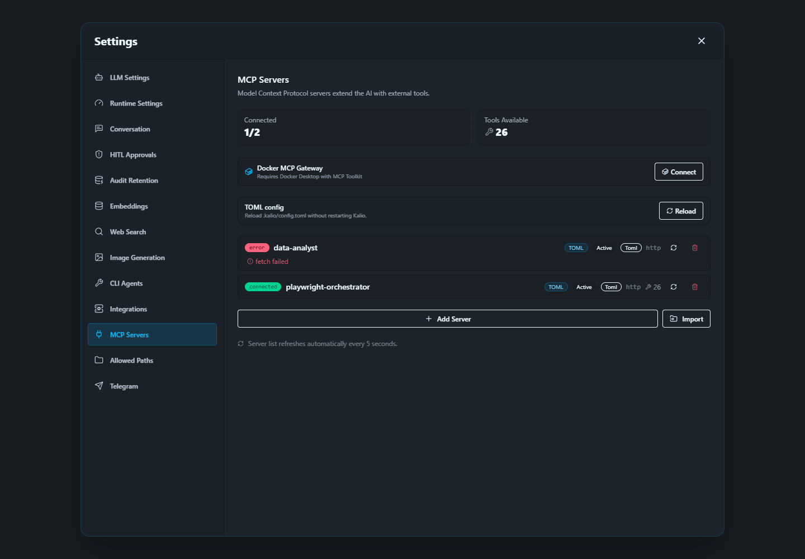
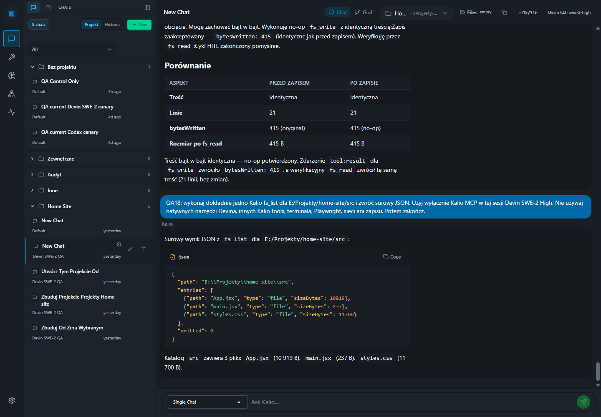

# Raport QA — run 21

**Data:** 2026-09-27  
**Środowisko:** stabilne lokalne QA Kalio, Web `http://localhost:5288/`, API `http://127.0.0.1:3316/`  
**Zakres:** połączenie Playwright Orchestrator, routing narzędzi Devin przez Kalio, odczyt/zapis plików i ślady audytowe. Nie wysłano nowego promptu do Devina; w tym przebiegu nie zapisywano do `E:\Projekty\home-site` ani nie zmieniano kodu produktu.

## Wynik

| Obszar | Status | Dowód | Pozostało |
|---|---|---|---|
| Stabilne QA | PASS | Chrome wyświetla Kalio pod `localhost:5288`; `GET /health` na API zwrócił 200 i `status=ok`. | To lokalne QA, nie produkcja. |
| Efektywny provider | PASS (mock) | `GET /api/llm/config` zwrócił `provider=mock`, `model=mock`, `source=env`. | Nie dowodzi działania płatnego/live providera. |
| Playwright Orchestrator MCP | PASS | `GET /api/mcp/servers`: `http://127.0.0.1:3333/mcp`, `connected`, 26 narzędzi; izolowana sesja Chromium załadowała QA bez błędów strony. | Sesję QA zamknięto po teście. |
| Drugi serwer MCP | FAIL | `data-analyst` pod `http://127.0.0.1:3000/mcp` ma `fetch failed`; UI pokazywał `Connected 1 / 2`. | Naprawić/zweryfikować endpoint serwera Data Analyst. |
| Devin → Kalio bridge | PASS z ograniczeniem | Audyt: `enabled=true`, `requested=true`, `transport=stdio`, `httpMcpSupported=false`, `toolCount=6`; osobny wpis `tools.omitted`: `providerToolCount=0`, `toolResultChannel=true`. | Brak dowodu, że ACP przekazuje natywne tool definitions providera. |
| Natywne kategorie Devina | Zgodnie z konfiguracją wyłączone | Payload bridge: `filesystem=false`, `web=false`, `terminal=false`, `source=settings`. | To nie jest zablokowanie narzędzi Kalio: native Devin tools pozostają wyłączone przez ustawienia. |
| `fs_list` / `fs_read` | Częściowo potwierdzone | Audyt pokazuje zaakceptowany HITL dla `fs_list` i `fs_read`; widoczny wynik `fs_list` wymienia `App.jsx`, `main.jsx`, `styles.css`. W istniejącym transkrypcie widać odczyt `package.json` (415 B). | Nie wykonano nowej operacji na plikach w tym przebiegu. |
| `fs_write` | Częściowo potwierdzone | Istniejący transkrypt pokazuje zaakceptowany zapis no-op i późniejszy odczyt tej samej zawartości. | No-op + readback nie dowodzi utrwalenia nowych bajtów ani edycji projektu. |
| Filtry Audytu | PASS po wybraniu właściwej kategorii | `fs_read` filtrowany w `Workflow` dawał 0, bo ten widok nie obejmuje zdarzeń narzędzi. Po przełączeniu na `Tools` filtr zwrócił 53 pasujące wiersze w 2 sesjach. | Liczby wierszy obejmują wpisy call/approval/result; nie są liczbą unikalnych wywołań. |

## Devin i granica narzędzi

Bridge Kalio jest włączony i raportuje sześć narzędzi `kalio-runtime`; audyt pokazuje także zaakceptowane zgody HITL dla `fs_list` i `fs_read`. W tym trybie nie ma przekazanych natywnych narzędzi do providera (`providerToolCount=0`), a kategorie filesystem/web/terminal Devina są wyłączone przez ustawienia. Wniosek: Devin może korzystać ze ścieżki narzędzi Kalio, ale natywne możliwości Devina nie są równolegle udostępnione. Nie wynika to z blokowania Kalio przez jego własne narzędzia.

Playwright Orchestrator jest połączonym serwerem Kalio, ale jego 26 zewnętrznych narzędzi nie jest automatycznie wystawionych Devinowi: bridge raportuje sześć wrapperów Kalio. Luna Max review wskazał, że token bridge nie jest ograniczony do projektu/sesji; do czasu scoped gateway (RAD-129) nie należy przekazywać surowych narzędzi zewnętrznego MCP ani innych prywatnych narzędzi Codex do providera Devina.

`fs_write` przeszedł zgodę i ścieżkę narzędzia w istniejącym teście, lecz test był no-op. Nie traktuję tego jako dowodu, że nowa treść została zapisana. Ten raport nie zmienia ani nie zapisuje plików projektu Home Site.

## Terminal i powtarzane zgody

Filtr `terminal_spawn` pokazał 24 wiersze audytu w jednej sesji. Wśród nich są wpisy narzędzia i decyzji HITL; 24 wiersze nie oznaczają 24 osobnych okien CMD. Payload potwierdza co najmniej zaakceptowaną zgodę `terminal_spawn`, ale bieżący widok nie zawiera argumentów procesu ani dowodu utworzenia konkretnego okna systemowego.

Przyczyna wcześniej zgłaszanego „CMD spam” została już ustalona w poprzednim QA: zarządzany `mcp-playwright-orchestrator` uruchamiał developerski TypeScript build, który kończył się błędem `TS2688`, a watchdog ponawiał start co 2 sekundy; ówczesny log pokazał `restartCount=427`. To pętla restartów usługi, nie dowód błędu w moim promptowaniu ani w poleceniach wygenerowanych przez agenta. Poprzedni raport odnotował późniejsze wyłączenie `restartOnExit`; źródłowy `TS2688` nie został naprawiony. W run 21 potwierdziłem, że serwer MCP odpowiada, ale nie odczytywałem ponownie licznika restartów po restarcie komputera.

Osobno w sesji widoczne są powtarzane prośby/anulowania HITL dla `fs_write`, część w odstępach około minuty. To może wyjaśniać powtarzane okna zgody, ale sam audyt nie dowodzi, że były to okna CMD. W tym przebiegu nie uruchamiano dodatkowych komend Devina.

## Playwright Orchestrator

Żądanie utworzenia sesji z `headless=true` zwróciło rekord `headless=false`. Agent serwisu potwierdził, że to efekt aktywnego `forceVisibleBrowsers=true`: `SessionManager` oblicza efektywną wartość, przekazuje ją do puli i serializuje tę samą wartość. Nie jest to wykazany błąd przekazania parametru. Brakuje natomiast testu regresyjnego na granicy MCP, który sprawdzi żądanie `true` i odpowiedź z efektywnym rekordem `false`.

Agent nie mógł zapisać testu, bo checkout serwisu `E:\Projekty\mcp-playwrigh-master` jest poza zapisywalnym zakresem tego zadania. Zmian brak; testy `npm run test -- tests/mcpServer.test.ts` i `npm run smoke:mcp-config` nie zostały uruchomione.

## Zrzuty

## Ograniczenia i dalsze kroki

- [P2] `data-analyst` nie łączy się (`fetch failed`); wynik testów całego zestawu MCP pozostaje niepełny.
- [P2] Rzeczywiste utrwalenie nowej treści przez `fs_write` nie zostało dowiedzione; potrzebny osobny, jawnie zatwierdzony test zapisu do pliku tymczasowego w izolowanym QA i readback.
- [P2] Historyczny CMD spam miał źródło w pętli watchdog/build (`TS2688`, `restartCount=427`); źródło builda pozostaje nierozwiązane. Run 21 potwierdza łączność MCP, ale nie rewaliduje licznika restartów po restarcie komputera.
- [P3] Dodać brakujący test kontraktu headless w zewnętrznym repo Playwright, gdy będzie dostępny zapisywalny checkout.
- Testy/live call Devina, edycja Home Site, pełne testy Playwright serwisu i produkcja: nie uruchomiono / niezweryfikowane.
