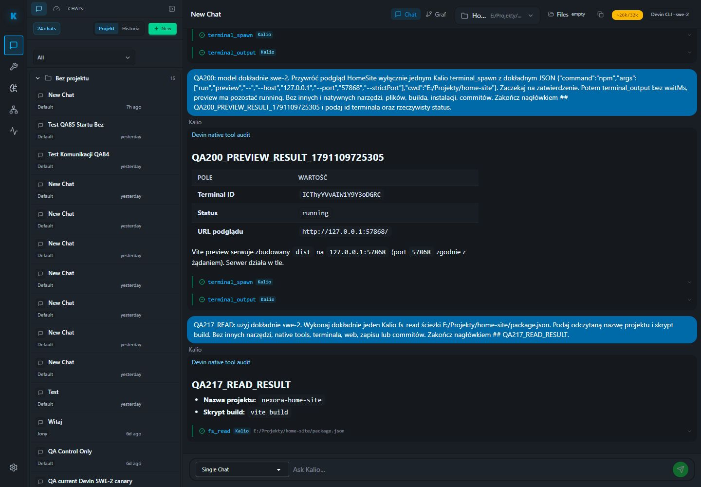

# QA217 — real Devin read through Kalio UI

Date: 2026-10-04. Checkout: `C:/Users/Radomiej/.codex/worktrees/5a7e/kalio-forever`, branch `codex/kalio-provider-runtime-ux`, pre-existing mixed dirty work preserved. Fixed built QA: UI `http://localhost:5288/`, API `http://127.0.0.1:3316/api`, data `%LOCALAPPDATA%/kalio-forever-qa`; frontend artifact from QA216.

Exact session `W4fggLSunrJB41C24MV7C`, profile Devin ACP `swe-2`, project `E:/Projekty/home-site`. No default-provider switch or database/configuration edits. This is a live single-chat read, not an AgentFlow or mock run.

## Readiness and action

Initial cold-host preflight failed its zero-host condition. No prompt was sent at that point. Inspection of the existing readiness implementation identified its explicit warm-session mode. GET-only preflight with `--resume-session W4fggLSunrJB41C24MV7C` passed all checks: exact thread, one online SWE-2 host with known epoch, fresh authenticated catalog, no current run/children, strict profile, six Kalio tools, manual confirmations, configured bridge and native filesystem/terminal disabled.

Used an agent-owned in-app browser tab, selected the exact session from observed DOM `data-session-id`, and submitted QA217_READ. Requested one Kalio `fs_read` of `package.json`, no terminal, native tools, web, writes or commits. Response returned project name `nexora-home-site` and build script `vite build`.

Durable IDs: turn `-MnER20t2IV4a3OEmydb0`, prompt `GtmeSxFMnzWodO-WxXvrn`, assistant `NPwBLc1eivaFIQB_AUVsa`, tool-result `YGCV331KItizHksoYB2OL`. All share the exact turn/prompt binding. Tool-result content contains the approved path and actual package data.

## Acceptance

| Requirement | Status | Evidence / remaining |
| --- | --- | --- |
| Exact real Devin configuration ready | PASS | Warm-session static preflight exit 0; pricing/account-free status not established. |
| FE-first live read of approved project | PASS | In-app browser submission; durable assistant and tool-result IDs above. |
| Tool origin visible | PASS | One `fs_read` card marked Kalio in exact response. No backend native-attempt audit collected in this run. |
| Response becomes idle and survives F5 | PASS | Chromium 1440x1000 read-only test: one result bubble, one tool-origin badge, expected name/script, no `Stop agent`; 1 passed in 2.5s. |
| Saved screenshot | PASS | `assets/devin-read-after-f5.jpg`, inspected after capture. |
| CMD-spam diagnosis or process-launch behavior | UNVERIFIED | This scenario requests no terminal action; no OS-wide or exact-turn process audit performed. |
| File writes/build/new project quality | UNVERIFIED | Existing project was read only. Historical builds are not new build proof. |

Test: `apps/e2e/tests/qa217-devin-read-readonly.spec.ts`, explicit `KALIO_QA217_READONLY=1`, external fixed QA, system Node outside sandbox. It only verifies the already-generated result and sends no prompt. Playwright closes its own browser through the fixture. Separate manual tab closed after verification.

The full delivery goal remains open; this proves a real resumed Devin read on the latest frontend, not complete integration closure. No commit made in this run.

