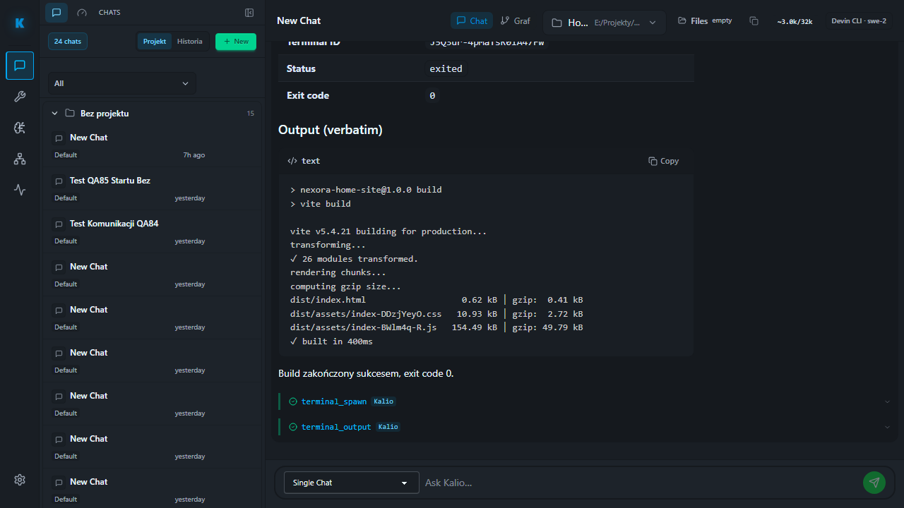

# QA218 — real Devin build with approval and scoped CMD audit

Date: 2026-10-04. Fixed QA UI `http://localhost:5288/`, API `http://127.0.0.1:3316/api`, persistent data `%LOCALAPPDATA%/kalio-forever-qa`. Checkout `C:/Users/Radomiej/.codex/worktrees/5a7e/kalio-forever`, branch `codex/kalio-provider-runtime-ux`; existing mixed changes preserved. QA216 frontend build and existing backend; no reset, provider change or source edit.

Exact approved Devin session `W4fggLSunrJB41C24MV7C`, exact model `swe-2`, project `E:/Projekty/home-site`. Warm-session static readiness was rechecked immediately before execution and passed. This does not establish pricing or an account-free entitlement.

Existing test `qa-devin-approved-build-live.spec.ts` was inspected before running with `KALIO_DEVIN_APPROVED_BUILD=1`, report run 218 and pending reload enabled. System Node outside sandbox, external fixed-QA Chromium. The test submits through Talk, verifies full arguments, approves through the actual Confirm control, then inspects scoped audit and durable results. This is not a mock execution.

| Acceptance | Status | Evidence |
| --- | --- | --- |
| Exact requested command before approval | PASS | One tool call, `terminal_spawn`, payload `{command: "npm", args: ["run", "build"], cwd: "E:/Projekty/home-site"}`. |
| No execution before confirmation | PASS | Scoped `process.cmd.invocation` count 0. |
| Pending request survives F5 without duplication | PASS | One Confirm control, full arguments visible, unchanged tool-call audit, CMD count still 0. |
| Approved command executes once | PASS | One `terminal_spawn` and one scoped CMD invocation; only spawn/output tool names observed. |
| Actual project build | PASS | Terminal `J5Q3ur-4pMaTsR0iA47Fw`, PID 42328, durable result `exited`, exit code 0, Vite 5.4.21, 26 modules, built in 400 ms. |
| Terminal conversation after F5 | PASS | Final heading retained, current run endpoint empty, connection indicator absent. Screenshot shows final result, Kalio tool cards and idle composer. |
| Browser test | PASS | 1 test passed, 8.2s scenario / 8.9s overall. |
| Broad OS-wide CMD leak / native attempt exclusion | UNVERIFIED | No OS-wide process sampling or dedicated native-attempt audit performed; the scoped invocation assertions cannot prove those broader claims. |

Durable turn: `HQbahkW-LGyLMoPx5n8Yq`. Prompt/result marker: `QA218_BUILD_1791112840856_RESULT`. Output assets: `index-DDzjYeyO.css`, `index-BWlm4q-R.js`. Source was not changed; normal build output was regenerated through Devin's approved Kalio terminal tool.

Saved screenshots: `build-awaiting-confirmation.png`, `build-pending-after-f5.png`, `build-result-after-f5.png`. Final screenshot inspected. Playwright fixture closes its browser; test cleanup cancels/stops only the scoped pending/running UI if necessary.

The full delivery goal remains open. Required remaining proof includes real edits/quality acceptance, remaining communication states and ChatGPT/Codex closure; this run proves the specific approved build and CMD audit boundary.

