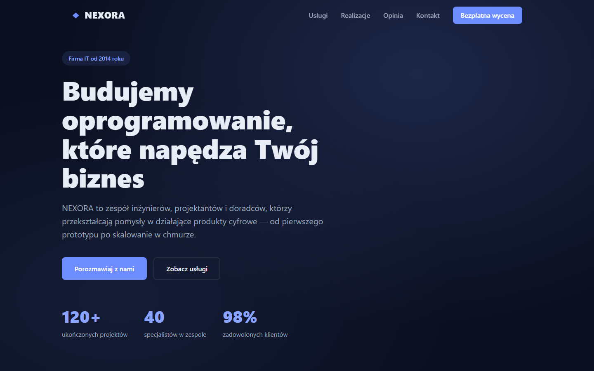
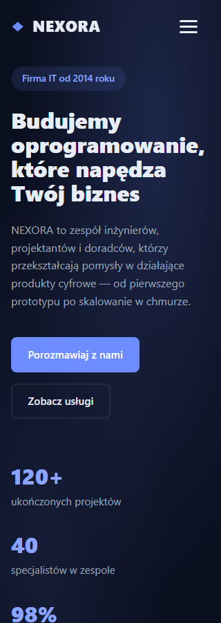

# QA219 — actual Home-site product audit after real Devin build

Date: 2026-10-04. Read-only generated-project audit; no target source edits or new agent request. Preview `http://127.0.0.1:57868/`, React demo in `E:/Projekty/home-site`, expected built script `index-BWlm4q-R.js` from successful real Devin QA218 build. Kalio fixed QA stays on UI 5288 / API 3316; providers and backend were not reset.

Existing `apps/e2e/tests/home-site-live-audit.spec.ts` was inspected and executed using system Node outside sandbox, external QA configuration, `KALIO_HOME_SITE_REPORT_RUN=219` and the exact expected script. Chromium: 2 tests passed, total 5.6s. These test browser behavior of the generated site, not Kalio communication itself.

| Acceptance | Status | Evidence / boundary |
| --- | --- | --- |
| Built application identity | PASS | Exact NEXORA page title and one script reference to `index-BWlm4q-R.js`. |
| Responsive widths 320, 390, 1440 | PASS | Viewport asserted, no horizontal overflow, visible H1, narrow menu initially outside viewport. |
| Mobile menu keyboard | PASS | Focus moves to first link; reverse Tab wraps; Escape closes and restores toggle focus. |
| Toggle and navigation close | PASS | Close button closes; reopening and clicking Usługi closes and navigates to `#uslugi`. |
| Demo form negative/recovery/success | PASS | Empty submit produces 3 invalid fields and focuses name; valid demo data shows reset; reset clears and focuses name with no invalid fields. No actual delivery asserted. |
| Reduced motion | PASS | Media matches reduce; scroll behavior auto; menu transition <= 0.01s. |
| Long hero word at 320 | PASS | `oprogramowanie` occupies one text-range fragment. |
| Screenshots | PASS | Full-page and hero captures at all three widths; 320 and 1440 hero images inspected. |
| Tablet-specific 820, WCAG/contrast/automated accessibility | UNVERIFIED | This test does not cover those boundaries. |
| Production content/contact delivery | UNVERIFIED | Demonstration company content and demo-only form; not a production business acceptance. |

No reproduced failure in this scenario required a repair prompt to Devin. This is not an exhaustive audit and does not close all Kalio runtime/UX issues or the ChatGPT target.

