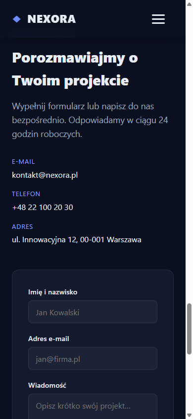
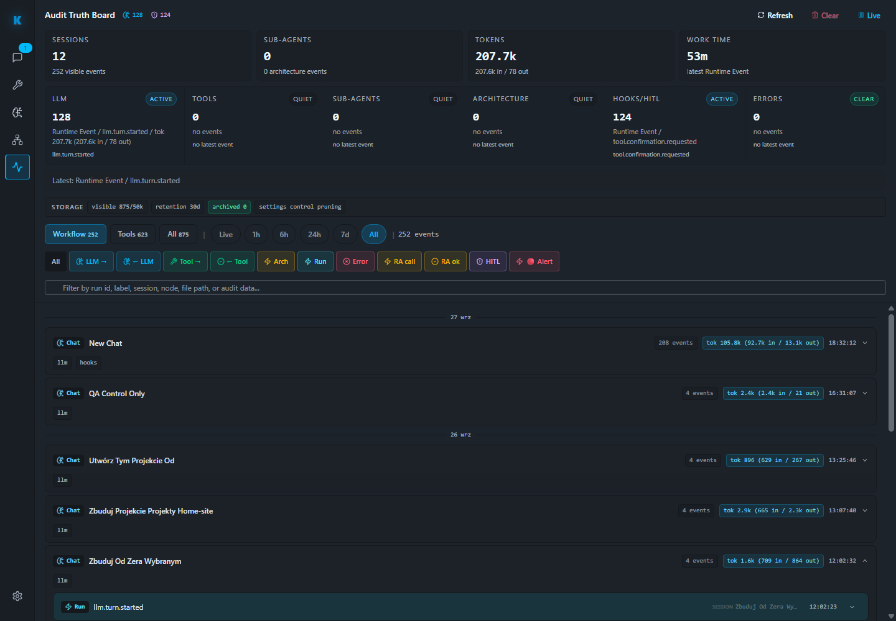

# Raport QA — run 22

**Data:** 2026-09-27 19:05–19:18 UTC (21:05–21:18 Europe/Warsaw)  
**Repo raportu:** `C:\Users\Radomiej\.codex\worktrees\5a7e\kalio-forever`  
**Zakres:** stabilne QA Kalio po resecie, audyt ostatniej sesji Devin, dostępność MCP Playwright Orchestrator oraz przegląd istniejącej strony `E:\Projekty\home-site`. Home Site było oglądane wyłącznie przez Chrome/Playwright; nie czytano ani nie zmieniano jego plików z powłoki.

## Wynik

| Obszar | Status | Dowód | Pozostało |
|---|---|---|---|
| Stabilne QA Kalio | PASS (lokalny runtime) | Chrome: `http://localhost:5288/`; `GET http://127.0.0.1:3316/api/health` zwrócił `status=ok`. | QA nie występuje jako osobna usługa w inwentarzu managed services; właściciel procesu po resecie pozostaje niepotwierdzony. |
| Efektywny provider QA | PASS (bez modelu live) | `GET /api/llm/config`: `provider=mock`, `model=mock`, `source=env`. | Nie jest to dowód działania SWE-2 w nowej sesji; w run22 nie wysłano nowego promptu do dostawcy. |
| Runtime UI Kalio | PASS | Playwright runtime collector: `status=passed`, 0 findings, 0 console/page errors; Chrome pokazał widok Observability. | Pojedyncza strona i okno czasowe, nie pełny E2E. |
| Ostatnia sesja Devin `zOrPQ7EweybA3uFCdQN2o` | FAIL dla dowodu użycia narzędzi | Wpisany model `swe-2-high`; sesja ma 4 zdarzenia LLM, a lane `Tools` pokazuje `0 / no events`. Brak rzeczywistego tool-call/result w audycie. | Powtórzyć test przy potwierdzonym bezpłatnym SWE-2; oczekiwać korelowanych zdarzeń request/approval/result. |
| Natywne narzędzia Devina | Zgodnie z polityką wyłączone | Ustawienia integracji miały `filesystem=false`, `web=false`, `terminal=false`; bieżący prompt także ich zabraniał. | To odrębna kategoria od `kalio-runtime`; brak calli w tej sesji nie dowodzi, że Kalio je blokuje. |
| Kalio MCP do Devina | NIEPOTWIERDZONE w tej sesji | Wcześniejsza notatka run12 twierdzi, że osobna sesja wykonała `fs_list`; run22 nie zawiera tool eventu. Nie przenoszę historycznego wyniku na aktualną sesję. | Ponowić i potwierdzić `fs_list`, `fs_read`, a potem `fs_write` zmieniający bajty + readback; każda operacja zapisu wymaga osobnej zgody. |
| Playwright MCP | PASS globalnie, BRAK w projekcji Devin | Serwer MCP na `127.0.0.1:3333/mcp` był połączony w Kalio z 26 narzędziami. Bridge Devina filtruje surowe narzędzia domeny `mcp`; nie ma scoped `browser_qa` fasady. | Nie usuwać filtra i nie dziedziczyć prywatnych narzędzi Codex. Wystawić wyłącznie Kalio-owned fasadę z grantem projektu/sesji/originu, świeżym browser context, HITL i audytem. |
| Home Site — desktop | PASS, zakresowy | `http://127.0.0.1:4173/` wyrenderował stronę „NEXORA — Nowoczesne rozwiązania IT” przy 1440×1000. | Nie weryfikowano źródła ani builda; obraz potwierdza tylko aktualny preview. |
| Home Site — mobile menu | FAIL (P2, UI) | Przy 390×844 menu otwiera się, ale kliknięcie przycisku zamknięcia kończy timeoutem: otwarty `nav.navbar__menu--otwarte` przechwytuje klik. Kliknięcie linku `Kontakt` zamyka menu. | Naprawę przekazać przez Kalio/Devin w projekcie Home Site; plików strony nie poprawiano ręcznie. |

## Devin, file tools i „blokowanie własnych narzędzi”

Natywne kategorie Devin są wyłączone osobnymi ustawieniami. Nie jest to konflikt ani blokowanie narzędzi Kalio: to dwa różne kanały dostępu. Kalio bridge pozostaje włączony, ale ostatnia wybrana rozmowa nie ma audytowanego wywołania narzędzia. Sama wypowiedź agenta o odrzuconym `fs_list` nie zastępuje zdarzenia `tool.call`/wyniku. Starsza notatka [QA run12](https://app.notion.com/p/3e8c847d1825810bb5f5eafb51abf3e3) mówi o udanym `fs_list` w odrębnej sesji; w run22 nie odtworzyłem tego przebiegu.

Odczyt i zapis nowych bajtów **nie są potwierdzone przez run22**. Wcześniejsze run13 opisywało `fs_read → fs_write → fs_read` na `package.json`, ale zapis był identycznym no-opem. Nie dowodzi to trwałego zapisu zmienionej treści. Dodatkowo, przez filtr `domain === "mcp"`, Devin nie dostaje surowych narzędzi Playwrighta ani innych zewnętrznych MCP. Bezpieczny kierunek to ograniczona fasada przeglądarki należąca do Kalio; pełne raw Playwright albo import prywatnych Codex MCP byłby zbyt szerokim grantem.

## Restarty / okna CMD

- Zarządzany dev stack `kalio-forever` (porty 3016/5188) miał `restartCount=56` o 19:11:21Z i `restartCount=58` o 19:17:55Z. Ostatni zarejestrowany proces zakończył się z `exitCode=1` o 19:16:34Z i uruchomił ponownie o 19:16:36Z. W run22 nie wykonywałem `start`, `stop` ani `restart` tej usługi. Zbieżność czasowa z testem nie ustala sprawcy ani przyczyny; log aplikacji pokazuje późniejszy poprawny start Nest, lecz nie wyjaśnia wcześniejszego exit code.
- To odrębne od stabilnego QA na 3316/5288 i od Playwright MCP na 3333. Inwentarz managed services nie zawiera osobnego `kalio-forever-qa`.
- Playwright Orchestrator pozostawał online, `autostart=true`, `restartOnExit=false`, z historycznym `restartCount=427`. Agent Playwright znalazł wcześniejszy build `TS2688` (brak `@types/node`), po którym watchdog ponawiał start co 2 s; późniejszy log pokazuje zainstalowane typy i udany build/listen. To wyjaśnia historyczną pętlę retry w tamtym przedziale, ale nie wszystkie 427 restartów ani dwa świeże restarty dev stacka Kalio.
- Agentowi przekazałem prośbę o naprawę. Wrócił `BLOCKED`: nie ma zapisywalnego checkoutu `E:\Projekty\mcp-playwrigh-master`; nie zmieniał plików i nie uruchamiał builda/testów. Nie przypisuję mu świeżych restartów Kalio.

## Zrzuty ekranu

## Priorytety i dalsze kroki

| Priorytet | Finding / działanie | Wpływ | Dowód | Rozwiązanie |
|---|---|---|---|---|
| P1 | Nie udostępniać raw Playwright MCP ani swobodnego bridge tokenu Devinowi | Zbyt szeroki dostęp do sesji/przeglądarki i ryzyko obchodzenia Kalio policy/HITL | Surowy MCP jest odfiltrowany; scoped browser facade nie istnieje; pokrywa się z granicami RAD-129/RAD-15 | Zbudować Kalio-owned `browser_qa` z grantem per project/session/turn/origin, świeżym nieodnawialnym kontekstem i audytowanymi, zatwierdzanymi akcjami. |
| P2 | Rzeczywisty tool routing i zapis nowej treści Devinem | Nie wiadomo, czy bieżąca persona dostała narzędzia Kalio; trwałość plików nieudowodniona | Ostatni Devin session: Tools 0; poprzedni write był no-opem | Po potwierdzeniu braku kosztu SWE-2 wykonać osobny read oraz zatwierdzony write/readback na nieszkodliwym pliku w zatwierdzonym Home Site QA. |
| P2 | Niewyjaśnione restarty dev stacka Kalio | Możliwa utrata dostępności i powracające okna procesu | `restartCount` 56→58; exit 1 o 19:16:34Z | Skorelować Supervisor/process-tree exit z pełnymi logami w zarządzanym repo; nie restartować ręcznie w ciemno. |
| P2 | Stały QA runtime nie jest widoczny jako zarządzana usługa | Po resecie nie ma potwierdzonego właściciela/start-stop QA | 3316/5288 działają, lecz inwentarz managed services zawiera tylko dev stack | Ustalić i dodać dedykowaną usługę QA z appdata, stałymi portami i autostartem zgodnym z decyzją użytkownika. |
| P3 | Mobilny przycisk zamknięcia menu przechwytywany przez otwarty nav | Użytkownik nie może zamknąć menu przyciskiem | Timeout w 390×844; link Kontakt zamyka | Naprawić przez flow Kalio/Devin i ponowić QA. |
| P4 | Data Analyst MCP ma wcześniejszy `fetch failed` | Drugi serwer MCP pozostaje niedostępny według poprzedniej kontroli | Ostatni odczyt Settings/MCP Servers w tym przebiegu przed zamknięciem serwisu | Diagnozować osobno; nie jest potrzebny dla przeglądarkowego QA. |

**Zmiany w Home Site:** brak. **Nowy prompt/live request do Devina:** brak w run22. **Kod Kalio/Playwright:** bez zmian w run22. **Testy automatyczne:** nie uruchamiano; ten run był manualnym testem UI/runtime. **Status całości:** QA częściowy; cel utworzenia i zweryfikowania pełnej strony przez rzeczywiste narzędzia Kalio/Devina nadal otwarty.
