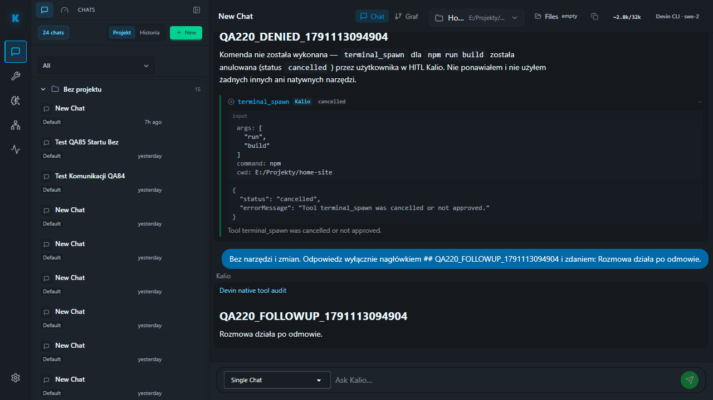

# QA220 — real Devin command refusal and recovery

Date: 2026-10-04. Fixed QA `http://localhost:5288/`, API `http://127.0.0.1:3316/api`; persistent QA data unchanged. Checkout `C:/Users/Radomiej/.codex/worktrees/5a7e/kalio-forever`, branch `codex/kalio-provider-runtime-ux`, pre-existing mixed changes preserved.

Real existing Devin ACP session `W4fggLSunrJB41C24MV7C`, model `swe-2`, approved target `E:/Projekty/home-site`. Fresh warm-session static preflight passed immediately before UI submission. Existing `qa-devin-denied-command-live.spec.ts` inspected and run via system Node outside sandbox, external QA, Chromium, report run 220.

| Acceptance | Status | Evidence |
| --- | --- | --- |
| Command request and full arguments | PASS | Exactly one pending `terminal_spawn`, exact npm/run/build/Home-site payload. |
| Actual UI refusal | PASS | Cancel clicked on the one inline confirmation; one `tool.confirmation.denied` audit event. |
| No execution or retry | PASS | Exactly one tool call across scenario; scoped `process.cmd.invocation` count 0. |
| Terminal response and follow-up | PASS | Denied-result heading plus separate follow-up heading; two `llm.turn.completed` events, current run empty. |
| Host continuity | PASS | One host before/after with unchanged process epoch. |
| F5 and idle UI | PASS | Both headings retained, Stop absent, connection warning absent. |
| Browser gate | PASS | 1 passed; scenario 7.9s, overall 8.6s. |

Saved `command-awaiting-denial.png` and `denied-followup-after-f5.png`; final screenshot inspected. Marker suffix `1791113049404`. No project source mutation, build execution, provider setting change or host reset occurred. Scoped audit does not prove OS-wide absence of CMD spam or native-attempt exclusion.

## Next-provider readiness observation

Codex static prelaunch check was attempted without a live prompt. It rejected cold-launch conditions because an existing host has registered sessions and its model catalog was not fresh. The implementation has an explicit resume-session path; use that for the existing approved Codex session, then refresh the catalog through its documented UI before retrying. No reset or live Codex request was performed on this failed snapshot. This is readiness, not evidence that Codex generation failed.

