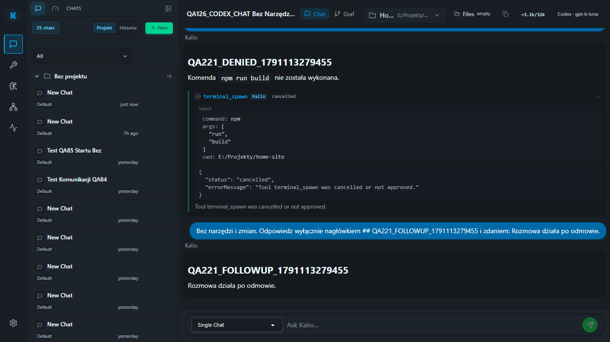

# QA221 — real ChatGPT/Codex refusal and catalog refresh

Date: 2026-10-04. Fixed QA UI `http://localhost:5288/`, API `http://127.0.0.1:3316/api`, persistent data unchanged. Existing mixed checkout preserved. Exact Codex profile `codex-local-1bd82ba45243e8a3a0c4aa0478538f67`, account `chatgpt-default`, model `gpt-6-luna`, session `yvD83rgDA_ZHvUwJKlo_S`, target `E:/Projekty/home-site`.

## Observed readiness recovery

In-app browser: Settings → Agent runtimes → Codex → Recheck. Source inspection confirmed this posts the integration `check` action only. Resume readiness then passed host/session identity but failed fresh catalog. No live prompt sent while red.

Talk → New → Recheck Codex models refreshed the catalog. This created one empty New Chat draft as a UI side effect; retained rather than deleting unverified data. No prompt was sent in that draft. The next explicit resume-session preflight passed every check, including catalog process epoch and freshness, strict tools/manual approval, approved paths and no unresolved run/children.

[P2] Settings Recheck is ambiguous: host connectivity and model freshness are distinct operations, while the catalog refresh control is currently in the new-chat surface. This run locates the working path; it does not fix the settings wording or unify the controls.

## Live verification

Existing `qa-devin-denied-command-live.spec.ts`, inspected in QA220, run with `KALIO_CODEX_DENIED_COMMAND=1` and report run 221. System Node outside sandbox, external fixed QA, Chromium. UI submits one npm/run/build request, verifies exact arguments and cancels using the inline control; a second no-tool follow-up follows.

| Acceptance | Status | Evidence |
| --- | --- | --- |
| Exact requested command and refusal | PASS | One tool call, exact Home-site npm build payload; one `tool.confirmation.denied`. |
| No execution or retry | PASS | Scoped CMD count 0; one tool call across both turns. |
| Follow-up and terminal state | PASS | Two completed turns; current run empty. |
| Host unchanged | PASS | One matching account host, same process epoch. |
| F5 reconstruction | PASS | Both result headings survive; Stop and connection warning absent. |
| Browser gate | PASS | 1 test passed, scenario 15.5s / total 16.3s. |

Saved `command-awaiting-denial.png` and `denied-followup-after-f5.png`; final image inspected. No approved build, source write, provider switch or reset performed. No OS-wide CMD or full native-tool attempt audit; no claim of complete ChatGPT integration closure.

