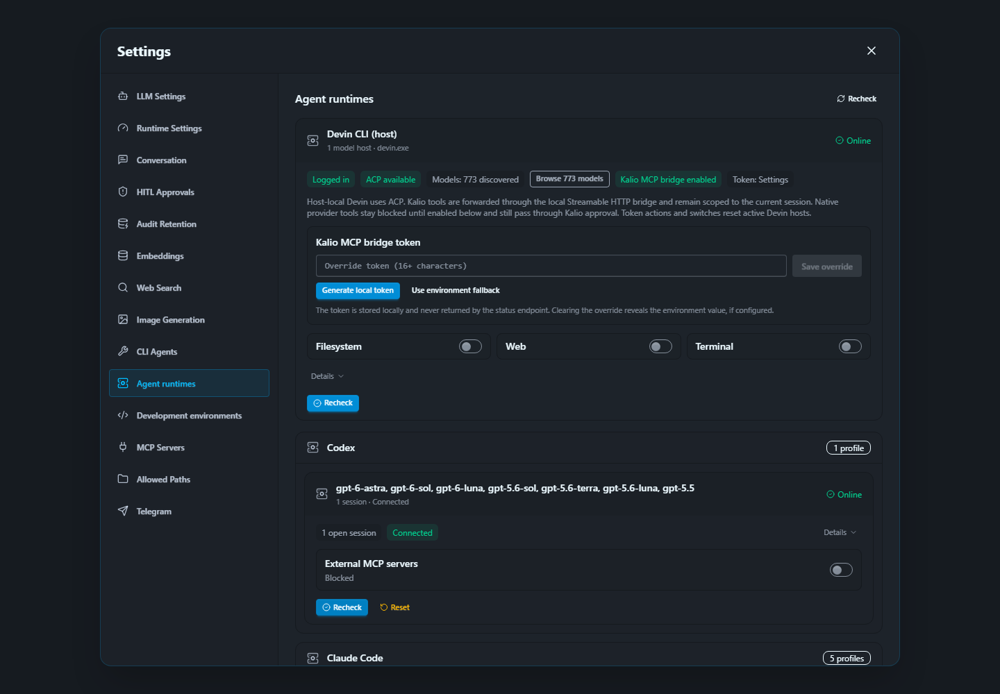

# QA223 — deployed Settings Codex catalog refresh

Date: 2026-10-04. Fixed QA UI `http://localhost:5288/`, API `http://127.0.0.1:3316/api`, persistent QA data unchanged; backend was not restarted. Frontend includes existing mixed work plus QA222 correction, not a clean committed release artifact.

| Acceptance | Status | Evidence |
| --- | --- | --- |
| Final frontend typecheck | PASS | `tsc --noEmit` exit 0 after final QA222 test edits. |
| Build | PASS | Vite 6.4.2, 3118 modules, 5.20s; main `index-DzHsXkek.js`. Existing >500kB chunk warning remains. |
| Served artifact | PASS | QA HTML HTTP 200 references exact main asset; runtime config restored to API/WS origin `http://127.0.0.1:3316`. |
| Real Settings → Codex → Recheck | PASS | Chromium 1440x1000, no intercepted API. Catalog checkedAt became greater than both previous value and click-start time; process epoch unchanged; `gpt-6-luna` present. |
| UI recovery | PASS | Recheck enabled after completion, no alert. Screenshot captured and inspected. |
| Browser regression | PASS | 1 passed, scenario 2.4s / overall 3.1s. |

Initial browser run failed because the catalog GET temporarily returned an empty body during explicit discovery. Test now returns a pending observation until a real catalog appears; it still checks epoch, model and strictly newer timestamp. No fixed sleep or runtime workaround added. Attempt to preserve the initial failure screenshot failed because the destination folder did not yet exist; the subsequent run cleared test-results. Initial failure screenshot is therefore missing, not claimed saved.

Before action, catalog checkedAt `1791113259400`, epoch `xmxczR4-naVuqtJqCDGvB`. Test `apps/e2e/tests/qa-settings-codex-catalog.spec.ts` is explicit opt-in via `KALIO_QA223_CATALOG=1`; system Node outside sandbox, external fixed QA. Test performs host/catalog checks only, no LLM prompt, reset, provider settings mutation or Home-site operation.

This closes QA221's Settings catalog-refresh gap for the tested Codex profile. Automatic polling remains covered by local QA222 tests, not a timed live process audit. Full Kalio delivery and all other requested states remain open.

