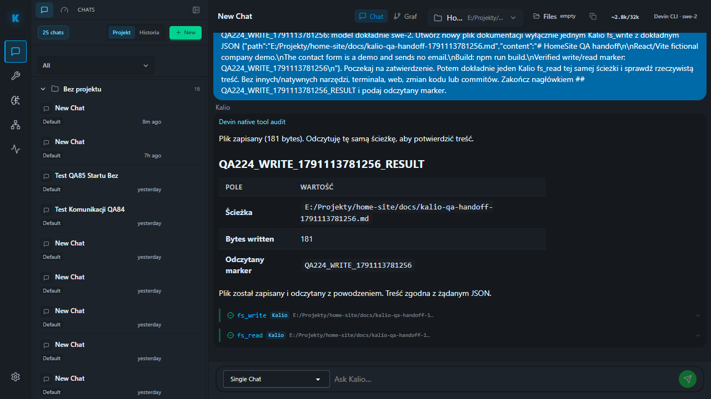

# QA224 — real Devin confirmed filesystem write/read

Date: 2026-10-04. Fixed QA UI 5288 / API 3316, persistent QA data and providers retained, no host reset. Current frontend QA223; mixed worktree preserved. Exact Devin session `W4fggLSunrJB41C24MV7C`, strict `swe-2`, approved project `E:/Projekty/home-site`.

Inspected existing approved-write test; parameterized only the numeric report run so QA179 evidence is not overwritten. Rechecked warm static readiness immediately before UI prompt: PASS. Executed through Talk using system Node outside sandbox, external fixed QA, Chromium. Test validates full requested path/content before clicking Confirm.

| Acceptance | Status | Evidence |
| --- | --- | --- |
| Manual write approval | PASS | Exactly one pending fs_write with exact path/content and full argument region before Confirm. |
| Write then actual read | PASS | Audit tool names exactly fs_write, fs_read; durable results include bytesWritten and exact read content. |
| No CMD invocation in scenario | PASS | Scoped CMD audit count 0 before and after. Not an OS-wide leak assertion. |
| UI reconstruction after F5 | PASS | Exact turn has two origin badges, both Kalio. |
| Browser gate | PASS | 1 passed, scenario 7.8s / overall 8.6s. |
| Independent disk read | PASS | Known file read directly after agent completion; exact marker verified. |
| Target Git status | N/A | `git -C E:/Projekty/home-site status --short` reports not a Git repository. No repository initialized. |

Created by Devin, not manually patched: `E:/Projekty/home-site/docs/kalio-qa-handoff-1791113781256.md`, 181 bytes. Marker `QA224_WRITE_1791113781256`, turn `v5Z9Nv35MB4v8RmsqJ1rh`. Documentation describes fictional company demo, demo-only contact form and build command. No source code edits or terminal operations requested. File retained as handoff evidence; not silently cleaned from user project.

Saved and inspected `assets/write-read-after-f5.png`; pending screenshot saved as `write-awaiting-confirmation.png`. This proves approved filesystem interoperability on latest QA, not all native-tool policies or full project-delivery acceptance.

