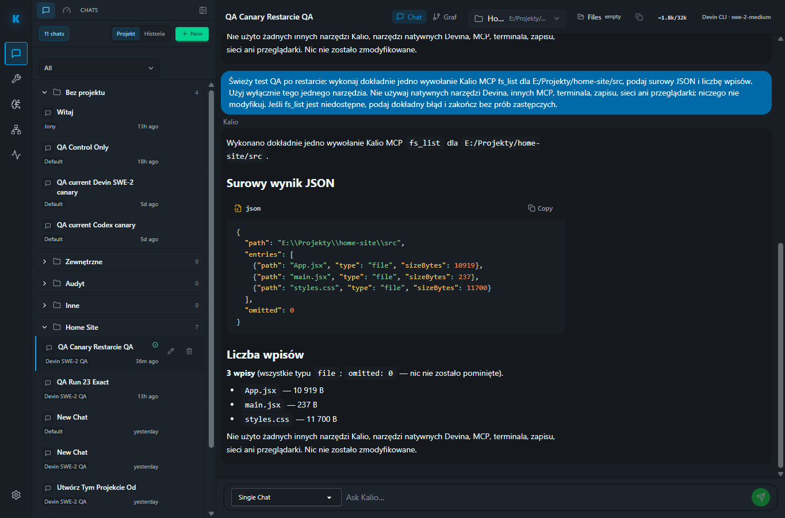

# QA run 24 — stabilne QA, Devin SWE-2 i procesy CMD

Data: 2026-09-28 (Europe/Warsaw)
Środowisko: lokalne, stabilny stack QA
UI: `http://localhost:5288/` · API: `http://127.0.0.1:3316`

## Wynik

Stabilne QA było już uruchomione po restarcie komputera, więc nie uruchamiałem drugiej instancji ani nie restartowałem działającej usługi. API odpowiada `ok`, UI ładuje aplikację, a prawdziwy Devin ACP `swe-2-medium` wykonał przez Kalio dokładnie jedno `fs_list` w zatwierdzonym projekcie `E:/Projekty/home-site/src`.

W czasie świeżego wywołania nie przybyło procesów `cmd.exe` ani `devin.exe` w porównaniu z pomiarem tuż przed testem. Nie oznacza to jednak, że host Devin nie uruchamia własnych MCP: przy starcie istniejącego hosta wystartowały procesy jego skonfigurowanych integracji, w tym para `cmd.exe` dla Context7. Te procesy poprzedzały świeży test i nie były uruchamiane ponownie dla `fs_list`.

## Kryteria i dowody

| Obszar | Status | Dowód | Granica |
|---|---|---|---|
| Stabilne QA | PASS | API `:3316` i UI `:5288` nasłuchują; `/api/health` zwraca `ok`. | Stack pozostał uruchomiony; bez restartu. |
| Efektywny provider Kalio | PASS | `/api/llm/config`: `mock/mock`, źródło `env`. | To osobna ścieżka niż hostowy Devin ACP. |
| Devin ACP | PASS | Integrations UI i API: `devin.exe` 3000.11.1, zalogowany, ACP dostępny, katalog 634 modeli; host `swe-2-medium` online. | Modeli nie używano przez provider `mock`. |
| Narzędzia Kalio widoczne dla Devina | PASS | W UI Talk etykieta `Devin CLI · swe-2-medium`; zakończony turn z dokładnie jednym Kalio MCP `fs_list`. | Tylko bezpieczny odczyt listy; brak testu zapisu/builda strony. |
| Wynik `fs_list` | PASS | 3 pliki: `App.jsx` (10 919 B), `main.jsx` (237 B), `styles.css` (11 700 B); `omitted=0`. | Żaden plik projektu nie został zmieniony. |
| Brak narastania CMD w trakcie jednego turnu | PASS — ograniczony pomiar | 11:18:43: 75 `cmd.exe` / 15 `devin.exe`; 11:20:00 po canary: nadal 75 / 15. | Punktowe próbki, nie gwarancja dla przyszłych uruchomień/hostów. |
| CMD poza drzewem QA po canary | WZROST GLOBALNY, NIE QA/DEVIN | O 11:30:44 i 11:35 globalnie było 76 CMD / 15 Devin; drzewo QA nadal miało te same 3 CMD. PID-owe porównanie wykazało 12 żyjących CMD utworzonych po bazie 11:18:43, żaden nie należał do QA/Devina. | Wzrost netto wyniósł +1; inne procesy mogły zakończyć się w tym samym oknie. |
| Zero CMD tworzonych przez Devina | NIE | Drzewo QA zawiera dwa procesy CMD łańcucha Context7, wystartowane przez host Devin o 10:45:42–43. | Jednorazowe procesy startowe MCP; nie powtórzyły się podczas canary. |
| Log CMD w Audit Truth Board | GAP | Wyszukiwanie `process.cmd.invocation` zwróciło „No events match your filters”, mimo że odczyt drzewa procesów wykazał CMD potomne QA. | Nie dowodzi to braku wszystkich zdarzeń w bazie; wywołania nie są widoczne pod tym wyszukiwanym typem. |
| Przeglądarka | PASS | Osobny Chromium Playwright: runtime signals `passed`, 0 findings, 0 błędów konsoli i 0 błędów sieci. | W logu otwartego wcześniej Chrome pozostały historyczne Network Error / reconnect z 11:06:58; świeży turn z 11:19 zakończył się poprawnie. |

## Procesy i przyczyna CMD

Pomiary wykonywałem tylko do odczytu; niczego nie zatrzymywałem.

- QA API PID `37264`, UI PID `54828`; stabilne od 10:36:14.
- Devin PID `63816`, start 10:45:41, komenda `devin.exe --model swe-2-medium acp`.
- Dwa CMD w drzewie tego hosta uruchomiły Context7 (`npx.cmd -y @upstash/context7-mcp` → `context7-mcp`) o 10:45:42 i 10:45:43.
- Trzeci CMD w drzewie QA to `codex.cmd app-server --stdio`, PID `62384`, rodzic API PID `37264`, start 11:08:14. Jest to proces Codex, nie Devin. Jego dokładny trigger i powód pozostawania przy `0 open sessions` nie zostały potwierdzone.
- O 11:20 drzewo API miało 21 potomków, w tym 1 `devin.exe` i 3 `cmd.exe`. Celowe wysłanie świeżego promptu w UI o 11:19 nie utworzyło nowego PID Devina/CMD.
- O 11:30:44 globalny licznik wynosił 76 `cmd.exe` / 15 `devin.exe`, a drzewo QA nadal zawierało te same trzy CMD z godzin 10:45 i 11:08. Wśród 12 CMD utworzonych od bazowego odczytu 11:18:43, cztery należały do startu MCP pod lokalnym Codex app-serverem (`codex-security`, `codex-app-tools`, Context7 + jego proces potomny). Pozostałe osiem należało do drzewa `E:\Projekty\portal-app\portal_mk.py start-dev` (frontend 3020, backend 3030, mock 3025). Żaden nie był potomkiem QA API PID 37264 ani Devin PID 63816.
- O 11:35:00 ponownie potwierdziłem API health=`ok`, porty 3316/5288 oraz globalne 76 CMD / 15 Devin. QA nadal miał tylko te same 3 CMD descendants; nie pojawił się nowy proces w tym drzewie.
- Procesy portalu i MCP mają przodków w lokalnym `codex.exe`; drzewo nie rozstrzyga, który równoległy task wywołał `npm run dev:ps`/`start-dev.ps1`. Nie zatrzymywałem tych procesów.
- Devin uruchomił też skonfigurowane procesy MCP (m.in. `mcp-dev-servers`, `mcp-supermemory`, Context7, ast-grep, Serena oraz most Kalio). Samo ich uruchomienie nie przeszkodziło w skutecznym wywołaniu Kalio `fs_list`.

## Zrzut ekranu

## Braki i granice

- Dokładny filtr `process.cmd.invocation` w Observability nie zwrócił wpisów. To pozostawia nierozstrzygniętą widoczność audytu procesów i zasługuje na osobny przegląd.
- Jednorazowy `codex.cmd app-server` należy osobno wyjaśnić; nie został uznany za spam i nie był uruchomiony przez Devina.
- Wcześniejszy błąd połączenia w Chrome nie powtórzył się podczas świeżego turnu i czystej sesji Playwright, ale nie przeprowadzono długiego monitoringu.
- Przed canary: 11 plików testowych API, 77 testów PASS; test `NativeCliIntegrationsPanel.test.tsx`, 10 testów PASS; API i web typecheck PASS.
- Nie uruchamiałem ponownie builda ani pełnego `pnpm test:e2e` — ten run nie zmieniał kodu, a dodatkowy pełny suite utrudniłby pomiar procesów CMD. Nie testowałem builda ani renderowania strony `home-site`.
- To lokalny dowód QA, nie dowód produkcyjny.

## Następne kroki

- [P2] Wyjaśnić, dlaczego `process.cmd.invocation` nie jest wyszukiwalne w Audit Truth Board, mimo widocznych CMD w drzewie QA.
- [P2] Ustalić źródło i lifecycle `codex.cmd app-server` w QA API, gdy Codex UI pokazuje `0 open sessions`.
- [P2] Ustalić, który Codex task uruchomił Portal MK dev stack i zestaw MCP-ów w oknie 11:26–11:28; process listing wyklucza QA API/Devina, ale nie wskazuje tożsamości wywołującego taska.
- Jeśli wymagane jest „zero CMD” na starcie Devina, rozstrzygnąć osobno, czy jego zewnętrzny Context7 MCP ma pozostać w konfiguracji. W tym teście niczego w profilu Devina nie zmieniałem.

Trwała notatka Agent Notes: [Kalio QA run 24 — Devin SWE-2 i CMD](https://app.notion.com/p/3e9c847d182581adab9fd002c1b186a3).
