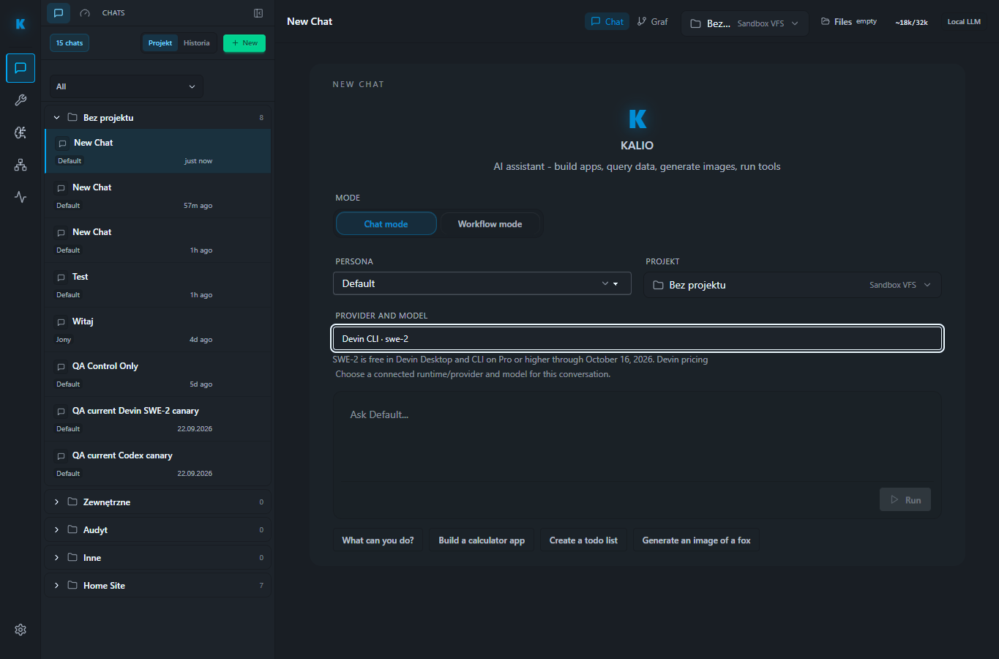

# QA run 25 — provider/model selection and Devin SWE-2 offer

Date: 2026-10-02 (Europe/Warsaw)
Environment: local stable QA (built distribution)
UI: `http://localhost:5288/` · API: `http://127.0.0.1:3316`
Data root: `C:\Users\Radomiej\AppData\Local\kalio-forever-qa` (preserved)

## Result

PASS for the implemented provider/runtime selection slice in local QA. Devin was available in the UI, its current CLI catalog loaded dynamically, and the exact `swe-2` choice could be selected in a new chat. The composer displayed the free-use terms and expiry. No Devin task was dispatched, no local bridge token was generated or rotated, and nothing was deployed to production.

The offer is conditional: Devin's official pricing page states free SWE-2 use in Devin Desktop and CLI for Pro or higher through October 16, 2026. Devin CLI catalog availability does not reveal the account's plan, so this QA run cannot certify that this specific account is eligible.

## Acceptance evidence

| Area | Status | Evidence | Remaining |
|---|---|---|---|
| Stable QA stack | PASS | Rebuilt stack reported UI `5288`, API `3316`; `/api/health` returned `ok`; AppData database/workspaces retained. | Local QA only. |
| Effective QA LLM configuration | PASS | Stack reports `provider=mock model=mock`; UI labels it a test-only environment fallback and does not offer Mock as a selectable provider. | No production configuration inference. |
| Devin runtime discovery | PASS | Settings → Agent runtimes after one explicit Recheck: `Online`, `Logged in`, `ACP available`, `773 discovered` models. | The app cannot confirm Devin plan eligibility. |
| Dynamic model picker | PASS | New-chat picker loaded discovered catalog and showed `Devin CLI · swe-2`, `swe-2-high`, `swe-2-medium`, and `swe-2-max`. | No catalog refresh loop or extra Recheck was used. |
| SWE-2 free-use disclosure | PASS | Selecting exact `swe-2` populated the composer and displayed “SWE-2 is free in Devin Desktop and CLI on Pro or higher through October 16, 2026.” | Conditional plan eligibility remains account-specific. |
| Provider/runtime settings UX | PASS | Visible tabs separate Agent runtimes and Development environments; LLM page distinguishes connection testing from active selection and labels QA mock fallback. | Full visual review of every settings state not repeated. |
| Frontend regression tests | PASS | Five focused Vitest suites: 68 tests passed. | Broader chat integration suite has unrelated prior mock failures; not claimed green. |
| Frontend static checks | PASS | `corepack pnpm typecheck`; ESLint on changed frontend files. | — |
| Backend checks | PASS | Session/profile tests: 43 passed; API typecheck and build passed (reported in this task before final QA rebuild). | No live Devin dispatch in this run. |
| QA frontend build | PASS | Final `pnpm qa:rebuild` completed and served the built stack. Existing Vite warning: main chunk ~2.1 MB minified. | Bundle-size optimization outside this scope. |
| Devin task execution / generated site | NOT RUN | The selected model was verified in the UI without pressing Run. | Separate real-ACP test requires approved project and post-dispatch bridge/HITL/tool-audit reconciliation. |
| Screenshot artifact | PASS | Rendered 1365×900 QA screenshot with exact SWE-2 selected and eligibility text: [swe-2-selection.png](assets/swe-2-selection.png). | Browser screenshot is QA evidence, not production proof. |
| Production | NOT DEPLOYED | No production action occurred. | Production remains unverified. |

## Steps exercised

1. Rebuilt the fixed-port QA distribution while preserving its existing AppData database and workspaces.
2. Opened Settings → Agent runtimes and used Recheck once; waited for the UI to report the Devin host online.
3. Confirmed the discovered-model dialog lists exact SWE-2 variants.
4. Opened Talk's new-chat model selector, filtered `swe-2`, and selected the exact base model.
5. Confirmed the composer shows `Devin CLI · swe-2` and the conditional free-use notice. Did not submit a prompt.

## Risks and next steps

- [P2] If the user wants proof that a generated React site can be produced, run one real Devin ACP task in the specifically approved test project after rechecking the paid/live run checklist and reconcile its Kalio bridge, HITL/native approval, and tool-audit records. This report does not claim that result.
- [P2] Keep the free-use label explicitly conditional on Devin Pro or higher and the published expiry; do not label the full `$0 Free` Devin plan as eligible based on CLI model catalog visibility.
- [P3] Preserve the existing Vite chunk-size warning for a later bundle investigation.

Pricing source: [Devin pricing](https://devin.ai/pricing).

