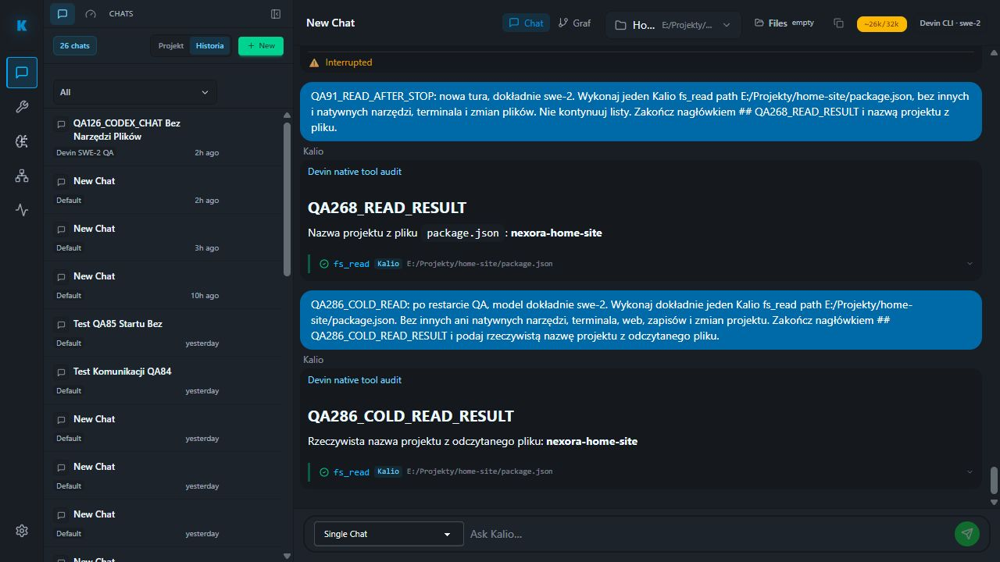

# QA286 — fixed QA deploy and real Devin cold read

Date: 2026-10-04, Europe/Warsaw. Checkout `codex/kalio-provider-runtime-ux`, source commit `997bfd3a`. Fixed UI http://localhost:5288/; API http://127.0.0.1:3316/api; persistent database C:/Users/Radomiej/AppData/Local/kalio-forever-qa/kalio-qa.db. Foreign dirty work preserved. In-app browser tab 7, default viewport; no temporary viewport override.

## Deployment

Fresh API build from QA284/285 deployed using system Node and managed `stack-manager.mjs start --backend-port 3316 --frontend-port 5288 --data-root C:/Users/Radomiej/AppData/Local/kalio-forever-qa --skip-build --use-env-llm --force-restart`. No reset/deletion of persistent data. SQLite online backup `.tmp/qa-provider-backup/qa-before-286.db` reports integrity `ok`. SHA256 comparison of ordered rows proves credentials, embedding_credentials, execution_profiles and app_settings unchanged; secrets were not printed.

Backend log: `.tmp/qa-stack-logs/backend-1791124890715-48776.log`. Stack reports started, exit 0. Global environment fallback remains mock/mock; the approved conversation explicitly resolves to Devin ACP, not mock. No provider activation, permission expansion or autostart change.

## Real UI test

Before restart: existing-host preflight 17 PASS. After restart: warm/resume preflight failed exactly its host-presence check; no prompt was sent under that failed gate. Registry source confirms hosts are lazy and restart removes them. Correct cold-start GET-only preflight then passed all 17 checks, including no hosts, no current run, no children, fresh authenticated exact swe-2 catalog, strict profile, project binding, bridge, six Kalio tools and manual write/terminal confirmation.

Opened the exact persisted conversation `W4fggLSunrJB41C24MV7C` through Talk. UI header shows Home Site E:/Projekty/home-site and Devin CLI swe-2. Submitted one authorized read-only prompt: one Kalio fs_read of package.json, no native/other tools, no terminal/web/writes. Response heading `QA286_COLD_READ_RESULT` contains `nexora-home-site`; visible tool row identifies `fs_read`, origin Kalio and approved path. Turn completes with no Stop or pending state. Reload preserves heading and absence of Stop.

| AC | Status | Evidence | Remaining |
|---|---|---|---|
| QA-PRESERVE | PASS | Backup integrity ok; four configuration tables hash-identical | Backup remains ignored/local |
| QA-DEPLOY | PASS | Managed stack start exit 0; browser operational on 5288 | Full workflow release gate not rerun |
| DEVIN-COLD | PASS | Real ACP session.resumed and turn.started exact swe-2; online epoch cdwKfw7sW-ZEAOHd6scDk | Not automatic startup reconnect proof |
| DEVIN-READ | PASS | Turn eSC-1oeF993v8JudqETHi; exactly one tool_call and tool_result fs_read; llm.turn.completed toolCallCount=1 | No project-source change or new build in this run |
| DEVIN-F5 | PASS | Result heading remains visible after reload; Stop false | Architecture role Stop not exercised with real Devin |
| CMD-SPAM | UNVERIFIED | This scoped audit has one fs_read and no terminal call | No machine-wide process sampling; do not claim historical CMD issue closed |
| HOME-PREVIEW | UNVERIFIED | Backend restart can stop backend-owned preview terminals | Restore/check approved preview through Devin before final website acceptance |
| JEV-LOOP | UNVERIFIED | Proposed contract only | Integrate real judge and bounded continuation after Devin/Codex gates |

Audit: 17 scoped rows since deployment, includes bridge and MCP approval, completed turn and one tool call/result. Current run endpoint returned no active run. No secret/file contents were copied to report.

Screenshot saved after F5, verified 101836 bytes:

Verdict: fixed-QA deployment and real Devin cold-read/reload slice PASS. Entire requested Home Site/integration delivery remains incomplete; no broad completion claim.
