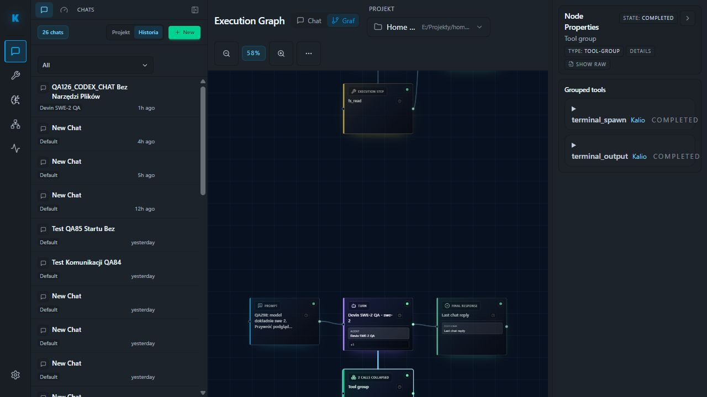

# QA302 — graph inspector fixes deployed and rendered

2026-10-04. Fixed QA localhost5288, in-app tab7 default viewport, persisted real Devin SWE-2 preview turn QA298. No new model prompt, backend restart, provider reset or Home Site source change.

Frontend typecheck and Vite build exit0, 3118 modules, 12.05s. Build warning remains for bundle over500kB; no speculative bundle refactor. Backed up and restored exact dist/runtime-config.js; origins preserved at127.0.0.1:3316. Running preview serves newly built dist. Backend stays running, preserving Home Site terminal.

Reloaded QA, opened last two-tool group, observed inspector STATE:COMPLETED and terminal_spawn Kalio COMPLETED / terminal_output Kalio COMPLETED. One group remains, with final response unchanged. Screenshot saved after actual rendered proof. Home preview still HTTP200.

| AC / PIT | Status | Evidence | Remaining |
|---|---|---|---|
| Completion/provenance / PIT-07 | PASS | Real QA298 group rendered with both new labels | Native audit remains separate chat panel |
| Deployment / PIT-11 | PASS | Built dist, preserved runtime origins, browser reload | Broad workflow release gate not rerun |
| Grouping / PIT-02 | PASS | Two calls in one group | Single-tool browser path not repeated |
| User preview | PASS | HTTP200 without backend restart | Long-duration stability |
| CMD issue | UNVERIFIED | No startup in this slice | OS short-lived process observation |

Verdict: grouped inspector wording/provenance deployed and browser-proven. Overall goal active.
