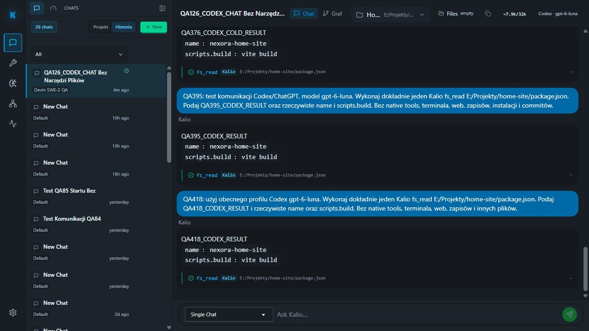

# QA418 — Codex, realny odczyt Home Site po deployu

Data: 2026-10-05. Stałe QA: UI localhost:5288, API 3316. Model: gpt-6-luna, profil codex-local-1bd82ba45243e8a3a0c4aa0478538f67, konto chatgpt-default. Sesja: yvD83rgDA_ZHvUwJKlo_S.

Scoped Recheck uruchomił host Codexa. Preflight agentflow-paid-readiness --static-only z dokładnym profilem, personą, projektem E:/Projekty/home-site i --resume-session przeszedł 18/18 kontroli przed promptem. Brak dziedziczenia zewnętrznych MCP, ścisłe Kalio tools, ręczne HITL. Nie resetowano uwierzytelnienia.

Prompt z UI żądał dokładnie jednego Kalio fs_read pliku E:/Projekty/home-site/package.json, bez native tools, terminala, web, zapisów i innych plików.

| AC | Status | Dowód | Pozostałe |
| --- | --- | --- | --- |
| Realna odpowiedź Codexa przez QA | PASS | QA418_CODEX_RESULT, name: nexora-home-site, scripts.build: vite build | Nie dowodzi pełnej stabilności długich zadań |
| Jeden odczyt Kalio | PASS | Scoped audit: fs_read running 1791152522812, tool_call 1791152522814, tool_result success i runtime completed 1791152522816 | Bez testu zapisów/terminala w tym podejściu |
| Zakończenie tury | PASS | llm.turn.completed 1791152525235, status completed, toolCallCount=1; Stop agent=0 | Stop w trakcie wykonania nie testowany |
| Hydratacja po F5 | PASS | Po reload ten sam final i fs_read oznaczony Kalio, Stop agent=0 | Graph nie testowany w tym podejściu |

Odczyt audit logu używał dokładnego sessionId i limit=40; raport dotyczy wyłącznie końcowego przedziału 1791152517396–1791152525235, nie starszych tur zwróconych w tej samej odpowiedzi. Pola nierozpoznane w projekcji nie stanowią dowodu nieobecności zdarzeń.

Werdykt: PASS dla realnego pojedynczego odczytu Codexa i trwałości wyniku na QA. Cały cel projektu oraz eliminacja krótkich konsol nadal nie są zamknięte. Nie zmieniano Home Site ani runtime w tym podejściu.
