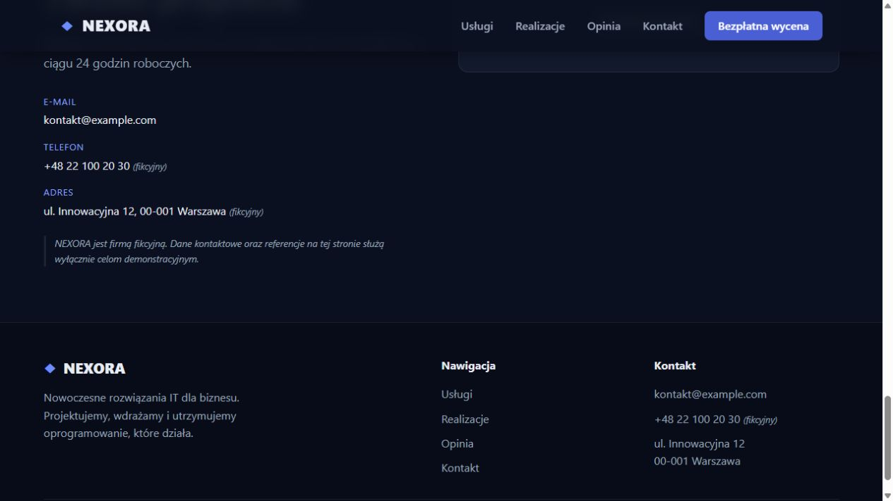

# QA420 — formularz wygenerowanej strony firmy

Data: 2026-10-05. Home Site: http://127.0.0.1:57868/, IAB, viewport 1280×720. Audyt black-box bez edycji projektu, bez restartowania QA. Użyto wyłącznie fikcyjnych danych QA420 Test / qa420@example.com.

| AC / PIT | Status | Dowód | Pozostałe |
| --- | --- | --- | --- |
| FORM-01 / PIT-03: pusty formularz | PASS | Kliknięcie Wyślij wiadomość (demo); trzy pola validity.valueMissing=true, fokus imie | Native tooltip nie udokumentowany screenshotem |
| FORM-02 / PIT-37: błędny e-mail | PASS | niepoprawny-email; typeMismatch=true, fokus email; brak przejścia do wyniku | Inne graniczne formaty nie testowane |
| FORM-03 / PIT-18: poprawny submit demo | PASS | role=status informuje, że wiadomość nie została faktycznie wysłana i firma jest fikcyjna | Brak przechwycenia sieci; komunikat nie jest dowodem braku requestów |
| FORM-04 / PIT-10: powrót | PASS | Wypełnij ponownie przywraca trzy puste pola i fokus imie | Repeated rapid clicks nie testowane |
| FORM-05 / PIT-04, PIT-05: runtime | PASS dla tej obserwacji | Niepusty DOM właściwej strony NEXORA; brak overlay w snapshot; captured error/warn logs=[] | Logi obejmują tylko obserwowany tab, nie cały proces |

Po poprawnym submit aktywnym elementem było body; role=status istnieje, ale nie ma tabindex. Nie klasyfikujemy tego automatycznie jako błędu: należy osobno zweryfikować czytnik ekranu i kolejność dalszej nawigacji. Po reset fokus wrócił poprawnie do imie.

Nie zmieniano Home Site. Test nie dowodzi produkcyjnej dostawy wiadomości — jest to celowo formularz demo. Mobile, hover, reduced-motion i pełna dostępność pozostają odrębnymi bramkami; nie zamknięto całego celu Kalio ani błędu krótkich konsol.
