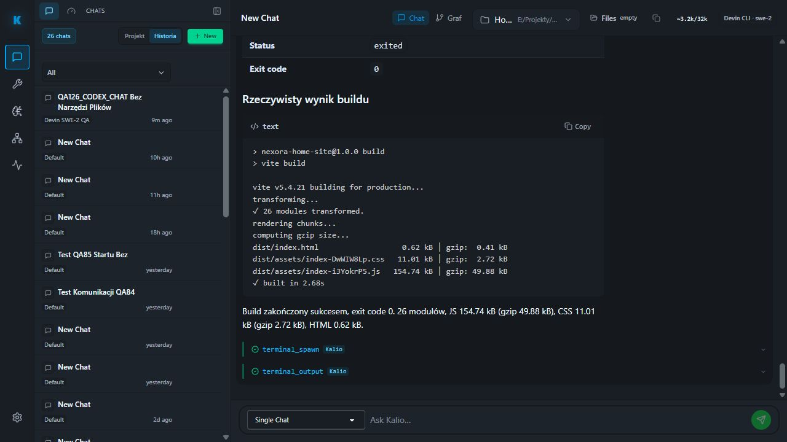

# QA421 — rzeczywisty build Home Site przez Devin SWE-2

Data: 2026-10-05. Stałe QA localhost:5288 / API 3316. Sesja W4fggLSunrJB41C24MV7C, profil Devin SWE-2, projekt E:/Projekty/home-site.

Pierwszy preflight omyłkowo dostał nieobsługiwaną flagę --devin-profile; wykonał globalny check i zgłosił mock. Nie zmieniono konfiguracji. Po odczytaniu parsera użyto właściwego --devin-session oraz --resume-session z tym samym ID: 17/17 PASS, świeży katalog swe-2, istniejący online host, brak unresolved run, sześć narzędzi Kalio, ręczne HITL.

Przez UI wysłano zadanie npm run build bez zmian źródeł, instalowania zależności, native tools, commitów lub deployu. Widoczne argumenty terminal_spawn: command npm, args [run, build], cwd E:/Projekty/home-site. Dopiero po ich sprawdzeniu kliknięto Confirm.

| AC | Status | Dowód | Pozostałe |
| --- | --- | --- | --- |
| Realne wykonanie buildu przez Devin/Kalio | PASS | QA421_RESULT, terminal kmpCgugnvyz-xtWqS9OfJ, exited, exit code 0 | Nie dowodzi wszystkich komend ani długiej stabilności |
| Wynik | PASS w UI | Vite 5.4.21, 26 modułów, 2.68 s; CSS index-DwWIW8Lp 11.01 kB, JS index-i3YokrP5 154.74 kB | Nie odczytano surowego terminal endpoint niezależnie od wyniku w bubble |
| Zakończenie | PASS | Scoped audit ostatnich 12 rekordów: success wyników, llm.turn.completed 1791153050003, status completed, toolCallCount 2; Stop agent 0 | Nie testowano Stop podczas procesu |
| F5 | PASS | Final z tym samym terminal ID i exit code oraz terminal_spawn/terminal_output oznaczone Kalio przetrwały reload | Graph nie testowany w tym podejściu |

Brak resetu QA/hosta. Build odświeżył wygenerowany dist w zatwierdzonym projekcie; nie edytowano ręcznie jego źródeł. Nie uruchamiano drugiego preview. Nie wykonywano pomiaru widoczności konsol, nie potwierdzono ich eliminacji. Nie zamknięto całego celu ani Jev goal loop.
