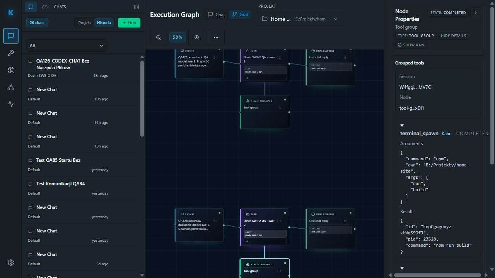

# QA425 — parytet czat/graf i szczegóły grupy narzędzi

Data: 2026-10-05. Stałe QA localhost:5288; istniejąca sesja Devina W4fggLSunrJB41C24MV7C, zakończony build QA421. Nie wysyłano nowego promptu ani nie zmieniano runtime.

| AC / PIT | Status | Dowód | Pozostałe |
| --- | --- | --- | --- |
| GRAPH-01: minimalne grupowanie | PASS | QA421: jeden Tool group, 2 calls collapsed, terminal_spawn i terminal_output | Większe grupy i child flows nie sprawdzone |
| GRAPH-02: zgodny final | PASS | Turn completed; final QA421_RESULT z tym samym terminal kmpCgugnvyz-xtWqS9OfJ, exited, exit code 0 i build 2.68 s | Statusy błędu/przerwania to osobna bramka |
| GRAPH-03: per-call szczegóły bez raw | PASS | Kliknięcie nazwy terminal_output otwiera regiony Arguments i Result; terminal_spawn ma npm / [run,build] / cwd E:/Projekty/home-site | Native tool nie był wywołany w tym runie |
| GRAPH-04: pochodzenie narzędzi | PASS | Obie pozycje Kalio / completed, zgodnie z bubble czatu | Nie dowodzi pełnego parytetu wszystkich rodzajów narzędzi |
| GRAPH-05 / PIT-18: powrót do czatu | PASS | QA421_RESULT nadal obecny, Stop agent=0 | F5 sprawdzono wcześniej w QA421, nie ponawiano tutaj |

W trakcie audytu początkowo błędnie uznano, że Details udostępnia tylko identyfikatory, a dane są wyłącznie w raw JSON. Po sprawdzeniu źródła i kliknięciu właściwego disclosure potwierdzono istniejącą funkcję per-call. To false-positive wynikające z niepełnej interakcji; nie dodano zbędnej implementacji.

Źródło ExecutionGraphInspector.tsx (commit 9083bdfe) używa details/summary dla każdej pozycji grupy oraz osobnych nazwanych regionów arguments/result. Nie zmieniano tego pliku. Nie wykazano w tym podejściu wspólności komponentów z całym edytorem Architect ani pełnego workflow Goal/Jev. Cel i problem krótkich konsol pozostają otwarte.
