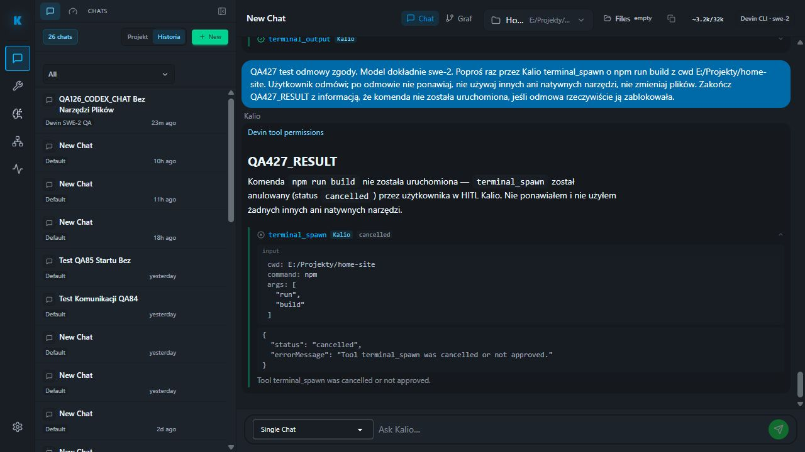

# QA427 — odmowa HITL Devin SWE-2

Data: 2026-10-05. Stałe QA localhost:5288 / API 3316. Sesja W4fggLSunrJB41C24MV7C, exact SWE-2 / Home Site. Preflight 17/17 PASS przed promptem, bez resetu hosta lub konfiguracji.

Z UI wysłano kontrolowane żądanie jednego npm run build przez Kalio terminal_spawn. Po obejrzeniu rzeczywistych argumentów command=npm, cwd=E:/Projekty/home-site, args=[run,build] kliknięto Cancel, nie Confirm.

Audit: llm.turn.started 1791153880908; tool.confirmation.requested 1791153882917; manual HITL cancelled i tool.confirmation.denied 1791153894312; terminal_spawn tool_result cancelled 1791153894314; llm.turn.completed 1791153895999, toolCallCount=1. W tym samym przebiegu devin-cli-acp.mcp_approval=accept dotyczył wejścia do Kalio bridge, nie zgody użytkownika na komendę — nie należy mieszać tych granic.

| AC | Status | Dowód | Pozostałe |
| --- | --- | --- | --- |
| DENY-01: ręczna odmowa blokuje narzędzie | PASS | Cancel → durable tool_result cancelled, bez terminal ID/PID; final QA427_RESULT | Nie jest testem Stop już działającego procesu |
| DENY-02: brak ponowienia | PASS dla zakończonej tury | toolCallCount=1, brak dodatkowego tool_call w odczytanym końcowym przedziale | Nie dowodzi wszystkich promptów/agentów |
| DENY-03: final i F5 | PASS | Ten sam QA427_RESULT i cancelled bubble po reload; Stop=0, Confirm=0 | Graph tego stanu nie sprawdzony tutaj |
| DENY-04: brak procesu/runu | PASS w zakresie audytu | Scoped process.cmd.invocation w przedziale tury: 0; runs/current HTTP 200, puste body | Nie jest globalnym pomiarem procesów OS |

Nie uruchomiono buildu w tym podejściu, nie edytowano źródeł Home Site. Błąd krótkich konsol i Goal/Jev nadal otwarte; nie uznaje się pełnego celu za zakończony.
