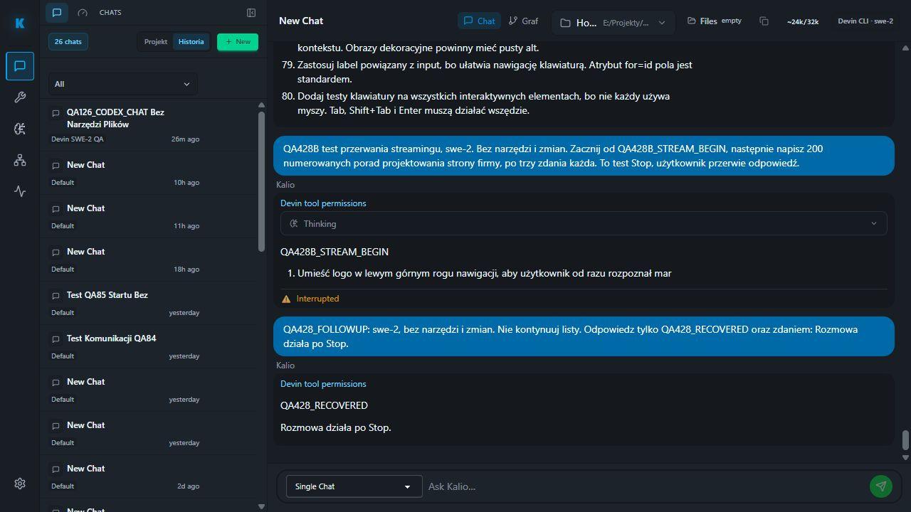

# QA428 — Stop rzeczywistego streamingu Devina i recovery

Data: 2026-10-05. Stałe QA localhost:5288, istniejąca sesja W4fggLSunrJB41C24MV7C, swe-2. Preflight 17/17 PASS. Bez narzędzi, zapisów, terminala i resetowania hosta.

Pierwszy prompt z 80 poradami zakończył się przed próbą kliknięcia Stop (selector no_matches). To nie dowodzi anulowania. UI i audit potwierdziły completed tury pxQt_GFMC831FyQYNo30r, toolCallCount=0. Nie ponawiano kliknięcia na nieistniejącym przycisku.

Drugi prompt QA428B z 200 poradami: po nadejściu rzeczywistego QA428B_STREAM_BEGIN i początku listy natychmiast kliknięto widoczny Stop. Stop i pending zniknęły. Audit: turn w3_Fq_Sc2i9dMt4KcBLhe, llm.turn.cancelled 1791154053193, ACP completed status cancelled 1791154053230. Nie traktowano samego placeholdera jako dowodu streamingu.

Nowa tura bez resetu: pqKUysJ-o3sSxY8Ykm38i, llm.turn.completed 1791154069181, toolCallCount=0. Final QA428_RECOVERED / Rozmowa działa po Stop. Po F5 pozostała jedna częściowa bubble QA428B oraz właściwy final; Stop=0, pending=0.

| AC | Status | Dowód | Pozostałe |
| --- | --- | --- | --- |
| STOP-STREAM-01: anulowanie aktywnego tekstu | PASS | Rzeczywisty fragment, kliknięcie, cancelled w runtime i ACP | Nie dotyczy już działającego OS terminala |
| STOP-STREAM-02: follow-up | PASS | Nowa zakończona tura bez tools, brak kontynuacji listy w finalu | Nie porównano processEpoch before/after; brak jawnego resetu nie jest dowodem epoch parity |
| STOP-STREAM-03: F5 | PASS | Partial i final zachowane, brak pending i Stop | Graph cancelled to osobna bramka |

Nie zmieniono kodu aplikacji ani Home Site. Cały cel nadal otwarty, w tym krótkie konsole i Goal/Jev.
