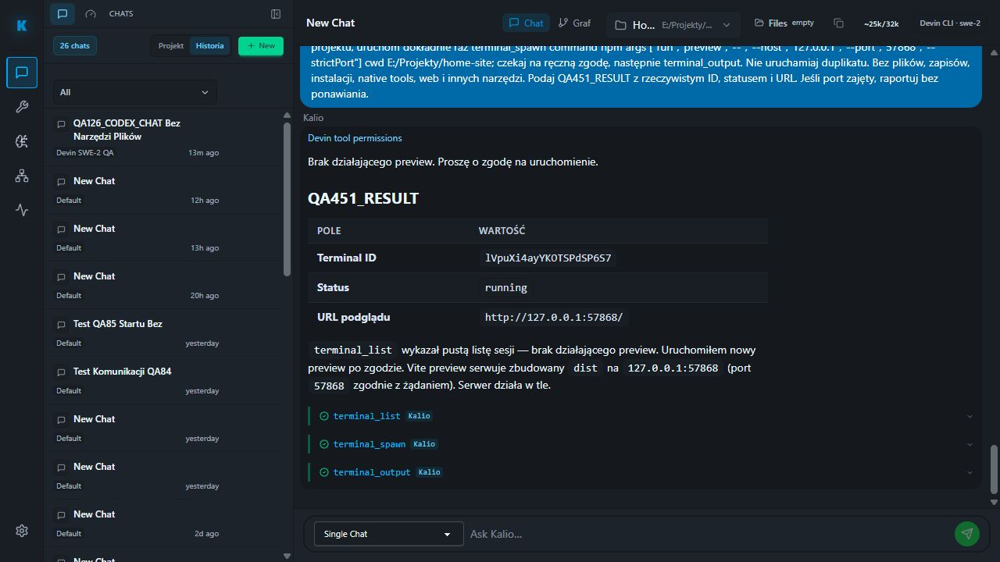
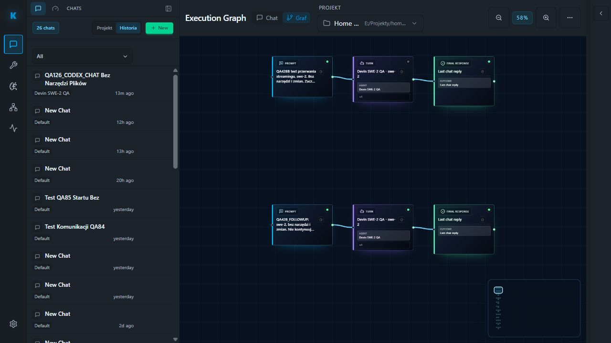
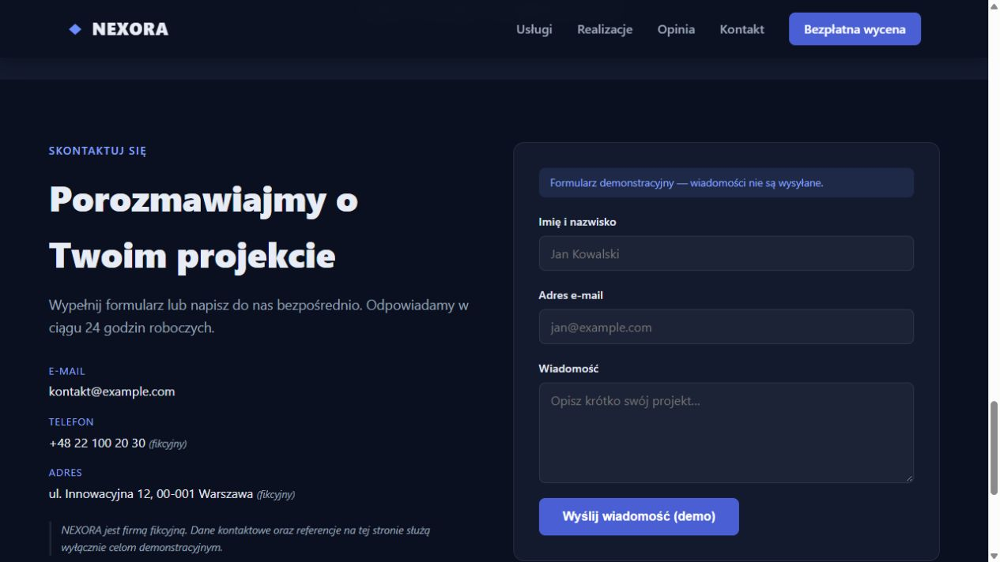

# QA451 — real cold Devin recovery after QA450 restart

2026-10-05 Europe/Warsaw. Checkout `C:/Users/Radomiej/.codex/worktrees/5a7e/kalio-forever`, branch `codex/kalio-provider-runtime-ux`, working tree includes pre-existing unrelated changes; no commit/deploy in this attempt. Fixed QA UI http://localhost:5288/, API http://127.0.0.1:3316/api, persistent AppData QA database. Browser: Codex in-app browser, default viewport, no device emulation.

Read-only static Devin readiness: 17 PASS. Exact session `W4fggLSunrJB41C24MV7C`, model `swe-2`, enabled strict local ACP profile, project `E:/Projekty/home-site`, six approved Kalio tools, manual approval for writes/spawns, native filesystem/terminal disabled. No host existed before action. Global mock fallback is not the provider for this explicit session. No new claim about vendor pricing.

Submitted one prompt from Talk after reload: inspect terminal_list and restore preview only if absent. Devin found no current terminal, requested one npm preview spawn at the exact project and loopback port 57868. The exact arguments were visible in Talk and approved once through Confirm. Three calls: terminal_list, terminal_spawn, terminal_output. No source file writes, installations, native tools or web requests authorized to the agent.

Actual expanded terminal_output result: terminal `lVpuXi4ayYKOTSPdSP6S7`, status `running`, exitCode null; Vite output shows `http://127.0.0.1:57868/`. Final response completed, Stop button disappeared. Reloaded Home Site renders NEXORA with services, demo portfolio/testimonial disclosures and demo contact form. This confirms preview restoration, not a new build or production deployment.

F5 restored the completed QA451 response and exactly the same three Kalio tool labels. Graph projects completed turn, one collapsed group of three calls (`terminal_list, terminal_spawn, terminal_output`) and final reply. No tool-node explosion or pending state observed for this turn. Whole-history graph screenshot is supporting evidence; turn-specific status/count proof comes from DOM inspection. No claim about unseen graph inspector interactions or all older sessions.

| AC | Status | Evidence / remaining |
| --- | --- | --- |
| DEVIN-COLD | PASS | UI-driven real SWE-2 response after no-host preflight |
| MANUAL-HITL | PASS | Exact npm preview command, one Confirm |
| TOOL-PROVENANCE | PASS | Three tools labeled Kalio; expanded actual output |
| HOME-PREVIEW | PASS | Actual terminal result plus fresh page reload |
| F5-HYDRATION | PASS | Completed reply and same three tool labels restored |
| CHAT-GRAPH-PARITY | PASS for this turn | Completed turn, one three-call group, final response |
| CONSOLE-FLASH | UNVERIFIED | No process/window monitor during this canary; QA450 remains open |
| BUILD | N/A for preview recovery | No target edits; prior QA436 build is not a fresh QA451 build |
| GOAL-JEV / FULL RELEASE | UNVERIFIED | Not exercised in this attempt |

Screenshots:

Verdict: real cold Devin preview recovery and scoped chat/graph hydration passed. Full objective remains active; console-window attribution, Goal/Jev integration and full release acceptance are not closed.
