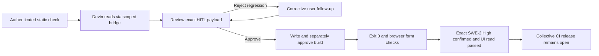

# QA run 507 — 2026-10-11 — Devin / Nekko Software

## Target and boundary

- Checkout: `C:/Users/Radomiej/.codex/worktrees/5a7e/kalio-forever`.
- Branch: `codex/kalio-provider-runtime-ux`; starting revision `73c45f6c`.
- Stable QA UI: http://localhost:5288/; API: http://127.0.0.1:3316/api.
- Existing data retained under `%LOCALAPPDATA%/kalio-forever-qa`.
- Effective global provider remained DB-backed OpenRouter / `openai/gpt-4o-mini`.
- Explicit conversation: `6NH6UWPn-4b-6vfQi4cmI`, Devin ACP profile requesting `swe-2`.
- Approved project: `E:/Projekty/home-site`. In-app browser, desktop viewport; mobile not verified.
- Existing task-owned repairs were dirty during the canary. No target source files were patched manually.

## Execution and findings

The first static check failed because CLI control-plane authorization was not
configured. The guard was retained. QA and its read-only preflight were restarted
with the same random bearer held only in process environments, not a file, prompt,
command-line argument, or log. All static checks then passed, including manual
HITL, pause on unattended requests, six-tool allowlist and native filesystem/terminal denial.

The first live turn performed two reads and returned `end_turn` with only thinking,
but Kalio displayed Completed. Regression tests reproduced this and incorrect
completion for `max_tokens`, `max_turn_requests`, and `refusal`. The adapter now
rejects these incomplete outcomes rather than emitting successful `done`.

The next attempt saved `index.html` after explicit HITL. Its proposed `App.jsx`
rewrite removed validation and called Nekko Software fictional; that write was
explicitly rejected. A corrective follow-up required ranged `fs_read` calls and
preserving existing accessibility/validation. The revised write was reviewed and
approved, followed by a separately approved `npm run build` in the exact project.

## Acceptance evidence

| AC / PIT | Status | Evidence | Remaining |
| --- | --- | --- | --- |
| AC-01 / PIT-03 protected readiness | PASS | Static preflight exit 0; unauthorized/missing-token cases remain blocked | Bearer is intentionally not persisted |
| AC-02 / PIT-34 incomplete turn | PASS locally | RED 4 failures, GREEN 17 source/completion tests; API typecheck/build exit 0 | Full UI failure-state replay still required |
| AC-03 / PIT-36 real bridge/HITL | PASS | Real ACP reads, explicit index write approval, rejected App rewrite, corrected write approval and terminal approval | Not a mock-only claim |
| AC-04 HomeSite build | PASS | Persisted `terminal_output`: `status=exited`, `exitCode=0`, Vite 26 modules, 2.82s | No deployment/commit in target |
| AC-05 / PIT-05 browser consumer | PASS desktop | Built preview http://127.0.0.1:50935/ shows Nekko Software; empty form displays 3 errors and focuses name; valid input shows demo-only notice | Mobile/keyboard menu and saved screenshots not verified |
| AC-06 exact model | PASS for SWE-2 High | Real ensure-only handshake confirmed `swe-2-high`; QA profile explicitly updated to that variant; protected preflight passed; UI follow-up completed one Kalio fs_read and answered Nekko Software | Other concrete variants and other persisted profiles not proven; unsupported family remains blocked rather than silently migrated |
| AC-07 local regression gate | PASS at recorded snapshot | Root gate exit 0: API 5998 passed/4 skipped, FE 2065, contracts 126, scripts 137, launcher 15 | Later fixes require a fresh gate |
| AC-08 remote release | FAIL | Old revision CI E2E job 114547546052: 19 failed, 146 passed, 68 skipped | Fix/re-run CI; PR 15 remains draft, no merge |

The read tool already supports `startLine`/`endLine`; whole-file output was truncated
by the consuming agent. Do not reconstruct unread sections. The final source keeps
`waliduj`, focus restoration, `aria-invalid`, `aria-describedby`, and demo-only submit.
No NEXORA, fictional contact address/telephone, or fictional-company claim remains
in the verified `App.jsx` / `index.html`.

## Delivery state

Packaging fix committed as `6bff7eff`; incomplete-turn/auth diagnostics as `07e55f03`.
Model guard committed as `35c6e79d`; cancellation/test stability as `c4cd8f9f`.
The model-guard build compiled 915 files with zero type issues. QA was restarted
with its existing database/provider settings and all 18 static checks passed.
A real UI read-only retry then failed closed before any provider prompt because
the exact model ID was absent from session options. This is not a successful
SWE-2 execution claim. The local CLI reports `swe-2` as a family and
`swe-2-medium`, `swe-2-high`, `swe-2-max` as concrete models, each marked Free.
Billing was not independently verified.

### Final model repair evidence

The bounded ensure-only diagnostic proved that `--model swe-2` initially returned
ACP selector `current=glm-5-2`, with no exact `swe-2` option. Its SWE-2 option was
`value=swe-2-high`. A second issue was reproduced: an initial GLM notification
overrode a later successful setter acknowledgement. Commit `ca8d3cc6` consumes
pre-setter updates while still rejecting drift during/after the setter. Concrete
model rows, not family headings, are now selectable from the CLI catalog.

Final focused parent suite: 59/59 tests in five ACP/catalog files passed.
Agent broader host suite: 56/56 passed; readiness tests: 80/80 passed.
API build: 915 files, zero type issues. Real ensure-only SWE-2 High confirmation
exited 0, with native tools disabled and no prompt. After QA deployment and exact
variant preflight, the approved UI follow-up used only Kalio `fs_read` on
`E:/Projekty/home-site/index.html`, returned Nekko Software and reached Completed.

The latest full parallel gate is NOT green: 6022 API tests passed, 4 skipped,
2 VFS fixture tests timed out; FE 2065 passed. The two VFS cases passed isolated
in 532/2575 ms (23/23 file tests), suggesting contention rather than a reproduced
reader defect. Remote CI and remaining E2E failures still block collective release.
These commits are not a declaration that the collective release passes CI.
QA was running after the API deployment. The local preview is test-only.
Screenshots were not saved for this attempt; accessibility-tree/browser assertions
and persisted tool results are the recorded evidence, not screenshot artifacts.

The successful SWE-2 High answer and fs_read persisted after F5; Thinking was
collapsed instead of still running. Other turns/profiles are not covered by this proof.

Required before release: remaining E2E failures, remote CI and Windows/Linux
packaged startup proof; sidebar lifecycle discrepancy remains unconfirmed. No production
readiness or verified free billing is claimed by this report.
