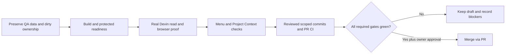

# QA 510 — 2026-10-17 — Kalio release continuation

## Scope and identity

- Checkout: `C:/Users/Radomiej/.codex/worktrees/5a7e/kalio-forever`, branch `codex/kalio-provider-runtime-ux`, starting HEAD `8cbe6e6c`.
- Existing dirty E2E recovery changes were retained and assigned to one owner; no reset/stash or foreign cleanup.
- Stable QA: http://localhost:5288/, API http://127.0.0.1:3316/api. Existing `%LOCALAPPDATA%/kalio-forever-qa` database, credentials and workspaces retained.
- Effective global API provider: DB-backed OpenRouter / `openai/gpt-4o-mini`, independently checked. Startup's environment `mock` log is not the effective DB configuration.
- Real canary session `6NH6UWPn-4b-6vfQi4cmI`, strict `swe-2-high`, project `E:/Projekty/home-site`. Native tools disabled, Kalio six-tool allowlist/manual HITL unchanged.
- Browser: in-app browser for real Devin action; isolated Chromium 1440×960 for inspectable screenshot artifacts. Not production or physical-mobile proof.

## Acceptance matrix

| AC / PIT | Status | Evidence | Remaining |
| --- | --- | --- | --- |
| AC-01 / PIT-04 QA | PASS | Root 1.0.3 build exit 0, QA restarted with preserved data, UI loaded and real Devin read completed | Remote release artifacts are a separate gate |
| AC-02 / PIT-36 Devin | PASS read-only | Real UI request caused Kalio fs_read of package.json; answer listed `nexora-home-site`, React/ReactDOM 18.3.1, Vite 5.4.11/plugin 4.3.4; tool and response visible, no writes/terminal | Not a new generated-project build proof |
| AC-03 / PIT-34 E2E recovery | PASS focused | 29/29 Chromium tests, 15/15 launcher tests; title update/sidebar/header/F5, workflow follow-up, manual/bypass/deny HITL, native audit and composer | Full browser suite and fresh GitHub CI |
| AC-04 / PIT-10 Home profile gear | PASS tested slice | 58 focused component tests; browser RED 3 passed/6 failed then GREEN 9/9 at 320/390/1440, Escape/Close/focus/overflow; parent verified Settings focus on stable QA | Not a complete all-submenu accessibility certification |
| AC-05 README | PASS source | Provider/runtime boundaries clarified; 20 relative targets verified; SVG intrinsic/declared 1280×780 unchanged | Fresh GitHub render |
| AC-06 Project Context | PASS Home Site | [Grounded retrieval report](project-context.md): 8/8 real hybrid requests HTTP 200 and expected top-5 hits; generation 2→3, all 8 hashes current, 108 chunks | Kalio-wide corpus not indexed in this QA store; no Gemma benchmark claimed |
| AC-07 login / tunnel | ASSESSED, NOT IMPLEMENTED | [Scope and 3–5 day estimate](../../spec/single-user-login-assessment.md) | No global password login or public tunnel enabled |
| AC-08 merge/release | IN PROGRESS | PR 15 draft awaiting current commits; version synchronized at 1.0.3. RAD-14 Done verified after owner's explicit closure instruction | Fresh CI, target archive checks and reviewed commits required; closure is not independent revocation proof |

## Captured artifacts

- [Home before gear](assets/home-before.png): QA Chromium, 1440×960.
- [Real Devin package.json response](assets/devin-package-json.png): second subscribed QA browser received the real canary's response and tool card.
- [Home after gear, 1440 px](assets/home-1440-closed.png).
- [Home settings dialog, 390 px](assets/home-390-settings-open.png).

## Observations requiring follow-up

- `AUDIT_PROOF_INVALID_INPUT` during the initial fs_read was traced to explicit undefined usage fields. Optional fields are now omitted without weakening the strict JSON validator. Real AuditService/SQLite regression and QA canary passed after rebuild.
- Settings focus containment/return and active-state ARIA gaps were identified by source review; runtime verification and scoped repair are tracked separately.
- Current Decision provider supports OpenRouter/TypeSafe and a custom loopback HTTP Decisions API. It does not install/download a local Jev model. The protocol requires typed `choice`/probability answers, not merely an OpenAI chat completion.

This is an in-progress evidence record. Local/focused gates do not imply remote CI, clean-device release, password protection or production readiness.

## Release continuation

- RAD-14 moved to Done on explicit owner instruction on 2026-10-17; status independently read back. Historical key revocation/rotation was not re-proven and no historical value was read or copied.
- Existing tag v1.0.2 retained; official sync script updated all 11 manifests to 1.0.3 and `--check` passed.
- First full local test gate: API 6027 passed / 1 failed / 4 skipped. Failure was the old registry expectation offering `swe-2` family heading, contrary to the concrete-model guard; expectation corrected and registry/catalog focused 12/12 passed. This is not yet a green full gate.
- Project Context final model: Xenova/multilingual-e5-small, CPU, 384 dimensions. First request including normal refresh 6857 ms; subsequent requests 84–160 ms. Updated title and code-line labels verified. These are retrieval results, not answer-generation scores.
- Security diff scan `0daa104f-edf5-415f-b47e-f6d67a340f11` covers immutable main→81623251 and remains separate from the newer UI/audit/version commits. No full security clearance claimed while coverage is incomplete.
- Final QA read turn `aoFoutewtqtZ14a7x3hsa`, swe-2-high: completed; one fs_read success. Audit duration 13261 ms vs completion 13262 ms, text 42, thinking 148, tool count 1, chunkCount 7, estimatedOutputTokens 48; no absent usage field. Restart log had zero AUDIT_PROOF_INVALID_INPUT/Audit update failed at 23:35:58 CEST.
- Local script gate passed 161/161 after release-version alignment; test manifest expectations now compare to root version rather than permanently pinning 1.0.2.
- Full local gate finished exit 0: shared types 126/126, API 6034 passed / 4 conditional skips, web 2075/2075, launcher 15/15. Typecheck and full build passed. Conditional API cases: Devin live config (3) and project-resource-index external port (1); the actual UI Devin and Home Site hybrid checks above are separate proof, not removal of these conditions.
- GitHub CI run 39071710706 on 2dd21d63 passed all six jobs including full E2E and quality-gate. Desktop run 39071710705 failed both OS jobs only in Bun startup; Node archive health/UI/SQLite smoke passed on Windows and Linux.
- [P1] Bun archive startup imported better-sqlite3 directly from memory-partitions, although Bun packages intentionally exclude it. Fixed the caller to use the existing runtime SQLite factory with equivalent read-only/must-exist options. Node write rejection and real Bun legacy read/missing-file/write rejection regressions passed; memory reembed regression group 25/25. Original local caller reproduced native ABI/crash failure under Bun; CI proved absent-package startup failure. Fresh target archive smoke/CI remains required after this fix.
- Current-tree publication pattern check: 3058 tracked files, 2439 text scanned, 619 binary not text-scanned; 14 recognisable pattern hits in 8 files classified as synthetic fixtures. No confirmed real secret or suspicious scratch/credential filename found. Not a reachable-history or exhaustive semantic security scan.
