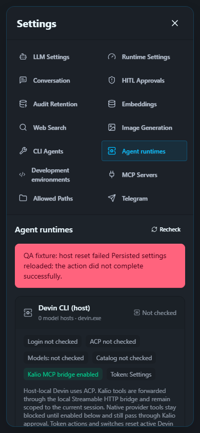

# QA run 60 — persisted settings recovery and polling error retention

Date: 2026-10-03. Scope: settings UI recovery after the actual partial-save/reset failure found in QA59. No real provider request, token generation, native permission expansion or target-project mutation in this run.

## Regressions and fix

Two fail-first component cases proved that a failed native-policy/token PATCH did not reload settings already saved by the backend. After adding the recovery GET, two additional failures proved the normal 30-second poll cleared the action error. Both defects are corrected: one read-only recovery GET, retained original error, no success notice or automatic write retry, and explicit unknown-state wording when the recovery GET fails. Manual Recheck can clear an old error; background status polling cannot.

| AC / PIT | Status | Evidence | Remaining |
| --- | --- | --- | --- |
| AC-01 / PIT-07: persisted state after partial failure | PASS, component and browser fixture | Failed policy and token actions reload the latest snapshot; fixture checkbox reflects it; writes remain exactly 1. | Actual failure originated in QA59; this run deliberately injects the fault rather than breaking the real host. |
| AC-02 / PIT-03: polling keeps error visible | PASS, component | Invoking the exact registered 30-second polling callback no longer removes the original action alert. | Browser test does not wait through a real 30-second interval. |
| AC-03 / PIT-37: recovery read failure | PASS, component | GET503 after PATCH500 reports persisted state unknown and never shows success. | Live API outage not induced. |
| AC-04 / PIT-09: mobile/browser/F5 | PASS, fixture | Chromium 2/2 PASS, 390x844 alert visible, no document horizontal overflow, fixture persisted checkbox restored after F5. | Screenshot shows the alert/card summary; checkbox assertion is browser evidence, not visible in that captured frame. |
| AC-05 / PIT-11: fixed QA artifact | PASS, live read-only | QA5288 loaded `index-KWDjlm98.js`; all three actual native categories remain off; no alert during normal settings load. | No new actual SWE-2 call needed for this frontend-only slice. |
| AC-06: full objective | IN PROGRESS | QA59 proves real SWE-2 reset/read; this run strengthens recovery. | Broader Home Site/UX matrix remains open. |

Verification: FE focused Vitest14/14, `tsc --noEmit` exit0, Vite build3109 modules exit0. Initial typecheck identified the timer mock's Node/DOM return-type mismatch; corrected and rerun green. Existing bundle-size warning remains.

Browser command: system Node outside sandbox, root:

```text
KALIO_PLAYWRIGHT_SKIP_BUILD=1
node apps/e2e/scripts/run-playwright-with-stack.mjs regression-devin-settings-recovery.spec.ts --workers=1
```

Successful isolated stack API61035/frontend61034, two tests passed in3.6s. Settings GET/PATCH are intercepted fixtures; other app surfaces use the isolated real stack. No real secret or credential enters the fixture. First run used synchronous checkbox `.check()` and failed before waiting for the controlled asynchronous update; using click plus auto-retrying state assertion corrected test setup, not production code.

Screenshots, explicitly **fixture UI**, not actual Devin inference:




Production boundary: this UI slice is built and QA-loaded; no production deployment. No claim that all earlier requirements or continuous CMD monitoring are complete.
