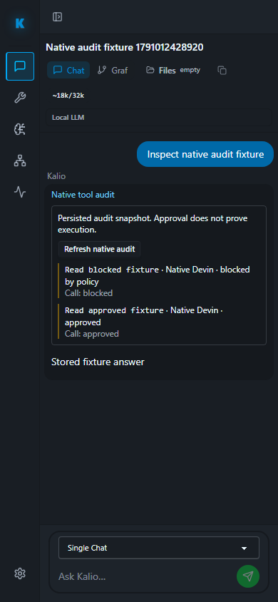

# QA 71 — Stop, reconnect i audyt narzędzi

Data: 2026-10-03. Checkout: `C:\Users\Radomiej\.codex\worktrees\5a7e\kalio-forever`, branch `codex/kalio-provider-runtime-ux`, baza rewizji `f3930dc`. Worktree zawiera wcześniejsze zmiany; nie czyszczono ani nie resetowano cudzych plików.

## Zakres i dowody

| AC | Status | Dowód | Granica |
|---|---|---|---|
| AC-01 Stop zwalnia turę i follow-up nie trafia do kolejki | PASS | `regression-stop-follow-up.spec.ts`, Chromium, 1.5 s | Izolowany mock, jawny profil testowy; nie Devin |
| AC-02 Reconnect odtwarza stan bez przeładowania | PASS | `chat-reconnect-hydration.spec.ts`, 2.0 s | Izolowana baza Playwright |
| AC-03 Audyt natywnych narzędzi zachowuje turę, stan i działa po F5 na 390 px | PASS | `regression-native-tool-audit.spec.ts`, 1.4 s | Zapisana fixture; approval nie dowodzi wykonania |
| AC-04 Testy lifecycle backendu i interfejsu | PASS | 55 testów BE, 92 FE | Wybrane pięć zestawów na aplikację; nie pełny gate |
| AC-05 Stałe QA i podgląd projektu dostępne | PASS | HTTP 200: UI `http://localhost:5288/`, `/api/llm/config` na 3316, Home Site `http://127.0.0.1:53601/` | Dostępność HTTP nie dowodzi inferencji |
| AC-06 Rzeczywisty Devin SWE-2: pending HITL, F5, Stop i follow-up | UNVERIFIED | Nie wykonano nowego live promptu w tym etapie | Wymaga preflight i obserwacji UI |

E2E uruchomiono systemowym Node poza sandboxem, jednym workerem. Pierwsze podejście: API 64931 / UI 64930, dwie próby PASS, Stop zatrzymał się przed wysłaniem, ponieważ pusta rozmowa nie miała wybranego wykonawcy. To nie był dowód awarii Stop. Fixture poprawiono, jawnie tworząc profil mock i inicjując istniejącą rozmowę; nie dodano produkcyjnego fallbacku ani mocka do zwykłej listy modeli.

Drugie podejście: API 58863 / UI 58862, izolowana baza `data/playwright-stack/1791012421592-4788`; **3/3 PASS w 6.4 s**. Runner zakończył się kodem 0. Sesja testowa jest usuwana w `finally`, socket jest rozłączany w `finally`.

Polecenie: `node apps/e2e/scripts/run-playwright-with-stack.mjs regression-stop-follow-up.spec.ts chat-reconnect-hydration.spec.ts regression-native-tool-audit.spec.ts --workers=1`, z `KALIO_PLAYWRIGHT_SKIP_BUILD=1` i `KALIO_NATIVE_AUDIT_REPORT_RUN=71`. Pominięcie build dotyczy tego podejścia testowego; nie stanowi nowego dowodu build całego dirty worktree.

Stała baza QA pozostaje w `%LOCALAPPDATA%\kalio-forever-qa`; nie została wyczyszczona. Docelowy projekt to `E:\Projekty\home-site`. Zgoda na reset Devina/QA nie została użyta do usuwania danych.

## Screenshot

Obraz przedstawia fixture: rozróżnienie blocked/approved i etykietę Native Devin, nie rzeczywiste wykonanie natywnego narzędzia. W tym podejściu nie mierzono liczby CMD ani nie wykonywano nowego live testu Devina.

## Pozostałe

- [P2] Wymagane przed zamknięciem zakresu: rzeczywisty test lifecycle Devina oraz pełna macierz pierwotnych uwag CTO, z dowodami odpowiednich paneli i stanów.
- [P1] Crash idle-session Playwright Orchestrator pozostaje nierozwiązany w jego osobnym repo; przywrócenie połączenia opisano w QA 70.
- Data Analyst pozostaje osobną decyzją konfiguracji, a nie blokerem powyższych regresji.

Werdykt całego zadania: **UNVERIFIED**. Powyższy izolowany zakres regresji: PASS.

## Preflight Devina i autoryzowany reset

Pierwszy GET-only preflight potwierdził profil ACP exact `swe-2` / `kalio_strict`, docelowy projekt, świeży uwierzytelniony katalog, sześć narzędzi Kalio, ręczne HITL, brak aktualnej nierozstrzygniętej tury i brak dzieci. Jedyny FAIL: istniejący host Devina. Na podstawie zgody użytkownika wywołano istniejące `PATCH /api/runtime/devin-cli/settings` z pustym DTO `{}`: kontroler zachowuje politykę i token oraz resetuje registry hostów. Nie kasowano bazy QA ani nie restartowano podglądu Home Site.

Reset odpowiedział: bridge enabled `true`, native filesystem/web/terminal wszystkie `false`. Ponowny preflight zakończył się kodem 0: wszystkie 16 kontroli PASS, w tym brak hostów. To gotowość statyczna; nowa inferencja i brak spamu CMD nadal nie zostały potwierdzone w tym podejściu.
