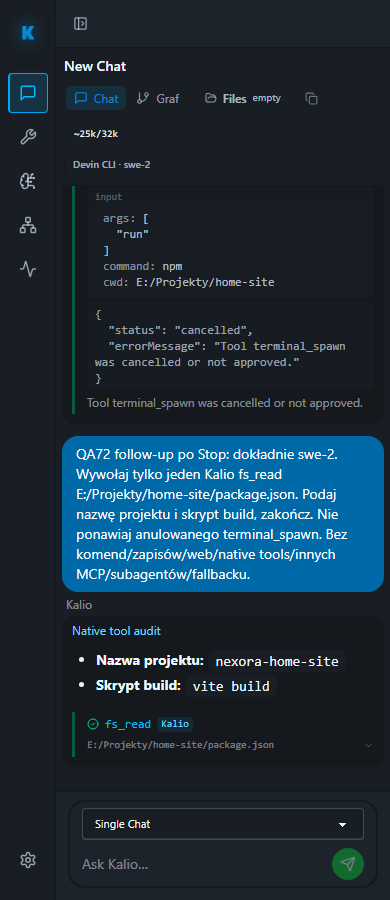

# QA 72 — rzeczywisty Devin SWE-2: F5, HITL, Stop i follow-up

2026-10-03. Checkout `C:\Users\Radomiej\.codex\worktrees\5a7e\kalio-forever`, branch `codex/kalio-provider-runtime-ux`, baza `f3930dc`; wcześniejsze zmiany worktree zachowane. UI `http://localhost:5288/`, API `http://127.0.0.1:3316/api`, trwała baza `%LOCALAPPDATA%\kalio-forever-qa`. Projekt **E:\Projekty\home-site**, sesja `W4fggLSunrJB41C24MV7C`, jawny Devin ACP exact `swe-2`, `kalio_strict`. Nie jest to mock inference.

| AC | Status | Dowód | Granica |
|---|---|---|---|
| AC-01 Gotowość przed nowym promptem | PASS | GET-only preflight 16/16, kod 0 | Bez zmiany modelu/tokena/uprawnień |
| AC-02 Devin korzysta z Kalio i czeka na indywidualne HITL | PASS | Talk: jeden terminal_spawn, `npm`, args `["run"]`, cwd `E:/Projekty/home-site`, awaiting confirmation | Nigdy nie kliknięto Confirm |
| AC-03 F5 podczas HITL | PASS | Po reconnect wróciło awaiting confirmation, Confirm/Cancel, waiting for approval oraz pełne argumenty | Przejściowy bootstrap pokazał Connecting; następny snapshot poprawnie odtworzył turę |
| AC-04 Stop nie wykonuje oczekującej komendy | PASS | UI wynik cancelled; audit waiting_for_human → cancelled; brak nowego procesu komendy w końcowej próbce | `mcp_approval accept` nie jest akceptacją użytkownika |
| AC-05 Follow-up po Stop startuje i kończy niezależną turę | PASS | Jeden Kalio fs_read package.json, nazwa nexora-home-site, build vite build, audit completed exact swe-2 | Bez ponowienia terminal_spawn i bez zapisów |
| AC-06 Trwała odpowiedź bez wiszącego thinking na mobile/tablet | PASS | Read-only Chromium fixed-QA test, F5 na 320/390/820, brak Stop/responding/pulse/overflow, 1 PASS w 4.3 s | Ten completed chat, nie cała macierz UX |
| AC-07 Brak spamu CMD | UNVERIFIED dla ciągłego przebiegu | Końcowa próbka drzewa QA bez nowych CMD tej próby | Nie wykonano ciągłego monitoringu krótkotrwałych procesów |

## Rzeczywiste tury

- HITL/Stop: `mxAIcMeBZEBpTOTzu8vkT`.
- Follow-up: `dIf-bKT0D6nX-juvGr0I2`; scoped audit potwierdza exact swe-2, providerToolCount 0, zakończony fs_read i zakończoną turę.

Test ręczny wykonano przez in-app browser, istniejącą kartę użytkownika. Nie zmieniano plików projektu, nie uruchamiano komendy `npm run`, nie deployowano ani nie commitowano Home Site. Nie używano natywnych narzędzi Devina; ustawienia filesystem/web/terminal pozostały wyłączone.

Repeatable capture: `node apps/e2e/scripts/run-playwright-with-stack.mjs qa-home-site-chat-live-audit.spec.ts --workers=1`, system Node poza sandboxem, `KALIO_PLAYWRIGHT_SKIP_BUILD=1`, `KALIO_FIXED_QA_READONLY_AUDIT_URL=http://localhost:5288/`, `KALIO_FIXED_QA_REPORT_RUN=72`. Pomocniczy izolowany stack użył API61068/UI61065; test nawigował do rzeczywistego stałego QA5288, bez mocków/interceptów/promptów w capture. Runner exit0.

## Procesy

Próbka UTC `2026-10-03T07:38:47.1474843Z`: root QA30844; dwa CMD27584/59052 utworzone około09:09:20 czasu lokalnego należą do wcześniej zatwierdzonego npm preview. Devin52920 utworzony09:36:12 z parent30844, bridge Node64596 pod Devinem. Nie znaleziono dodatkowego CMD w tym drzewie. Pierwsza szeroka próbka cmd/devin miała ucięty output; nie wykorzystano jej do twierdzenia o globalnym braku spamu. Nie odczytywano command line ani env procesów, nie zabijano współdzielonych procesów.

## Screenshots — rzeczywisty chat po zakończeniu

[320 px](assets/completed-real-chat-320.png) · [820 px](assets/completed-real-chat-820.png)

Nie zapisano screenshotu chwilowego pending HITL; jego dowodem jest obserwacja DOM przed/po F5 i scoped audit. Nie zastępuje to wymaganej brakującej wizualnej klatki stanu pending.

Werdykt tego lifecycle canary: **PASS**. Cały cel pozostaje **UNVERIFIED**: pełny gate dirty worktree, komplet pierwotnych uwag CTO, ciągły pomiar CMD oraz osobny crash Playwright Orchestrator pozostają otwarte. Nie potwierdzano aktualnej ceny modelu tym testem.
