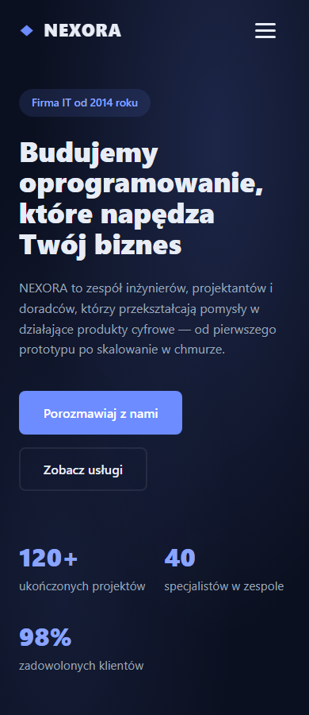

# QA 75 — rebuild, deploy stałego QA i rzeczywisty preview

2026-10-03. Checkout `C:\Users\Radomiej\.codex\worktrees\5a7e\kalio-forever`, branch `codex/kalio-provider-runtime-ux`, baza `2510692`, z zachowanymi wcześniejszymi zmianami. Zbudowano bieżący dirty checkout, nie clean-commit-only release. System Node poza sandboxem.

| AC | Status | Dowód | Granica |
|---|---|---|---|
| Build API/web | PASS | `start-qa.ps1 -ForceRestart`, API TSC0/SWC672, web3109 modules/build11.48s | Web ostrzega o chunk >500kB |
| Stała baza i porty QA | PASS | API3316/UI5288, AppData kalio-forever-qa/kalio-qa.db; nowe PID API62388/FE1980 | Nie resetowano danych/tokena |
| Nowy bundle serwowany | PASS | UI HTTP200, HTML zawiera index-DCqQ6vK3.js | Snapshot buildu worktree |
| Preflight Devina po restarcie | PASS | 16/16, exact swe-2, strict profile, Home Site, sześć tools, manual HITL | Bez cichej zmiany globalnego mocka |
| Rzeczywisty preview przez Kalio | PASS | UI reviewed/Confirm pojedynczego npm preview, terminal_output running; URL57868 | Bez zapisu/build/commitu w Home Site |
| Browser responsive i czat | PASS podczas runnera | 3/3 Chromium, 7.7 s; HomeSite320/390/1440, hero320, chat F5 320/390/820 | Następnie wykryto konflikt shared runtime-config — patrz niżej |
| Stały runtime-config po testach | PASS po ręcznym przywróceniu | HTTP200 runtime-config.js wskazuje3316, nie58773; CUA F5 odtworzyło18 chats/HomeSite/exact swe-2 | Trwała naprawa runnera nadal otwarta |
| Bounded procesy przed HITL Confirm | PASS w obserwowanym oknie | 15 próbek,07:53:38.7265005Z–07:53:59.5687494Z, API62388,0 owned CMD | Nie ciągły event-based monitor, nie cały startup/approved npm |

## Odtworzony Home Site

Sesja `W4fggLSunrJB41C24MV7C`, projekt **E:\Projekty\home-site**, exact Devin ACP `swe-2`. Po restarcie wywołano przez istniejący Talk tylko:

`terminal_spawn` command `npm`, args `["run","preview","--","--host","127.0.0.1","--port","0","--strictPort"]`, cwd `E:/Projekty/home-site`. Pełne argumenty odczytano przed osobnym Confirm. Surowy terminal_output: id `57fc1xs9ZOOFGtvAGqJjU`, status running, exitCode null, Vite URL **http://127.0.0.1:57868/**. HTTP200. Bridge nadal enabled, native filesystem/web/terminal false.

## Wykryty defekt infrastruktury

Korekta po inspekcji w QA76: klasyfikacja P1 i sugestia awarii HTTP stałego QA były zbyt mocne. `vite.config.ts` ma `configurePreviewServer` middleware, które serwuje runtime-config z env danego procesu i przesłania plik dist. W QA75 udowodniono nadpisanie wspólnego pliku, nie zmianę odpowiedzi HTTP stałego procesu przed recovery. Rzeczywiste naruszenie izolacji artefaktu klasyfikujemy P2; usunięcie zbędnego zapisu i niezależne HTTP origins potwierdzono w QA76. Poniższy akapit pozostawiono jako historyczną diagnozę, nie aktualny werdykt.

[P1] Izolowany Playwright stack zapisuje wspólny `apps/kalio-web/dist/runtime-config.js`, pozostawiając po zakończeniu API58773 w pliku wykorzystywanym przez stałe QA5288. Odczyt pliku po zakończeniu testów potwierdził zły origin. To realny konflikt artefaktu/odbiorców: zielony browser test nie zamyka trwałości stałego QA. Przywrócono wygenerowany plik do3316 przez apply_patch, bez restartu i zmian źródeł; GET przez stały serwer potwierdził poprawę, CUA F5 odtworzyło rzeczywistą rozmowę i historię. Nie commitowano dist. Trwała izolacja runnera/config należy do następnego kroku, nie jest zamknięta tym hot recovery.

Runner: `node apps/e2e/scripts/run-playwright-with-stack.mjs qa-home-site-chat-live-audit.spec.ts home-site-live-audit.spec.ts --workers=1`, SKIP_BUILD1, fixedQA URL5288/report75, HomeSite URL57868/report75; pomocniczy isolated API58773/UI58772. Runner exit0. Wynik testów zapisano jako obserwację w trakcie runnera, nie dowód finalnego runtime-config. Finalny fixed-origin proof wykonano osobno CUA/HTTP po recovery.

## Screenshots

[Home Site320](assets/home-site-320.png) · [390](assets/home-site-390.png) · [1440](assets/home-site-1440.png) · [Chat320](assets/completed-real-chat-320.png) · [390](assets/completed-real-chat-390.png) · [820](assets/completed-real-chat-820.png)

Werdykt całego celu: **UNVERIFIED**. Wymagane przed zamknięciem: trwała izolacja runtime-config, pełna macierz UX/CTO, pozostałe reviewed source commity i ciągły pomiar procesów. Produkcja nie była zmieniana.
