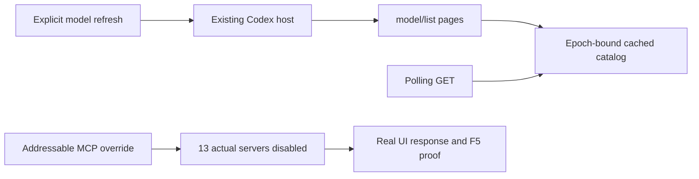

# QA84 — real Codex response, MCP isolation fix, Devin post-deploy check

2026-10-03. Starting revision: 3c4ed26, shared dirty checkout. Only the Codex files and this attempt's evidence are owned by this slice. No production deployment or clean-release claim.

## Environments and scope

- DEV: UI localhost:5188, API 127.0.0.1:3016; separate AppData kalio-forever-dev. Started with the canonical start-dev.ps1 and mock global direct provider. Explicit Codex execution uses ChatGPT login, not that mock.
- Fixed QA: UI localhost:5288, API 127.0.0.1:3316; existing AppData kalio-forever-qa/kalio-qa.db preserved.
- QA deployed with start-qa.ps1 -SkipBuild after API gates. Old managed stack stopped, old launcher observed terminal before new start. Current QA backend PID 55964, frontend 66004. No database deletion, plaintext credentials export or provider update.
- Approved generated project: E:/Projekty/home-site. No source writes or builds performed directly by Codex.

## Root causes and changes

1. Configured Codex profiles advertise gpt-5.4 even though actual inference with ChatGPT login rejects it (QA83). Added explicit POST runtime/native-cli-integrations/:authProfileId/models/check using the existing host's model/list protocol. Picker-visible pages are validated, deduplicated, bounded, and time out after 15 seconds per page. Concurrent checks share a request. GET :authProfileId/models reads cached data only and invalidates it on host epoch change/disconnect. This backend catalog is not yet wired to the chat selector.
2. Native MCP isolation was ineffective: CLI dotted keys containing JSON-quoted names created different literal keys. Real config/read showed 25 server entries, 12 still enabled and 13 disabled quoted-name copies. Fix uses bare addressable server IDs and preserves transport identity while setting enabled=false. Non-addressable IDs fail closed. An intermediate leaf-only enabled override failed host startup because the transport identity was required; the final whole-table override passed actual startup/config proof.

## Acceptance matrix

| AC | Status | Evidence | Remaining |
| --- | --- | --- | --- |
| AC-01 Actual host model discovery | PASS | DEV and deployed QA returned gpt-6-astra/sol/luna, gpt-5.6-sol/terra/luna, gpt-5.5; gpt-5.4 absent | Catalog discovery alone is not inference authorization for every model |
| AC-02 Cache/pagination/error/reset behavior | PASS locally | Focused tests include coalescing, malformed data, repeated cursors, empty catalog, epoch change, provider errors and timeout | Full UI refresh/error workflow still absent |
| AC-03 Correct Codex MCP overrides | PASS scoped | Actual fresh Kalio host config/read after fix: 13 total, 13 disabled, zero enabled; helper-owned host closed in finally | Not comprehensive proof against every native tool/hook or later project-specific configuration |
| AC-04 Real ChatGPT/Codex response | PASS scoped | gpt-5.6-luna, codex-luna, kalio_strict, ChatGPT auth; DEV84_CODEX_OK, subsequent DEV84_ISOLATED_OK, QA84_CODEX_OK | Kalio tool/HITL/stop tests for Codex remain |
| AC-05 Dynamic model choices in chat | FAIL / OPEN | Existing selector still reads configured profiles, including obsolete choices | Required before prod: connect catalog to selector and backend resolution; preserve persona independence |
| AC-06 Post-deploy Devin communication | PASS scoped | 16/16 static readiness, real SWE-2 fs_read and normal final response | Does not close all prior Devin/native isolation requirements |
| AC-07 HomeSite preview restored through HITL | PASS scoped | Exact npm preview command reviewed in UI, one Confirm, successful terminal_spawn/output | Preview lifetime remains tied to QA process lifetime |
| AC-08 QA provider preservation | PASS scoped | Same database path; exact Devin SWE-2 and Codex Luna IDs/enabled/strict modes retained; Codex MCP policy false retained | No credentials export/restore feature implemented or all-secret round-trip claim |

## Verification

- Final focused API gate: 7 files, 42 tests PASS. Focused lint exit 0. Nest build/typechecker exit 0, 674 files compiled, zero type issues.
- Fail-first MCP regression: two failing assertions before correction. First real correction failed process startup; final correction produced zero enabled MCP entries.
- DEV UI canary session Kgm0bdtzIt0wpO45h0Xru, initial turn BEn6NUTilwrHArPUR8NOs completed with gpt-5.6-luna. Current run empty after answer. No-tool response canary, not filesystem proof.
- QA UI canary session 58mz05cKrZDGG1DPbMKBU, turn GXfuXc19MQ1t2LpI5XiIO, completed; current run empty. Scoped audit contains no tool_call/tool_result. New backend log had no `MCP server startup failed` matches at inspection; absence of this log is supporting evidence, not the isolation proof.
- Actual Codex F5 audit: DEV 1 PASS (10.5s suite), QA 1 PASS (4.3s suite); widths 320/390/820/1440, visible final answer, no Stop/responding state, no horizontal overflow. Screenshots saved, QA 390px inspected visually.
- Post-restoration HomeSite audit: 3 PASS (9.5s suite): real generated artifact responsive keyboard/demo-form flow, intact 320px hero word, real Devin conversation F5 at 320/390/820. No mock/interception substitutes these actual URLs. No new build performed.
- Devin session W4fggLSunrJB41C24MV7C, SWE-2 turn FG9WJfO41q8uWXuhuus7z: fs_read success, final name nexora-home-site and build script vite build, no current run. UI shows fs_read provenance Kalio.
- QA restart stopped the old HomeSite preview. Restored through Devin, after another preserving host reset and 16/16 preflight: turn dUBDZOhiZJi5k_mfMNPDp. Confirmed only `npm run preview -- --host 127.0.0.1 --port 57868 --strictPort`, cwd E:/Projekty/home-site. HITL requested 1791018584278, approved 1791018611893; terminal 6_n1GtjH-7Io2fQovsmYd returned running, output shows exact Vite local URL. One intentional CMD invocation recorded in scoped turn audit; this is not an OS-wide no-spam measurement.

## Screenshots

- [QA Codex mobile response](assets/codex-qa-completed-390.png)
- [QA Codex desktop response](assets/codex-qa-completed-1440.png)
- [DEV Codex response](assets/codex-dev-completed-390.png)
- [Devin completed conversation](assets/completed-real-chat-390.png)
- [HomeSite mobile hero](assets/home-site-hero-390.png)
- [HomeSite desktop](assets/home-site-1440.png)

## Remaining boundaries

[P1] Connect discovered Codex models to the selector and resolve supported strict execution profiles without changing existing saved provider choices. QA83's silent Run from an unselected landing state also remains open [P2].

No full goal closure: real project generation/build evidence exists from earlier passes, but this pass restores and retests that artifact rather than regenerating/building it. Codex tool/HITL/native-denial paths, all chat consumers, and comprehensive no-CMD-spam proof are still required. Existing unrelated changes, other agent work and older uncommitted work remain preserved.
