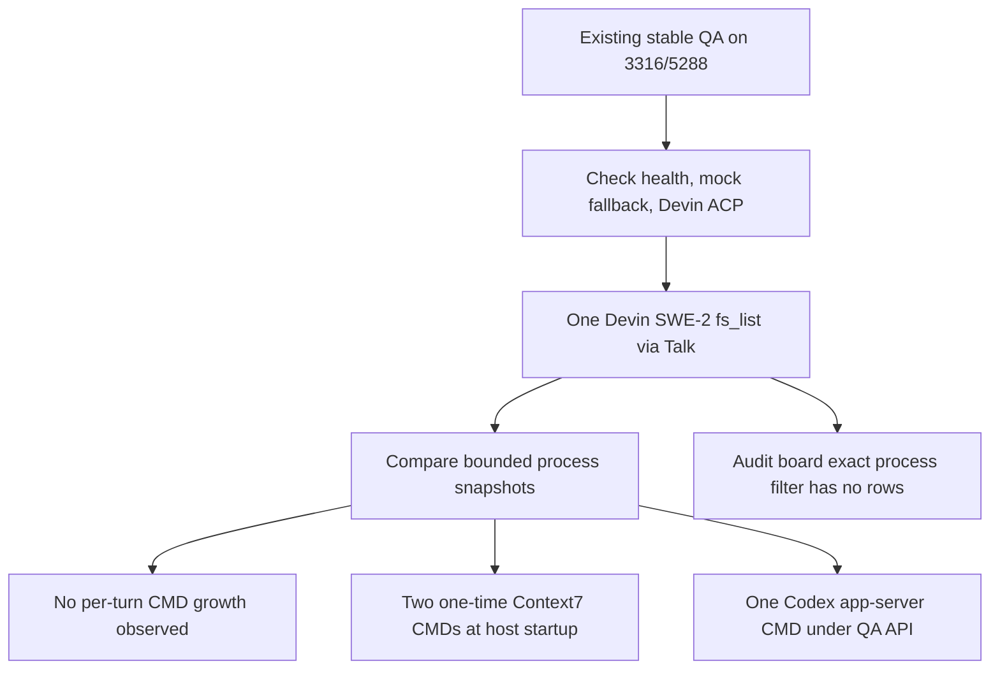

# 2026-09-28 — Kalio stable QA run 24: Devin ACP and CMD

## Purpose

Verify the post-restart stable QA service, confirm a real Devin SWE-2 host can see and invoke one Kalio MCP tool from Talk, and check whether a single fresh turn causes repeated CMD/Devin process creation.

## Scope and constraints

- Repository: `C:\Users\Radomiej\.codex\worktrees\5a7e\kalio-forever`.
- Existing stable QA only: UI `http://localhost:5288/`, API `http://127.0.0.1:3316`, data root `C:\Users\Radomiej\AppData\Local\kalio-forever-qa`.
- Reused the already-running stack; no duplicate start, restart, process termination, Devin-profile change, or application-source edit.
- Reused the explicitly approved `Home Site` project and performed only one read-only `fs_list` for `E:/Projekty/home-site/src`.

## Acceptance criteria

| Criterion | Status | Evidence |
|---|---|---|
| Stable QA API and UI available | PASS | Ports 3316/5288 listening; API health=`ok`. |
| Devin host and SWE-2 model online | PASS | UI: logged in, ACP available, 634 models; `swe-2-medium` online. |
| Devin can call a Kalio tool through the UI | PASS | Fresh Talk turn used exactly one `fs_list`; three entries; omitted=0. |
| No repeated CMD/Devin processes during the canary | PASS — bounded | Global counts stayed 75 CMD / 15 Devin at 11:18:43 and 11:20:00; QA tree CMD start times all predate the 11:19 canary. |
| No CMD processes anywhere in Devin's startup tree | NOT MET | Two Context7 CMD processes were created once at Devin host startup. |
| No global CMD churn after the canary | NOT MET — unrelated activity observed | At 11:30:44 global counts were 76 CMD / 15 Devin; 12 live CMD PIDs had been created since the baseline, none in the QA API/Devin tree. |

## Starting evidence

- The managed stable stack was already online, owned by API PID 37264 and UI PID 54828; both listeners had started at 10:36:14.
- `/api/llm/config` returned `mock/mock`, source `env`. Devin ACP is a separate native-host route.
- Devin host PID 63816 ran `swe-2-medium`; Settings → Integrations showed authenticated, ACP available, 634 discovered models, and Kalio MCP bridge enabled. Native Devin filesystem/web/terminal switches were off.

## Investigation and execution

1. Read API health, LLM config, and Devin runtime status; inspected Integrations and the persisted Talk transcript in Chrome.
2. Recorded the 11:18:43 process baseline (75 `cmd.exe`, 15 `devin.exe`).
3. Sent one fresh read-only canary through the selected Devin SWE-2 persona and `Home Site` project in Talk at about 11:19 local time.
4. Verified exactly one Kalio `fs_list` response for `E:/Projekty/home-site/src`: `App.jsx` (10,919 B), `main.jsx` (237 B), `styles.css` (11,700 B), `omitted=0`.
5. Re-sampled at 11:20:00: still 75 CMD / 15 Devin. Inspected the QA API process tree and found three persistent CMD children/descendants, with all three start times before the canary.
6. Filtered Audit Truth Board for `process.cmd.invocation`; the board returned no matching rows. Captured the Talk UI screenshot in `docs/raports/qa-run-24/assets/devin-fs-list.png`.
7. Ran isolated Playwright runtime-signal collection against the same local QA UI: status `passed`, zero findings, zero console errors, zero network errors; closed that temporary browser session.
8. Follow-up process attribution at 11:30–11:31 found 12 live CMD PIDs created after the baseline: eight in a Portal MK dev-server tree and four in local Codex MCP startup. All were outside the QA API/Devin process tree; the exact task that invoked the Portal MK start remains unknown.

## Root causes and decisions

- Observed a successful `fs_list` through the Kalio MCP bridge while all native Devin filesystem/web/terminal tools remained disabled; therefore the bridge canary passed without enabling native tools.
- The Devin host process tree showed its configured MCP children, including `mcp-dev-servers`, `mcp-supermemory`, Context7, ast-grep, Serena, and the Kalio bridge. Two `cmd.exe` processes were part of the Context7 `npx.cmd` startup chain, created at 10:45:42–43 with the Devin process. The fresh 11:19 turn did not create another Devin/CMD process.
- A separate `codex.cmd app-server --stdio` process (PID 62384) was started by the QA API at 11:08:14. It is not a Devin process; its trigger and persistence were not proven.
- Later global CMD growth was from other process trees. Twelve live CMD processes appeared after the baseline: eight descended from `E:\Projekty\portal-app\portal_mk.py start-dev` and four from Codex MCP startup. Their ancestors show local Codex, but cannot identify which concurrent task initiated them. None belonged to the QA API or Devin process trees.
- The process tree is readable from Windows, but exact search `process.cmd.invocation` returned no Audit Truth Board rows. This is an observability gap to investigate, not proof that every process event is missing.
- No Devin user profile or MCP configuration was changed because the test only establishes observed startup behavior; disabling Context7 is a separate configuration decision.

## Flow

## Files and boundaries changed

- Added `docs/raports/qa-run-24/report.md` and `docs/raports/qa-run-24/assets/devin-fs-list.png`.
- Added this session record.
- Added and read back the Notion Agent Note: [Kalio QA run 24 — Devin SWE-2 i CMD](https://app.notion.com/p/3e9c847d182581adab9fd002c1b186a3).
- No source, Devin configuration, QA database, Linear issue/status, or production state was changed. One user-authorized chat turn was appended to the local QA database.

## Verification evidence

- Runtime API: `/api/health` returned `ok`; `/api/llm/config` returned `mock/mock` from `env`.
- Devin API/UI: version 3000.11.1; authenticated; ACP available; model catalog ready; 634 models; one online `swe-2-medium` host.
- Process sample: 11:18:43 and 11:20:00 both showed 75 CMD / 15 Devin. At 11:20, the QA tree had 21 descendants, including one Devin and three CMD processes; all CMD start times were 10:45:42, 10:45:43, and 11:08:14, before the canary. The same three remained identified at 11:27.
- Later system samples: 11:30:44 and 11:35:00 showed 76 CMD / 15 Devin; the QA tree still had the same three CMD. At 11:31:05, 12 currently live CMD PIDs created after the baseline were traced outside QA: four Codex MCP startup processes and eight processes in the Portal MK dev-server chain. API health and both QA listeners remained good at 11:35.
- Browser: visible completed Devin response and screenshot in the linked QA report; isolated Playwright runtime signals reported zero findings/errors.
- Pre-canary local gates: API targeted set 77/77, web `NativeCliIntegrationsPanel.test.tsx` 10/10, API and web typecheck passed.

## Caveats and inconclusive checks

- `process.cmd.invocation` was not visible through the Audit Truth Board search; event persistence and taxonomy remain unverified.
- The reason the QA API started `codex.cmd app-server` while the UI showed zero open Codex sessions remains unknown.
- The previous Chrome tab retained network errors and reconnect messages timestamped 11:06:58 local. They did not recur in the fresh canary or isolated Playwright signals, but there was no long-duration monitoring.
- Full E2E, a new build, and `home-site` build/render/browser behavior were not run in this QA-only turn.

## Remaining boundary and production closure

This proves local stable QA availability and one real Devin-to-Kalio read-only MCP call only. It does not prove site generation quality, absence of CMD on future host starts, or production readiness. Follow up on the Audit Truth Board process event visibility and the single Codex app-server lifecycle; decide separately whether Devin's Context7 startup MCP is acceptable.
