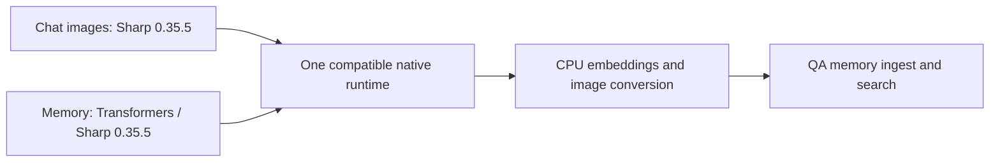

# 2026-10-11 — Sharp and local embedding runtime

## Purpose and scope

Fix Windows `ERR_DLOPEN_FAILED` during memory ingestion without separating image
processing and local embeddings into different applications. Preserve QA providers.
No shared contracts or embedding-space identities changed.

## Starting evidence and decision

The API loaded Sharp 0.34.5, while Transformers 4.3.1 loaded Sharp 0.35.5.
Fresh-process tests reproduced the reported native load failure with images first,
and an image colourspace failure with embeddings first. Aligning the direct Sharp
dependency to 0.35.5 removes the incompatible native dependency pair.

## Implementation and flow

Changed API package manifest and lockfile; added a fresh-process regression that
loads both libraries in both orders and performs actual image conversion.

## Acceptance and verification

| Requirement | Status | Evidence |
| --- | --- | --- |
| Both native load orders | PASS | Two fresh-process regressions, RED before dependency alignment and GREEN after |
| Adjacent memory/images | PASS | Focused suite: 379 passed, one opt-in HomeSite test skipped |
| HomeSite wiring | PASS | Explicit HomeSite run plus native regressions: 3/3 passed; real VFS reads, index dispatch mocked |
| Real CPU inference alongside images | PASS | Cached offline Gemma 270M produced 768 finite dimensions; Sharp produced a 97-byte PNG in the same process |
| API typecheck, build, scoped lint | PASS | System Node 22.15.0; typecheck and Nest build exit 0; new regression ESLint exit 0 |
| QA memory roundtrip | PASS | POST /api/memory/ingest wrote one entry; hybrid search returned the same entry |
| QA settings preserved | PASS | API health ok, UI 200; effective provider OpenRouter / openai/gpt-4o-mini |

QA: UI http://localhost:5288/, API port 3316; existing local QA database and
workspaces retained. Roundtrip used a separate `qa-sharp-regression-20261011`
persona scope, with one intentionally retained diagnostic memory entry.

## Delivery boundaries

This proves the Windows native conflict fix and real API memory roundtrip, not
a new end-to-end Devin conversation or production deployment. Full workspace
test results and remote CI status are recorded in the PR description. The
collective branch includes earlier integration work beyond this four-file fix.
Secret-pattern scan matches were synthetic sanitizer fixtures, not credentials;
the scan is not an exhaustive security audit. No automatic merge is authorized.
