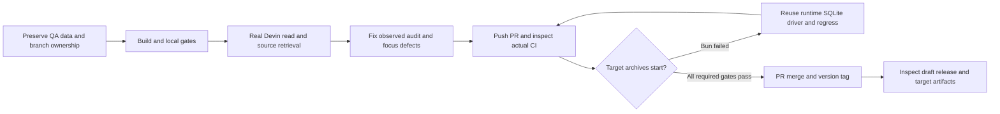

# 2026-10-17 — Release 1.0.3 preparation and QA handoff

## Purpose and constraints

Continue the existing collective integration PR #15, preserve stable QA data,
verify Devin and project retrieval, simplify Home settings and prepare 1.0.3.
Use PR-based integration, never a direct main push; do not publish while target
builds are red. This is a verification checkpoint, not a completed public release.

Checkout: `C:/Users/Radomiej/.codex/worktrees/5a7e/kalio-forever`.
Branch: `codex/kalio-provider-runtime-ux`. Main fetched as `2917ea37`; rebase
reported up to date. Existing `v1.0.2` remains unchanged. Version 1.0.3 was
synchronized with `scripts/bump-version.mjs` across all 11 release manifests.

## Acceptance and starting evidence

| Area | State at this checkpoint | Evidence / remaining boundary |
| --- | --- | --- |
| Stable QA | Deployed and browser-verified | UI :5288/API :3316, existing DB/providers retained |
| Devin | Real read completed | Exact swe-2-high, Kalio fs_read; no writes/native tools |
| Home/Settings | Implemented and browser-verified | 320/390/1440, 9/9; focus return regression reproduced first |
| Project Context | QA-verified Home Site | 8/8 hybrid HTTP 200/top-5 matches; normal source refresh |
| Node/Bun packaging | Node smoke passed; Bun fix local-verified | Fresh target archive jobs pending |
| Main/tag/public release | Not performed | Required remote builds must pass first |

The starting PR head was `73c45f6c`; the remote PR contained the earlier
Sharp/Transformers and broad runtime integration. Those changes were preserved.
Initial QA read exposed an audit-update warning; full local tests exposed an
obsolete family-heading expectation. Actual desktop CI then exposed a Bun-only
startup dependency that source/Node gates did not catch.

## Investigation and decisions

1. Checked effective QA provider rather than trusting the environment fallback
   startup log: DB-backed OpenRouter/openai/gpt-4o-mini remained intact. The
   conversation's connected execution profile independently selected Devin.
2. A real UI request used Kalio fs_read against the approved Home Site project.
   The response and tool survived reload. No model/config/file mutation occurred.
3. Explicit `usage: undefined` caused strict audit JSON validation to roll back
   the final metrics. Omit absent optional fields; do not weaken proof validation.
4. Settings unmount attempted to focus an opener while App background was inert.
   App now records the opener before opening and restores focus after removing
   inertness; the modal retains its own focus containment.
5. Home execution selection belongs behind the gear; Quick Chat and RA-Apps
   remain primary. No wholesale redesign or unrelated menu rewrite was added.
6. Bun archives intentionally omit better-sqlite3. A top-level memory partition
   import bypassed the existing runtime driver. Reuse that driver and preserve
   readonly/must-exist semantics for both Node and Bun, rather than shipping a
   conflicting native addon or dropping the Bun lane.

## Implementation sequence and changed boundaries

- `a81560cf`: E2E draft/auth fixture recovery, no production auth weakening.
- `81623251`: README provider/runtime clarification and login assessment.
- `20189df3`, `62843c6c`, `68ab77a4`: version sync, concrete catalog expectation,
  current installer examples and root-version parity checks.
- `69ad89f4`: runtime audit omission plus real AuditService/SQLite regression.
- `4d666a8e`: Home gear, modal/App focus fixes and real browser regression.
- `2dd21d63`: QA 510 report and screenshots.
- `8ee7f8db`: existing SQLite runtime factory options and memory partition caller;
  real Bun legacy/missing-file/write-denial test plus Node readonly regression.

No shared contract, native approval policy, provider credential or global login
configuration was changed by these final fixes.

## Verification evidence

- Full local gate before the Bun-only fix: exit 0; scripts 161/161, shared
  contracts 126/126, API 6034 passed/4 conditional skips, web 2075/2075,
  launcher 15/15. Full workspace build and typecheck exit 0.
- Focused browser recovery 29/29; final Home/Settings RED 3 passed/6 failed,
  GREEN 9/9 against parent-owned stable QA, without API intercepts or LLM calls.
- Actual Devin post-audit-fix turn completed on swe-2-high with one successful
  fs_read. Persisted audit: duration 13261 ms, text 42, thinking 148, tool count 1,
  chunkCount 7. No audit-update warning in that restarted log window.
- Home Site: multilingual-e5-small CPU/384 dimensions; 8 queries HTTP 200,
  expected matches 8/8 top-5 and 5/8 top-1. Auto-refresh generation 2→3,
  108 chunks, all 8 file hashes current. First request including refresh 6857 ms,
  later 84–160 ms. Not a new Gemma or whole-Kalio benchmark.
- GitHub CI run 39071710706 at 2dd21d63: all jobs passed; browser suite
  181 passed/68 opt-in skips. Desktop run 39071710705: Node archive health/UI/
  SQLite smoke passed on Windows and Linux, Bun startup failed on both.
- Bun fix: Node/Bun/reembed group 25/25, final explicit readonly group 5/5;
  API typecheck/build exit 0. Actual Bun 1.2.18, not a mocked constructor.
  Original caller locally reproduced a native ABI/crash failure; CI independently
  proved absent-package startup. Current fix passed real Bun without that import.
- New source head 8ee7f8db is pushed; fresh CI run 39072441098 and desktop
  run 39072441061 were running at checkpoint creation. No green claim for them.
- README's public GitHub rendering loaded its architecture SVG at intrinsic
  1280 px and displayed 823×502 without aspect distortion.

## Caveats and production closure

- RAD-14 is Done on explicit owner instruction, verified by reading Linear back.
  This records the decision, not independent revocation/rotation verification.
- Current-tree pattern check: 3058 tracked files, 2439 text scanned, 619 binary
  excluded from text scanning. Fourteen hits in eight files were synthetic
  fixtures; no confirmed real secret. This is not reachable-history clearance.
- Full immutable-range security scan 0daa104f-edf5-415f-b47e-f6d67a340f11 retains
  a partial threat-model checkpoint, not completed discovery or certification.
- Global password login was assessed only; no tunnel or access expansion enabled.
  Custom local Decisions API is supported, but no local Jev model installer was
  implemented or claimed tested. Full Kalio corpus was not indexed in this QA.
- Required before public release: fresh CI/Windows/Linux archive and desktop
  gates, artifact/manifest inspection, PR merge, tag and draft-release review.
  Do not represent unsigned artifacts or QA as signed clean-device proof.
- Evidence and screenshots: `docs/raports/qa-run-510/report.md` and
  `docs/raports/qa-run-510/project-context.md`. Temporary logs and generated test
  data remain ignored; feature commits were clean before this checkpoint.
