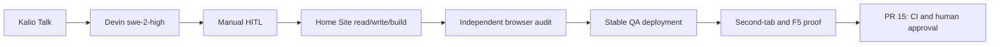

# 2026-10-18 — Home Site QA and release handoff

## Purpose, scope and acceptance

Prove a real Home Site workflow through Kalio/Devin, repair observed Kalio
defects, preserve QA providers, and prepare the existing release PR. No manual
target-project source edits, native-tool bypass, database reset or main push.

## Starting evidence and method

Stable QA uses web :5288/API :3316 and the AppData QA database. Actual project
is E:/Projekty/home-site (not a Git repository). Drive Talk/HITL with actual
Devin swe-2-high; independently inspect outputs and run headed browser tests.
An inactive observer reproduced stale history on returning from Home to Talk.

## Root causes, decisions and implementation

- 88cf5478: persist session activity atomically with new messages and publish
  post-commit metadata. Finalization/replay must not manufacture new activity.
- 99ff315f: retain failed ACP startup resource ownership until child/transport
  shutdown is confirmed; uncertain termination remains fail-closed until reset.
- 77b7cb88: keep Chat mounted to preserve drafts/streams, refresh metadata on
  Talk entry, and independently fence metadata/watchlist stale responses.
- Strengthen the explicitly enabled Home Site browser audit, including real
  Windows scrollbar layout, six widths, keyboard, invalid form and zero writes.

## Flow

## Verification evidence

| Boundary | Result | Evidence |
| --- | --- | --- |
| Actual Devin | PASS | Approved writes/build exit 0; postdeploy preview terminal Eu5_ilu4yNngo3PnV8rZC running |
| Home Site | PASS | Headed Playwright 2/2 at 320/390/640/641/820/1440; no page errors/form writes |
| Backend | PASS | Parent final ACP suite 102/102; full root gate API 6072 pass / 4 conditional skips |
| Frontend final | PASS with stderr caveat | Parent 232 files / 2091 tests; fresh tsc/lint/build exit 0 |
| Stable QA | PASS | :5288, providers preserved; real cold-start/resume and preview :50330 |
| Observer | PASS | Fresh Home observer sees another client's rename on Talk entry without F5; title restored; F5 preserves metadata; 30 chats |
| Release | Pending | PR https://github.com/Radomiej/kalio-forever/pull/15 requires fresh pushed-head CI and authorized reviewer approval |

## Caveats and inconclusive checks

Existing jsdom XHR AggregateError stderr occurs before and after the FE patch;
not suppressed and not described as a pristine test log. Build retains an
existing large-chunk warning. FE mutation measurement ran zero tests in two
Stryker dry-runs: no score. Backend scoped mutation was 48 killed/1 survivor
(diagnostic message), not whole-app coverage. No exhaustive history security
clearance or independent provider-key revocation proof is asserted.

Detailed local evidence and screenshots: docs/raports/qa-run-511/report.md
(ignored QA artifacts, deliberately not included as bulk release media).

## Remaining boundary and production closure

### Release CI follow-up

CI 39078212232 at 9e2fd612 exposed a wait_for deadline defect: the hung CLI poll
test observed two calls instead of one. All three polling loops admitted a
new query at elapsed time exactly equal to timeout. Deterministic clock-boundary
regressions reproduced 3 failures (CLI/conversation/tool_result); strict deadline
checks then passed all 9 focused tests. No timeout increase or assertion removal.
Fresh parent API tsc/scoped lint/build exit 0; SWC compiled 921 files. Full API
coverage run exit 0; exact summary retained in .tmp/qa511-wait-full-coverage.log.
fe7bdf2e was pushed and deployed to QA with provider settings preserved. Protected
cold preflight passed; real resumed Devin used manual HITL to start preview
terminal T26vOnIMpU9PU5lbUPr7b (turn z4_SisoZ9F4Ka9SJURi5X). Durable F5 and Graph
show completed turn, two calls collapsed, final response. CI 39078780026 backend,
frontend, tests and audit passed; E2E failed workflow deletion with
ORDINARY_CANCELLATION_CONFLICT in all three attempts. This is an open runtime
defect under investigation, not a green release or a reason to suppress checks.

### Fresh-connection notice and test-sandbox hygiene

The old QA tab successfully reconnected and ran Devin without F5, but still
displayed Connection dropped because the notice only changed on recovered=true.
Two deterministic RED cases (false/omitted recovered) now pass with the truthful
Connection restored notice. Parent adjacent suite 820/820, final clean full FE
232 files / 2093 tests, tsc/scoped lint/build exit 0. Built isolated Playwright
reconnect/hydration 1/1 passed, separate database/random ports; fixed QA config
restored after confirming unchanged stack state. Baseline jsdom XHR stderr remains.

The first full FE attempt discovered mutation sandbox copies inside app .tmp and
was explicitly stopped, not reported green. Only that verified Vitest process
tree was terminated. The exact observer-reentry-sandbox-20261018 directory moved
recoverably to root outputs/observer-reentry-sandbox-quarantine-20261018; no user
or QA data deleted. AGENTS now requires mutation copies outside application test
roots. The subsequent clean full run above is the authoritative result.

### Stop/Delete release regression — verification checkpoint

The CI deletion failure reproduced in a fresh built stack. Ordinary cancellation
read an active revision while an external role owner concurrently wrote its
terminal revision. The strict SQLite CAS correctly rejected that stale snapshot.
The repair retains per-session admission leases and a database-scoped topology
claim: freeze discovery, fence every discovered session synchronously, settle all
external owners, finalize ordinary cancellation, perform DELETE, then release.
Socket Stop, HTTP DELETE and Telegram use the same coordinator. Child insertion
is guarded at both production insert boundaries; parent links remain immutable.
No timeout, protected-goal condition or CAS check was weakened.

Parent local gates at this checkpoint: root tests exit 0 (scripts 161, shared
types 126, FE 2093, API 6111 plus four conditional skips, launcher 15); API tsc,
scoped lint and build exit 0 (928 compiled files). API coverage: statements
89.42%, branches 85.25%, functions 92.48%. Built isolated Stop/Delete browser
regressions: 2/2 PASS. Scoped topology mutation: 43 killed, three instrumented
hit-limit timeouts, two survivors, zero no-coverage/final errors, 95.83%; this
is not whole-app mutation coverage or universal equivalence proof.

The wider workflow release gate passed all groups, including Goal Guard, HITL,
child visibility, replay and ordinary chat. Its first attempt failed the fixture
storage safety check before running a workflow. The generated temporary root
now includes the existing playwright-stack marker; an executable path regression
passes without weakening that guard. Stable QA was restored afterward: UI 200,
effective saved OpenRouter/openai/gpt-4o-mini unchanged, protected Devin cold
static preflight PASS. The preview terminal did not survive backend maintenance
and must be restarted through the approved Devin UI before final live handoff.

Final review found a further failure-path gap: the retained lease's completion
promise acknowledges cleanup, not successful Stop. Twelve deterministic cases
reproduced waiting submissions proceeding after owner/DELETE failures. A separate
semantic waiter now propagates the exact coordinated error (including falsy
throws); release ACK remains fulfilled and the first release outcome wins.
Real pipeline/SQLite and controller regressions cover root/child submissions,
coalesced Stop, local finalizer failure, blocked action and fresh recovery.
Independent final root gate exit 0: API 6131 PASS / four conditional skips,
FE 2093, shared types 126, scripts 161, launcher 15. Final changed-path ESLint,
API typecheck/build exit 0 (928 files), isolated built Stop/Delete 2/2 PASS.

Commits: da385864 fixes workflow fixture storage; 8b512ad4 contains the retained
Stop repair and semantic failure propagation. Stable QA was redeployed from
these compiled source bytes without resetting saved providers: HTTP 200,
OpenRouter/openai/gpt-4o-mini source=db unchanged, protected Devin cold static
preflight PASS. Final real UI Devin swe-2-high run used one manually approved
terminal_spawn and terminal_output. Actual output binds terminal
KiGNvU36dDFUAQ3-HLZ3B (pid 49168), turn zd9orRMNoy8ik-3wUnvpF,
cwd E:/Projekty/home-site and URL http://127.0.0.1:50330/. The server remains
running. F5 restores the completed answer, collapsed Thinking and no Stop button;
Graph shows completed turn, two grouped tools and final reply. Headed final
Home Site audit passes 2/2 across six widths, menu/focus/demo-form/reset and
320px comma regression, with actual index-CiG0h558.js. No source edits, installs
or duplicate spawns occurred during this final canary.

### Final acceptance boundary

| Area | Status | Evidence | Remaining |
| --- | --- | --- | --- |
| Stop/Delete failure and recovery | PASS locally | Final root gate, actual SQLite regression, built browser 2/2 | Fresh pushed-head CI |
| Stable QA / providers | PASS | UI 200, saved effective provider unchanged, actual UI reconnect | No production claim |
| Devin / Home Site | PASS on QA | Exact model, one HITL, actual terminal output, F5/Graph, headed audit 2/2 | Leave QA and preview running |
| Public release | Pending | PR15 remains approval-gated | Push final head, verify CI/Desktop and obtain human approval |

No main merge, tag or public release has been performed. The unrelated image
agent remains untouched; task-owned helper agents are closed. Ignored logs,
screenshots and mutation outputs remain local and are not bundled into the PR.

RAD-14 Done read verified on owner instruction, not a waiver of security
acceptance criteria. Leave QA/preview running. Push only the feature branch,
verify fresh CI, and obtain the required PR approval; do not bypass protection,
create a public tag/release early, or call QA proof production proof.
