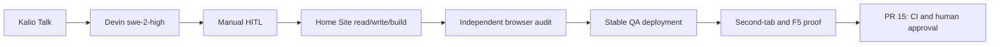

# 2026-10-18 — Home Site QA and release handoff

## Purpose, scope and acceptance

Prove a real Home Site workflow through Kalio/Devin, repair observed Kalio
defects, preserve QA providers, and prepare the existing release PR. No manual
target-project source edits, native-tool bypass, database reset or main push.

## Starting evidence and method

Stable QA uses web :5288/API :3316 and the AppData QA database. Actual project
is E:/Projekty/home-site (not a Git repository). Drive Talk/HITL with actual
Devin swe-2-high; independently inspect outputs and run headed browser tests.
An inactive observer reproduced stale history on returning from Home to Talk.

## Root causes, decisions and implementation

- 88cf5478: persist session activity atomically with new messages and publish
  post-commit metadata. Finalization/replay must not manufacture new activity.
- 99ff315f: retain failed ACP startup resource ownership until child/transport
  shutdown is confirmed; uncertain termination remains fail-closed until reset.
- 77b7cb88: keep Chat mounted to preserve drafts/streams, refresh metadata on
  Talk entry, and independently fence metadata/watchlist stale responses.
- Strengthen the explicitly enabled Home Site browser audit, including real
  Windows scrollbar layout, six widths, keyboard, invalid form and zero writes.

## Flow

## Verification evidence

| Boundary | Result | Evidence |
| --- | --- | --- |
| Actual Devin | PASS | Approved writes/build exit 0; postdeploy preview terminal Eu5_ilu4yNngo3PnV8rZC running |
| Home Site | PASS | Headed Playwright 2/2 at 320/390/640/641/820/1440; no page errors/form writes |
| Backend | PASS | Parent final ACP suite 102/102; full root gate API 6072 pass / 4 conditional skips |
| Frontend final | PASS with stderr caveat | Parent 232 files / 2091 tests; fresh tsc/lint/build exit 0 |
| Stable QA | PASS | :5288, providers preserved; real cold-start/resume and preview :50330 |
| Observer | PASS | Fresh Home observer sees another client's rename on Talk entry without F5; title restored; F5 preserves metadata; 30 chats |
| Release | Pending | PR https://github.com/Radomiej/kalio-forever/pull/15 requires fresh pushed-head CI and authorized reviewer approval |

## Caveats and inconclusive checks

Existing jsdom XHR AggregateError stderr occurs before and after the FE patch;
not suppressed and not described as a pristine test log. Build retains an
existing large-chunk warning. FE mutation measurement ran zero tests in two
Stryker dry-runs: no score. Backend scoped mutation was 48 killed/1 survivor
(diagnostic message), not whole-app coverage. No exhaustive history security
clearance or independent provider-key revocation proof is asserted.

Detailed local evidence and screenshots: docs/raports/qa-run-511/report.md
(ignored QA artifacts, deliberately not included as bulk release media).

## Remaining boundary and production closure

RAD-14 Done read verified on owner instruction, not a waiver of security
acceptance criteria. Leave QA/preview running. Push only the feature branch,
verify fresh CI, and obtain the required PR approval; do not bypass protection,
create a public tag/release early, or call QA proof production proof.
