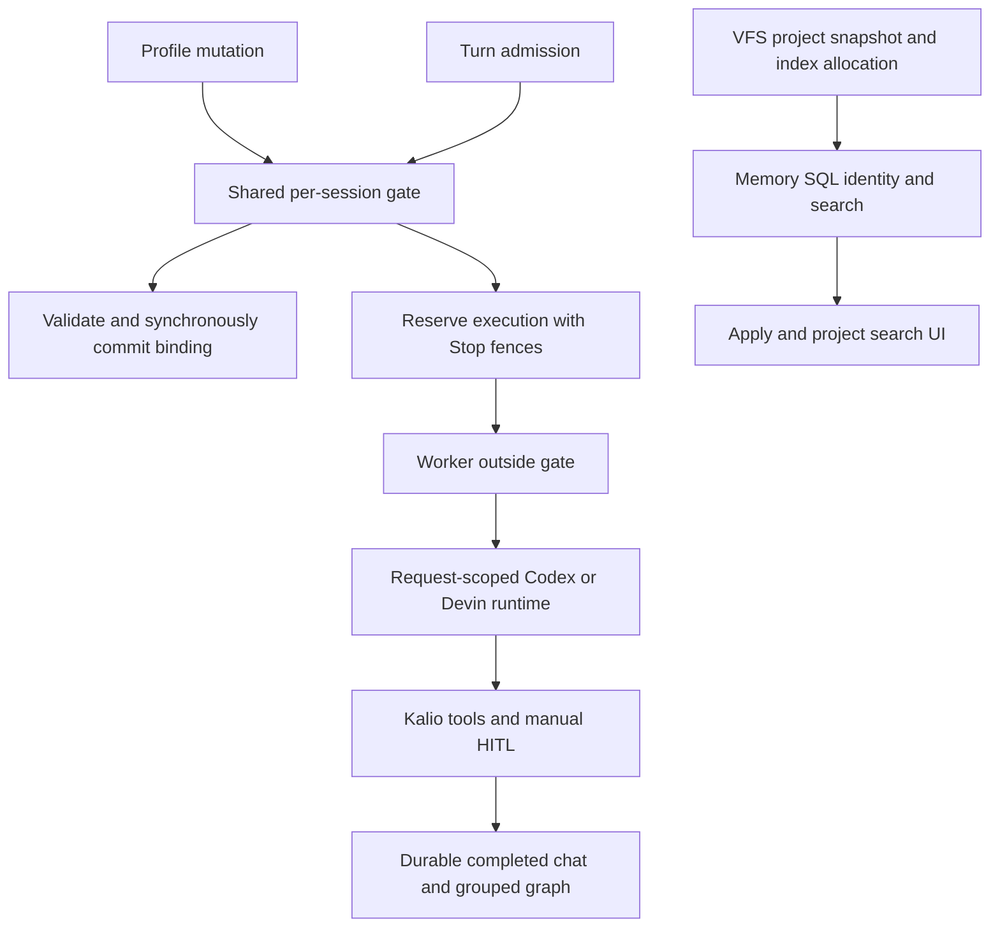

# 2026-10-18 — QA512 release-review corrections

## Purpose and scope

Prepare PR15 release 1.0.3 and verify the eight inline findings missed by an earlier review-summary-only read. RAD-14 is Done by explicit owner direction, not independent provider-key revocation proof. Preserve QA providers, the approved Home Site project and unrelated image-agent work. No direct main push, merge bypass or premature tag/publication.

## Starting evidence and decisions

Baseline `9bf33c0c` had successful CI and unsigned Windows/Linux desktop workflows but eight unresolved inline review threads. That baseline was not release closure. Real SQLite reproduced a profile PATCH/admission mismatch; a real Codex router showed pending requests accumulating after catalog timeouts; reader-to-index fixtures indexed only 48 of 75 admitted files.

Observed concurrency and ownership defects justified a shared session admission gate, request-owned cancellation and a VFS-owned storage port. Independent advisory review required retaining Stop fences and keeping worker/drain/callback execution outside admission. A second review found a final Drizzle thenable yield before SQL: synchronous `.run()` now makes final guard and write contiguous, with a deterministic regression.

## Implementation and boundaries

- Profile update and all reservation paths share the injected per-session gate. Durable session reread, explicit/persona-induced profile validation and commit are serialized against admission. Stop invalidates live mutation tokens; transient counters clean up. No private production fallback gate. Sessions 492 LOC, Pipeline 488, gate 72, profile helper 37.
- Shared `EXECUTION_PROFILE_LOOKUP` delegates enabled/default/selection reads to existing runtime services; Sessions no longer imports concrete agent-runtime profile services. Contract additions require normal PR review.
- Codex catalog deadline aborts its local request. Pending entry and abort subscription are removed on response, abort, write failure and connection termination; no host reset or invented protocol cancel method.
- Windows auto resolves the actual CPU backend when deriving pinned E5 identity.
- VFS storage port owns path hashing, existence, quotas and directory allocation. Common database infrastructure still owns SQLite connection lifecycle; Memory owns schema, identity and semantic search. Existing per-project/per-model paths and quota thresholds are preserved, without migration or data reset.
- Index classification now covers every reader-admitted format and extensionless document. Binary assets remain metadata-only. Existing secret/link/size exclusions are unchanged.
- Project Context Apply reloads the selected index status with existing stale/unmount guards, without project reselection or implicit remote consent.

## Verification

System Node 22.15 on Windows outside the sandbox for native SQLite, builds and browsers:

| Acceptance | Status | Evidence |
|---|---|---|
| Profile race / persona / reservation / queue / continuation / Stop / seed | PASS | Parent 91-test regression group, including 17 new workflow cases; original RED and final SQL RED reproduced before fixes |
| Catalog cleanup and healthy request recovery | PASS | Real router/fake transport: parent 12 protocol + 10 catalog + 8 host tests |
| Storage and format parity | PASS | 75 admitted fixtures searchable with explicit representations; adapter/store/service regression group; real HTTP/auth and Home Site port 6/6 |
| Full local root gate | PASS | `.tmp/qa512-release-root-final.log`, exit 0: scripts 175, shared 126, FE 2099, API 6176 passed / 4 conditional skips, launcher 15 |
| Typecheck / build / lint | PASS | API and FE typecheck exit 0; full build exit 0; final API rebuild TSC 0 / SWC 938; API lint 0; FE lint 0 with 25 existing warnings |
| Built isolated browser | PASS | 3/3: explicit profile launch/F5, workflow Stop and Delete; random ports and own database |
| QA Apply to real search | PASS | Home Site selected once, disable/Apply then enable/Apply; Search enabled without reselect, actual package.json returned first; local E5 CPU/384d, 108 sections |
| Real Devin / HITL / F5 / Graph | PASS | UI marker QA512-final-review-3e8a7e2b; turn e2b7kzP0qWHOx9hkHf1id; audited exact swe-2-high, 3 tools, one confirmation and one intended shell invocation; completed after F5; grouped graph matches |
| Actual Home Site preview | PASS | Headed browser 2/2, six widths 320/390/640/641/820/1440, keyboard/menu/demo form, no horizontal overflow or page errors; expected index-CiG0h558.js; `.tmp/qa512-home-site-final.log` |
| Remote current-head CI / merge / publication | UNVERIFIED | Must inspect after push; no tag/public release or merge claim in this note |

QA UI `http://localhost:5288/`, API `http://127.0.0.1:3316/api`, AppData `kalio-forever-qa` retained. Saved effective global OpenRouter gpt-4o-mini and default connected Devin SWE-2-high remain configured. Final preview terminal `dXVEOIduW7VKtxrBsVWhN`, pid 44472, URL `http://127.0.0.1:50330/`, left running through Kalio after manual HITL. Native Devin filesystem/web/terminal disabled. No target edits in this canary.

## Caveats and remaining release boundary

Existing jsdom XHR AggregateError stderr remains visible; Vitest did not report unhandled errors. Existing FE bundle-size warning remains. Four conditional root skips are not live proof; the Home Site port test was separately executed with the explicit approved path. One Home Site audit invocation initially skipped without its explicit environment; it was rerun with the approved preview URL, expected script and report-run configuration. Reports and screenshots remain local ignored artifacts under `docs/raports/qa-run-512/`, not bulk-committed.

No whole-machine cmd-window census or broad fresh embedding benchmark is claimed. Project search can still return package-lock noise after the correct first result ([P3]). README source dimensions were consistent; styled GitHub visual verification was inconclusive and no speculative redesign was made. Unsigned desktop artifacts are not signed production releases.

Required before publication: current-head remote CI/desktop success, inline-thread replies/resolution verified, required human PR approval and merge under repository protections, then release/tag flow. This note records the completed local/QA correction slice, not a merged or published release.
