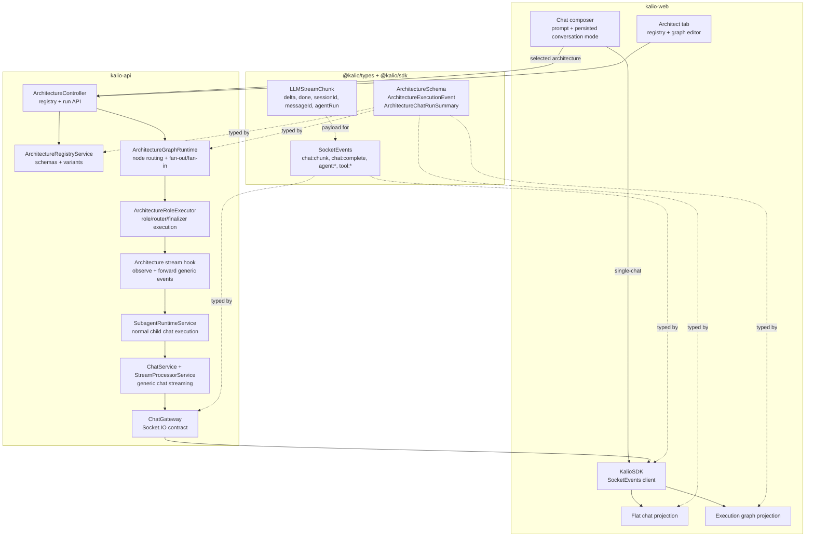
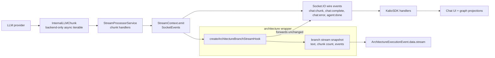
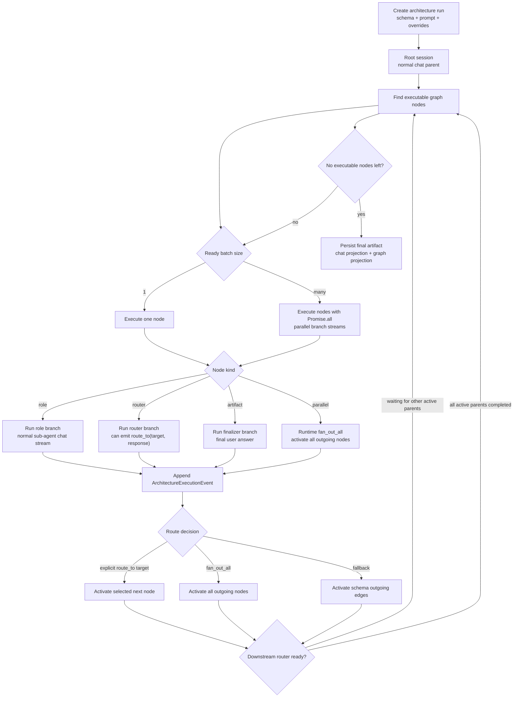
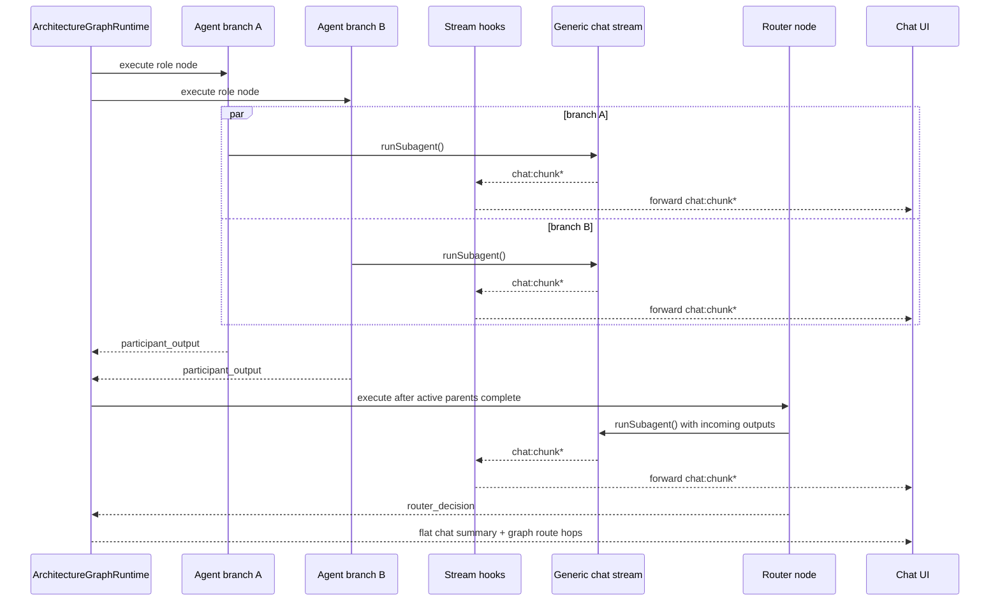

# Architecture Runtime Stack

This document shows the current architecture orchestration layer and the stream boundary it must preserve.

The important design rule: architecture runtime controls graph execution, but the LLM stream remains the normal Kalio chat stream.

For the target nested-flow delegation model, see `sub-agentflow-target-architecture.md`.

## Existing conversation mode

Architecture selection belongs to new-chat setup. Follow-up sends derive the schema
from the active session's persisted architecture context, not from the welcome
screen's current selection. Older sessions may recover the schema from their
persisted architecture messages. Switching sessions must not transfer a previous
workflow's schema into a single chat. Reload and a second workflow prompt require
browser verification; a completed first run alone does not prove this lifecycle.

## Devin structured role responses

The Devin ACP adapter prompts for one complete JSON value and validates the final
post-tool answer against the requested schema with Ajv. This is host validation,
not native ACP constrained decoding. Prose, fences, wrappers, invalid schemas,
unresolved tool activity and answers over 65,536 UTF-16 code units fail closed.
Any tool activity invalidates preceding candidate JSON. Cancellation or a stale
execution check must prevent publication, including during completion auditing.
A completed reply with invalid JSON or schema mismatch and no ACP tool activity
does not invalidate the ACP host. The turn runtime can apply its existing
one-shot format repair when no tool executed and the turn is still current.
Only validated `structured_output` chunks feed typed router/finalizer contracts;
chat prose must not supply graph routing authority. Adapter fixtures alone do not
prove real model compliance, graph completion or the protected goal protocol.

The explicit mock `[[mock:architecture:evidence]]` fixture requests an actual
isolated VFS write only from slots advertising `vfs_write`. It exercises executor
tool-evidence guards without host project writes; it is not project-quality proof.

## Current Stack

## Generic Stream Boundary

Architecture runs do not introduce a second streaming protocol. A branch is a normal child chat stream with an observer attached.

Extraction target for the future SDK split:

| Boundary | Current owner | Future package |
| --- | --- | --- |
| Wire events | `@kalio/types` `SocketEvents` | shared protocol package |
| Client handlers | `packages/@kalio/sdk` | client SDK |
| Backend stream source | `apps/kalio-api/src/modules/chat/interfaces` | server SDK |
| Stream observer/tee | `architecture-stream-hooks.ts` | server SDK utility, with architecture adapter on top |
| Architecture projections | web + API architecture modules | Kalio app layer |

What must stay generic:

- `LLMStreamChunk` must not get architecture-only fields.
- `chat:chunk`, `chat:complete`, `chat:error`, `agent:start`, `agent:done`, and `tool:*` stay valid for normal chat, sub-agents, CLI agents, and graph branches.
- Architecture-specific metadata lives in `ArchitectureExecutionEvent`, `ArchitectureChatRunSummary`, or an observer snapshot, not in the base chat stream.
- Context filtering is done before a branch chat starts. The streaming contract should not care why a branch received a smaller context.

## Graph Runtime Flow

Current behavior:

- Routers are node-level, not global.
- Parallel nodes can fan out into several normal chat branches.
- A downstream router waits for all currently active incoming branches before it merges or chooses a route.
- Cycles are bounded by runtime step and per-node visit limits.
- A revisited graph node shows the status, action and tool evidence of its latest explicit visit. The projection retains cumulative event IDs and visit count for audit.
- Branch output may contain `route_to(targetNodeId, response)` to force the next hop when that target is a valid outgoing node.

## Parallel Stream Shape

## Compatibility Checklist

REST create/createAsync explicitly pass the architecture-local runtime publisher to the existing engine. The singleton session event bus and gateway FIFO relay resolve full persisted ancestry before delivery, deduplicate subscribed recipients and fail closed for missing/cyclic ancestry. Relay delivery does not subscribe clients or confer child-session ownership. Gateway disposal cancels queued relay work; Home approval actions explicitly identify the request's child session before acting.

Typed `LLM_BAD_STRUCTURED_OUTPUT` and `LLM_STRUCTURED_OUTPUT_SCHEMA_INVALID` from router/judge roles bypass partial-evidence recovery: the role rejects, preserving the original bad-output error or wrapping an invalid schema as a contract violation with its cause. Successful reads never authorize a synthetic implementation route. Existing valid decisions, unrelated error recovery, goal/receipt guards and strict provider validation are unchanged.

Cold history restoration unions run identities from existing summaries and raw `run_subagent` call metadata. Inference scopes calls/results to each exact run before fetching its typed projection, then merges envelopes with their durable prompt and turn identities. This includes a failed middle run between completed runs. Active-session changes fence stale writes; per-run projection failure cannot mix evidence from another run or fabricate a terminal status. Warm reload and a fresh browser context are separate verification gates.

An early failure can have only a persisted parent-projection prompt and error text. Its exact prompt ID and matching workflow turn ID identify the run for an authoritative projection fetch even when the host history has no tool call for it.

Loading older chat messages runs the same architecture projection restoration on the merged history window. Live messages that arrive while projections load are retained, and switching conversations fences the pending page.

Architecture branch execution uses one monotonic remaining-time budget. Only a verified, durably persisted manual tool request opens a host-owned wait token, before its announcement; every settlement path releases it. Overlapping waits exclude their union. Approval resumes the remaining time, not a fresh timeout; the existing explicit iteration grant retains its separate reset policy. Stop/dispose/stale ownership fence timer rearming and tool entry. Ordinary subagents keep existing behavior; no durable restart accounting or scheduler policy change is implied.

The graph passes its host-owned abort signal through the role executor to the active subagent. When the graph stops, the child controller aborts and its tool-confirmation waiter cancels the pending durable request.

Before tool policy or confirmation, dispatch validates arguments against the canonical registered Kalio or MCP schema, without coercion, defaults or property removal. Invalid input settles as an `INVALID_ARGUMENT` tool error and does not create a confirmation request or executor-entry authority. Missing or invalid canonical schemas fail closed. Existing execution-time guards remain defense in depth; valid destructive operations still require confirmation.

When a tool-execution role returns a subagent timeout, the graph retains its partial tool evidence. A role with a default successor and a single distinct continuation to a router sends the timeout only to that router. The failed attempt counts against the node visit limit and appears as failed in the graph. A successful attempt excludes that recovery edge. Without a configured recovery route, the timeout fails the run.

Before extracting the stream into a standalone library, keep these checks true:

- Normal `chat:send` still reaches `ChatService` without importing architecture modules.
- `SubagentRuntimeService` still emits ordinary `SocketEvents`.
- Architecture uses an observer around `SubagentEmit`; it does not require architecture fields in `LLMStreamChunk`.
- Frontend architecture summaries are projections from `ArchitectureChatRunSummary`, not a replacement for `KalioSDK.onChunk`.
- Tests cover both normal chat streaming and architecture runtime execution with a mock LLM.

### Durable terminal status recovery

Ordinary architecture audit events persist their existing typed lifecycle and status fields; recovery accepts only known enum values. Status reconstruction scans past neutral trailing events to the newest recognized terminal event. A later final artifact can supersede an earlier failure, while later cancellation remains cancellation. Participant output, a running node, prose or elapsed time cannot resurrect a terminal run. This repairs legacy failed-event histories without rewriting their audit rows. An authoritative durable active-resume epoch is not implemented by this projection fix.

Auto-routing checkpoints use the required audit writer. Recovery discards a legacy lossy duplicate only when the same session, run, schema, event identity, sequence, node and route have a complete checkpoint. A malformed checkpoint without that match still fails validation.

Game Development 2 finalization requires successful browser navigation, click, snapshot and repeat navigation through Kalio in both current QA visits, after the latest recorded write. Audit records preserve tool result names and statuses for this check after recovery. Provider-native activity and participant prose do not satisfy it. A router selecting an artifact without that evidence takes its configured non-artifact continuation when available. The finalizer still blocks when there is no such edge.

## Target Direction: Sub-AgentFlow

The current architecture runtime should evolve into a reusable nested flow runtime rather than a heavyweight workspace orchestrator.

Target delegation kinds:

| Kind | Parent sees | System runs |
| --- | --- | --- |
| `sub_agent` | One child-agent tool call. | Child `ChatSession` with one bounded agent loop. |
| `cli_agent` | External executor delegation. | CLI process/session with status and progress. |
| `sub_agentflow` | One delegated flow tool call. | Child `ChatSession` plus `AgentFlowRun`, graph trace, routers, guards, and final result. |

`sub_agentflow` should reuse the existing session isolation model: history, VFS, KV, approvals, lineage, and graph evidence stay tied to sessions. The parent receives a summary/result while the user can open the child flow as chat or graph.

The first product-critical flow is `goal_guard_delivery_loop`: a two-agent Dev/Implementer and Goal Guard loop. Five Minds-style debate flows remain useful for analysis, but they are not valid substitutes when the user asks to validate implementation/guard ping-pong behavior.

Talk and the graph inspector share the structured final-answer presentation. A file preview resolves relative paths against the persisted session project and uses the bounded project resource reader. Plain-text legacy artifacts remain readable.
The report selector prefers the complete durable finalizer assistant message when recovered metadata contains only a clipped preview. It parses supported report JSON once, including the historical Finalizer heading wrapper. Decoded report fields preserve newline layout; arbitrary text, Windows paths and code are not globally unescaped.

Legacy audit projections capped at 800 characters show a labeled excerpt when the status and complete evidence entries can be recovered. The UI never reconstructs missing evidence.

Router decisions and finalizer output are visually marked as Kalio workflow events, with explicit route transitions in Talk and the graph inspector.

Router detail cards present confidence, input counts and available action/strategy as fields, preferring the typed event output. Final-answer evidence rows attach each file preview action to the evidence that references it.

In Game Development 2 and its variants, Release Review receives the latest completed participant output from Core, UX, Senior and both QA nodes in the current run. A newer unfinished or failed visit suppresses that node’s older output. These summaries inform routing. Artifact publication still depends on runtime evidence guards.

Game Development 2 finalization keeps a bounded head and conclusion of each browser QA report so the result and reload evidence near the end survives prompt compression. Reports remain supplemental to runtime evidence.

## Deterministic status conditions

A status_router node compares the execution outcome of its single source role with completed or failed. Its statusRouting field stores sourceNodeId and expectedStatus. Exactly one choice edge (Yes) and one default edge (Else) must have distinct targets. The node has no persona, tools or model call.

The predicate reads the latest source node_started visit in the same run. A recovered runtime failure or exhausted subagent timeout counts as failed. A nested tool failure does not determine the whole role outcome. A new source visit without a terminal outcome blocks evaluation. Fatal contract errors and explicit Stop remain terminal.

Decisions use the existing required route checkpoint, with source-start and terminal event IDs and the exact condition. Recovery validates that binding and the selected edge against the saved schema before resuming. Checkpoint persistence errors fail the node. Route selection does not supply implementation, build or semantic acceptance evidence.
