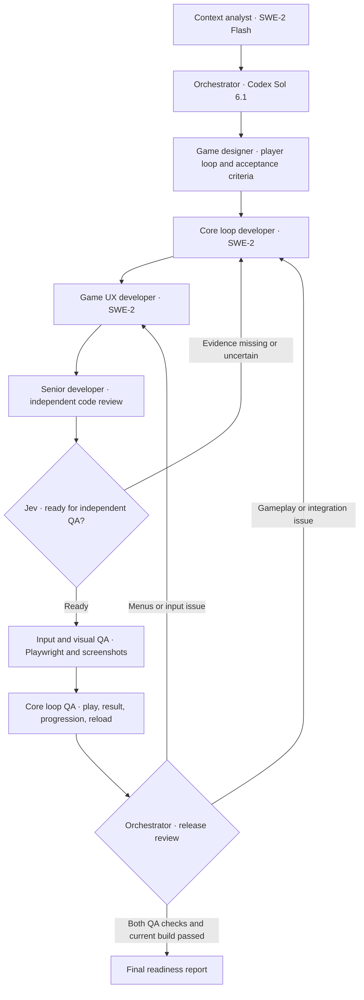

# Game Development 2

The built-in preset lives in the API architecture registry. Use it for an existing game with a registered project root and a bounded delivery brief.

The model names in the diagram describe the intended deployment. The preset uses existing personas and the current execution profile contract. Mixed native profiles require host-authorized per-role selection. A model listed in the catalog does not prove that it ran. Jev readiness uses the configured goal decision service. Native Ollama tool decisions have a separate contract.

## Traffic MOBA Showcase acceptance

- Preserve the existing career, roster, strategy, match simulation, UI, assets and uncommitted changes. Remove only artifacts whose ownership and lack of use are verified.
- Index the exact registered project, using local embeddings or separate consent for remote processing. The analyst verifies each cited file against current source.
- Start a new career in an isolated browser profile. Play a complete match, inspect the result and league progression, reload the saved career, and play again. Exercise menu controls and applicable keyboard, pointer and touch interactions.
- Verify the locked build and tests. QA attaches screenshot receipts at desktop and narrow game viewports and reports whether the image was actually delivered to a model.
- Report observed failures by role. Route back to the relevant developer on missing proof. Keep publish and commit outside the default completion criteria.
