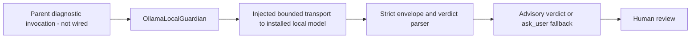

# Local decision guardian: compatibility and DEV integration plan

Status: isolated, tested advisory Ollama component; no application wiring. DEV only.
Production approval policy is outside this change; no settings, credentials,
approval modes, provider processes, dependencies, or production files were changed.

## Decision

Do not configure an arbitrary Ollama/chat endpoint as a custom Decisions provider.
The existing custom setting selects a transport destination, not a protocol adapter.
Prefer a separate, advisory local guardian verdict over pretending that generated
yes/no text is a Jev probability. `OllamaLocalGuardian` implements a separate
structured-output verdict protocol, not a Jev-compatible facade or scoring model.

Accepted supervisor design: deterministic rules plus one decision model first;
Guardian is optional and is not required on every call. See the accepted decisions
in `docs/spec/runtime-delivery-todo.md` (read-only in this task). Optional backend
installation must show backend/model download sizes and an explicit Install
action, with progress/error/retry. No silent pull on first use. This component
does not install, download, register, or enable any backend or model.

The research handoff recommends Granite Guardian4.1-8B Q4_K_M first (reported
artifact size 5.12 GB), with Qwen3.5-2B as a smaller candidate. These are supplied
candidate selections, not verified download, compatibility, latency, memory,
accuracy, or scoring claims. Artifact size is not runtime memory use. Pin exact
repository, revision, artifact checksum, runtime version, template and policy
before using either candidate; do not silently substitute one for the other.

## As-built contract and consumers

Source paths below are repository-relative.

| Boundary | Observed contract |
| --- | --- |
| `packages/@kalio/types/src/decision-settings.ts` | `DecisionSettings.provider` is `openrouter`, `typesafe`, or `custom`; endpoint is a full Decisions-compatible POST URL, independent of conversational LLM settings. |
| `apps/kalio-api/src/common/decision-settings.service.ts` | Custom connections can omit credentials; optional credentials become bearer authorization. HTTPS is allowed; HTTP is restricted to loopback. Embedded credentials, query and fragment are rejected. Saving configuration does not probe protocol compatibility. |
| `apps/kalio-api/src/common/decision-settings.controller.ts` | Guarded `decision/config` GET/PUT configuration, not a model inference or guardian route. |
| `apps/kalio-api/src/common/jev-decisions.client.ts` | POSTs `{ model, questions, state }` directly to the configured endpoint, rejects redirects, uses an 8-second deadline and a 65,536-byte response limit. No OpenAI messages or Ollama generate envelope. |
| `apps/kalio-api/src/modules/hitl/hitl-jev.service.ts` | `decideNoul` asks probability of allowing an operation, with sanitized operation state. This is not equivalent to a content-safety classification. |
| `apps/kalio-api/src/modules/hitl/hitl-policy.service.ts` | Jev uses approval threshold 0.95 by default; uncertainty/errors can invoke a configured persona when `jevFallbackToPersona` is true, otherwise manual review. Cancellation propagates. Merely throwing an adapter error does not guarantee manual review under every existing configuration. |
| `apps/kalio-api/src/modules/architecture/architecture-auto-routing.service.ts` | `decideChoice` chooses an exact edge ID; confidence below threshold selects default. Provider/invalid-response failures select fallback; caller cancellation propagates. |
| `apps/kalio-api/src/modules/architecture/architecture-goal-review.service.ts` | `decideNoulBatch` reviews source completeness, scope faithfulness and supersession validity. All probabilities >= 0.95 accept; any <= 0.05 reject; otherwise needs user. A safety guardian is not evidence for these semantic checks. |

Example wire shape for a single approval question (illustrative values only):

```json
{
  "model": "configured-model-id",
  "questions": {
    "approval": {
      "type": "noul",
      "instructions": "Should the requested operation be allowed?",
      "criteria": {
        "true": "The answer is yes: allow the requested operation.",
        "false": "The answer is no: do not allow the requested operation."
      }
    }
  },
  "state": { "operation": { "kind": "tool", "name": "example" } }
}
```

The corresponding answer must be an object at `answers.approval`, with
`type: "noul"` and numeric `noul` in [0, 1]. The client exposes that number as
`JevNoulResult.probability`. Choice answers require `type: "choice"`, an exact
own key from request criteria in `choice`, and numeric `confidence` in [0, 1].
Non-finite values and numeric strings are invalid. A response `model` string is
optional; it is not proof of actual model identity.

Batch requests require 1–32 questions, unique bounded IDs, nonempty instructions
and exactly true/false criteria (text <= 4096 characters), and <= 65,536 UTF-8
request bytes. Batch responses must contain exactly the requested answer keys.
Do not assume these batch-specific input limits also exist for single requests.

Chat completions, Ollama envelopes, free text, JSON embedded inside generated text,
or yes/no labels do not satisfy this contract. JSON schema validity and a number
between zero and one do not prove a calibrated probability. Never turn yes/no
into 1/0 or copy a model's claimed confidence into Jev probability.

## Implemented advisory API

All new code lives in `apps/kalio-api/src/common/local-guardian/`:

| File | API / responsibility |
| --- | --- |
| `local-guardian.types.ts` | Local-only input, config, discriminated result and injectable `LocalGuardianTransport` contracts. No shared type edits. |
| `local-guardian.schema.ts` | JSON Schema and pure strict `parseGuardianContent(unknown)`. |
| `ollama-guardian.transport.ts` | `OllamaGuardianFetchTransport`, with optional fetch injection, redirect rejection, bounded streaming read and cancellation. |
| `ollama-local-guardian.ts` | `new OllamaLocalGuardian(config, transport).evaluate(input)`; one explicit request, no retries, no tool execution. |

```ts
const guardian = new OllamaLocalGuardian(
  { endpoint: 'http://127.0.0.1:11434/api/chat', model: 'explicit-installed-tag:version' },
  new OllamaGuardianFetchTransport(),
);
const result = await guardian.evaluate({
  requestId: 'operation-123',
  policy: { id: 'read-only-v1', instructions: 'Allow read-only inspection; deny writes.' },
  context: { operation: { name: 'read_file', path: '/project/README.md' } },
  signal: abortController.signal,
});
```

Imports come from the files above. Policy text and ID must be supplied by the
trusted host, never by the operation, user-provided evidence or model. The caller
must sanitize and minimize context before invocation; no automatic credentials
redaction is claimed. The model sees only request ID and context as user data;
endpoint, signal and configuration do not become prompt data. Policy is a separate
system message. Prompt separation is not proof of injection resistance.

Result always includes `source: 'local-guardian'`, request ID and policy ID:

- `status: 'evaluated'`: `verdict: 'allow' | 'deny' | 'ask_user'`, nonempty model
  `reason`, and configured `model`. This means protocol-valid output only, not
  empirically validated model quality, identity, confidence or execution authority.
- `status: 'fallback'`: always `verdict: 'ask_user'`, with reason `invalid_config`,
  `invalid_request`, `invalid_output`, `provider_error`, `timeout` or `aborted`.
  Exception details and response bodies are not returned or logged. Abort returns
  this advisory fallback, not a successful classification; parent must stop work.

The adapter posts Ollama `messages`, `stream: false`, temperature zero, output
token cap 512 and `format` JSON Schema. Model content must be exactly an object
with `verdict` and `reason` (1–1000 characters, nonblank), no extra fields. Fenced
JSON, yes/no, scores, commentary, missing fields and coercions are rejected. The
Ollama envelope must have matching exact model tag, assistant role, `done: true`,
`done_reason: 'stop'`, and no `tool_calls` field. Missing completion metadata and
token-limit termination fail closed. The tag echo is not artifact identity proof.

Only HTTP/HTTPS loopback `localhost`, `127.0.0.1` or `[::1]`, full `/api/chat`
URLs are accepted, without embedded credentials, query or fragment. Default
deadline is 8000 ms; custom integer deadlines are limited to 1–30000 ms. Serialized
request limit is 32768 UTF-8 bytes, response limit 16384 bytes, and generated content
limit 8192 characters. Policy instructions are limited to 8000 characters; request
and policy IDs to 128. Unsupported JSON values, circular and oversized context
fail before network use. The deadline covers transport and response-body reads;
even an injected transport that ignores abort cannot delay the returned fallback.
Injected transports must honor signal to release their own resources. No retries.

Configuration, request binding and serialized policy/context are captured before
external awaits. The parent still owns checking that the operation/policy is
current when displaying a result; this adapter has no durable state or authority.

Protocol source: [Ollama structured outputs](https://docs.ollama.com/capabilities/structured-outputs)
and [chat API](https://docs.ollama.com/api/chat). This is generic structured chat,
not verified Granite native scoring or a claim that Granite's template supports
this prompt. A model that emits only its native label will yield `ask_user` until
separately validated for this protocol. No model downloads or live inference ran.

If a real scoring backend is later available, retain score semantics separately:
record scored class, label/token mapping, normalization method, model/template
identity and calibration evidence. A harmfulness score is not automatically
`P(allow operation)`. Do not invert it into approval probability without proving
that policy equivalence. A Jev-compatible facade remains a separate future change.

## Exact missing integration and ownership



There is no guardian HTTP route, Nest provider registration, health/readiness
check, install UI or module wiring supplied here. The transport and strict parser
are implemented, but adding these files alone does not register them with Nest.
`DecisionSettingsModule` remains unchanged.

Parent Nest wiring can use an explicit factory provider, no decorators or new
module needed in these files:

```ts
{
  provide: OllamaLocalGuardian,
  useFactory: () => new OllamaLocalGuardian(devGuardianConfig, new OllamaGuardianFetchTransport()),
}
```

Register only when explicitly enabled/installed in DEV. Parent owns configuration
and imports this provider into an approved module. Inject the class into a guarded
diagnostic controller/service; call `evaluate` only when requested, not on every
operation. Never pass the result directly into HITL execution. Escape model reason
as untrusted text in any UI. No enablement switch is written by this component.

Next implementer sequence, after parent finishes dependency installation:

1. Capture one real request and response for each selected policy, including an
   unsafe example, malformed/truncated output and an unavailable backend. Pin
   the exact model artifact/template and document the output grammar; verify
   whether the runtime exposes actual class scores rather than generated numbers.
2. Reuse the implemented component and tests below. No dependencies were added
   or installed by this task. Parent supplies installation/readiness state and
   pins backend/model identities outside model-generated data.
3. In a separately authorized change, register a DEV-only diagnostic controller
   and provider in an existing importing module; protect it with the established
   decision-auth boundary, enforce loopback backend policy/no redirects, bound
   requests/responses and timeouts, and preserve caller cancellation. Keep secrets in
   host configuration. Return no raw operation text or credentials in logs.
4. Prove the diagnostic path with a real local model, then prove human/manual
   approval remains authoritative for allow, deny, timeout, invalid and stale
   results. Do not route diagnostic errors through the existing optional persona
   fallback. Preserve hard approval rules. Do not enable `auto`, `bypass` or `jev`
   approval mode, repoint shared Decision Settings, or use guardian verdicts for
   workflow routing/goal acceptance.
5. Any later authority/scoring integration requires separate shared-contract,
   consumer, module and spec review outside this task's file ownership.

Tests in `ollama-local-guardian.spec.ts` and `ollama-guardian.transport.spec.ts`
cover all verdicts, strict invalid-output/envelope rejection, unsafe endpoints,
invalid input/timeout configuration, concurrent bindings, snapshots, no score
coercion, caller abort and late responses, provider errors without exception
disclosure, UTF-8 byte limits, reader cancellation and real loopback HTTP on a
random port. The HTTP server is a protocol fixture, not a real model. Unit tests
cannot establish calibration or model quality; those require a labeled
policy-specific evaluation set and live proof.

Verification for the isolated component (system Node, 2026-11-02):

- From `apps/kalio-api`: `node node_modules/vitest/vitest.mjs run src/common/local-guardian/ollama-local-guardian.spec.ts src/common/local-guardian/ollama-guardian.transport.spec.ts`
  — 57/57 passed outside sandbox, including random-port loopback HTTP. The initial
  sandbox run failed its loopback case; outside-sandbox verification is authoritative.
- From repository root: `node node_modules/typescript/bin/tsc --noEmit -p apps/kalio-api/tsconfig.json`
  — passed. Subsequent API build also typechecked the final test additions.
- From `apps/kalio-api`: `node node_modules/@nestjs/cli/bin/nest.js build`
  — zero type issues; 949 files compiled. No service was started or restarted.
- From repository root: `node node_modules/eslint/bin/eslint.js apps/kalio-api/src/common/local-guardian --ext .ts`
  — passed.

## Acceptance and evidence for this change

| AC | Requirement / state / consumers | Status | Evidence / remaining |
| --- | --- | --- | --- |
| AC-01 | Explain custom endpoint compatibility, including single/batch/choice | PASS | Inspected settings, client and client regression test source. Tests were not executed. |
| AC-02 | Preserve manual control; no fabricated probabilities | PASS | Isolated component only; no Jev/HITL imports, settings writes, execution or module wiring. |
| AC-03 | Identify consumer twins and failure boundaries | PASS | HITL approval, architecture routing and goal-review contracts inspected; separate verdict plan above. |
| AC-04 | Concrete component, interface, bounded transport and tests | PASS | 57/57 focused tests, API typecheck/build and scoped lint passed; commands above. |
| AC-05 | Live local model compatibility, scoring and DEV end-to-end proof | BLOCKED | Parent must install/pin backend, validate model protocol and wire diagnostic provider/route; no model-quality or production readiness claim. |
| AC-06 | UI/reconnect/persistence and production validation | N/A | No UI, durable state or production behavior changed; production manual mode is user-reported, not live-verified here. |

Nekko Board tools were not available in this session; no external sync is claimed.
This file is the local handoff pending exact Board project mapping and access.
No changes to shared files, no commits, no production changes. Before any future
production use, close AC-05 and the independently authorized integration gates;
the isolated component itself is not loaded by application startup.
