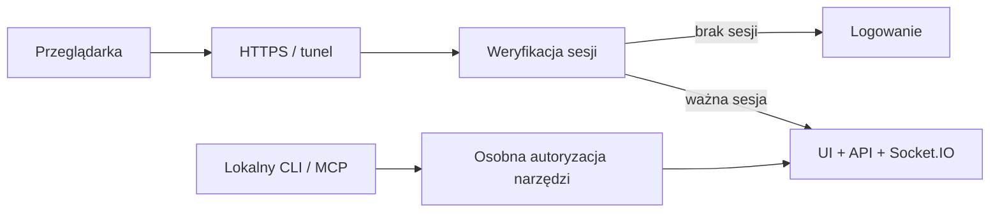

# Logowanie do Kalio przed wejściem przez tunel

Ocena z 2026-10-17. To opis zakresu, nie wdrożone logowanie ani zgoda na publiczne wystawienie QA.

## Obecny stan

- QA działa lokalnie: UI `5288`, API/Socket.IO `3316`. Samo wejście nie wymaga hasła.
- `DecisionAuthGuard` chroni wybrane ustawienia, a nie całą aplikację. `POST /api/decision/auth` wydaje lokalne cookie po sprawdzeniu pochodzenia żądania; nie weryfikuje hasła użytkownika.
- `DecisionAuthService` i proxy ustawień świadomie dopuszczają wyłącznie lokalne originy. Nie wystarczy dopisać domeny tunelu do CORS.
- `ChatGateway.handleConnection` rejestruje klienta bez globalnej sesji logowania. Adapter Socket.IO ma recovery z `skipMiddlewares: true`; projekt logowania musi uwzględniać ponowne sprawdzenie ważności dostępu po reconnect i wylogowaniu.
- Aktualny plik QA `runtime-config.js` wskazuje API/WS na `127.0.0.1:3316`. Na telefonie oznaczałoby to telefon, nie host Kalio. Dostęp zdalny wymaga również poprawnej konfiguracji URL-i.
- Token control-plane, tokeny MCP i klucz szyfrowania providerów nie są hasłem użytkownika i nie powinny być do tego ponownie używane.

Dowody źródłowe: `apps/kalio-api/src/common/decision-auth.{service,guard,controller}.ts`, `apps/kalio-api/src/modules/chat/chat.gateway.ts`, `apps/kalio-api/src/adapters/socket-io.adapter.ts`, `apps/kalio-web/decision-auth.proxy.mjs`.

## Najmniejszy użyteczny wariant

Jedna osoba, jedno hasło administratora, bez rejestracji kont i odzyskiwania hasła e-mailem:

1. Opcjonalny tryb logowania konfigurowany na backendzie. Przy włączonym trybie błędna/brakująca konfiguracja blokuje start zamiast otwierać dostęp.
2. Hasło dostarczane jako zmienna środowiskowa, preferencyjnie w postaci hasha (`KALIO_LOGIN_PASSWORD_HASH`, nazwa proponowana). Nigdy `VITE_*`, bundle przeglądarki, URL ani logi. Odrębny sekret sesji.
3. Ekran logowania i sesja po stronie serwera; losowe cookie `HttpOnly`, `Secure` przy HTTPS, odpowiednie `SameSite`, wygaśnięcie i wylogowanie. Hasło nie trafia do localStorage.
4. Globalna ochrona odczytów i zapisów API, uploadów, pobrań i pozostałych tras z danymi. Jawna, mała lista tras publicznych, np. logowanie i minimalny health check.
5. Weryfikacja sesji przy połączeniu i działaniach Socket.IO, z odcięciem po wylogowaniu/wygaśnięciu. Sama ochrona REST nie zabezpiecza czatu.
6. Ochrona przed zgadywaniem hasła, CSRF i nieakceptowanym Origin/Host; zaufanie do nagłówków proxy tylko od znanego proxy.
7. Jeden origin HTTPS dla UI, `/api` i `/socket.io`, przez tunel do loopback hosta. Bez publicznego, alternatywnego portu backendu omijającego logowanie.
8. Osobny dostęp maszynowy dla lokalnego MCP/CLI i preflightów, z dotychczasowym zakresem. Logowanie do UI nie znosi HITL ani polityk narzędzi.

## Szacunek pracy

Wstępny szacunek dla jednej osoby znającej repo, bez wieloużytkownikowości i bez nowego systemu zarządzania kontami:

| Część | Szacunek |
| --- | --- |
| Backend: sesja, globalna ochrona, konfiguracja, logout, limity | 1–2 dni |
| Frontend: ekran logowania, obsługa 401, reconnect, wspólny origin | 0,5–1 dnia |
| Regresje integracji, Socket.IO, MCP/CLI, restart i test przez HTTPS/tunel | 1–2 dni |
| Razem | około 3–5 dni roboczych |

To przedział, nie zobowiązanie terminowe. Dokładna liczba tras z wyjątkami oraz wybrany sposób tunelowania mogą go zmienić. Ochrona reverse proxy może być krótszym etapem przejściowym, ale musi obejmować API i WebSocket, a lokalne blokady originów nadal wymagają zgodnej konfiguracji. Nie jest to automatycznie równoważne logowaniu w aplikacji.

## Warunki odbioru

- Bez sesji: brak dostępu do historii, plików, ustawień i uruchamiania agentów, zarówno REST, jak i Socket.IO.
- Poprawne/błędne hasło, limity prób, wygasła sesja, logout, restart i reconnect mają testy.
- F5 i bezpośredni link prowadzą do logowania bez utraty docelowego widoku.
- Wylogowanie unieważnia aktywne połączenie i nie odtwarza uprawnień przez recovery.
- Test z rzeczywistego drugiego klienta przez HTTPS obejmuje czat, upload/download i HITL; localhost nie zastępuje tego dowodu.
- Osobno przechodzą lokalne Devin/Codex/MCP i preflighty. Brak hasła/sekretu sesji w artefaktach frontendu, logach i repo.

P1 przed wystawieniem tunelu: obecnego QA nie należy uznawać za zabezpieczone globalnym logowaniem. Nie włączono tunelu ani nowego hasła w ramach tej oceny.

Zalecenia bazowe: [OWASP Authentication](https://cheatsheetseries.owasp.org/cheatsheets/Authentication_Cheat_Sheet.html), [OWASP WebSocket Security](https://cheatsheetseries.owasp.org/cheatsheets/WebSocket_Security_Cheat_Sheet.html).
