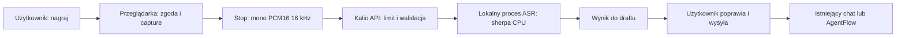

# Wejście głosowe Kalio na Windows — badanie Skryby

Data: 2026-11-02. Status: **research zakończony; integracja i wydajność Windows niezweryfikowane**. Dokument jest propozycją, nie opisem wdrożonej funkcji.

## Wniosek

Najmniejszy sensowny zakres to dyktowanie uruchamiane przyciskiem w webowym Kalio: nagraj, zatrzymaj, rozpoznaj lokalnie, popraw tekst w istniejącym composerze, wyślij zwykłym przyciskiem. Rekomendowany pierwszy silnik: **Parakeet TDT 0.6B v3 INT8 przez sherpa-onnx na CPU**. Reuse oznacza te same artefakty i konfigurację dekodowania oraz wzorzec izolacji procesu; Androidowego AAR, usług i Kotlinu nie można bezpośrednio użyć w NestJS.

GTX 1060 nie jest warunkiem działania. Wariant GPU należy traktować jako osobny eksperyment, a nie obiecywane przyspieszenie. Nie zmierzono tu Windows CPU, GPU, pamięci ani jakości polskiego.

## Zakres i pochodzenie dowodów

- Odczytano rzeczywisty projekt `E:/Projekty/skryba`, znaleziony przez dopuszczony fallback `rg --files E:/Projekty -g package.json -g '*parakeet*' -g '*skryba*'` z wykluczeniami katalogów zależności. Everything nie było dostępne w narzędziach tej sesji.
- Czytano kod i istniejące artefakty testowe; nie zmieniano Skryby, nie uruchamiano jej skryptów, nie pobierano modeli i nie uruchamiano mikrofonu.
- Próba delegacji do agenta badawczego nie powiodła się: `agent thread limit reached`. Analizę wykonano w bieżącej sesji; nie ma niezależnej recenzji agenta.
- `git -C E:/Projekty/skryba rev-parse HEAD` i `status` zwróciły `Permission denied`. Poniższe dane opisują odczytane pliki robocze, nie potwierdzony commit ani czysty checkout Skryby.
- Kalio HEAD: `9f65f22d77ecc6ac65049dc5515610434ab7f29b`; zastano liczne cudze zmiany robocze. Jedyny zapis tego badania to ten nowy plik.
- Nekko Board MCP nie było dostępne; mapowania projektu i kontekstu Board nie zweryfikowano. Nie zapisano danych do Board ani archiwów Linear/Notion. Ten dokument zachowuje lokalny wynik badania, bez deklaracji synchronizacji.
- Wstępna pamięć sesji wskazała historyczny projekt Skryby; identyfikacja silnika poniżej pochodzi ze świeżego odczytu kodu, nie z pamięci.

## Co Skryba rzeczywiście implementuje

Ścieżki w tabeli są względem `E:/Projekty/skryba/`.

| Obszar | Zaobserwowany stan | Pochodzenie |
| --- | --- | --- |
| Runtime | sherpa-onnx **1.13.8**, Android AAR pobierany z wydania upstream, sprawdzany SHA-256 | `app/build.gradle.kts:13–35` |
| Model | `parakeet-tdt-v3-int8`, eksport `csukuangfj/sherpa-onnx-nemo-parakeet-tdt-0.6b-v3-int8`, revision `2bda32ec70b097a55adaa07d9a7173915b43cc78` | `app/src/main/java/pl/skryba/model/ModelCatalog.kt:9–19` |
| Dekoder | `OfflineRecognizer`, transducer encoder/decoder/joiner, `modelType="nemo_transducer"`, `greedy_search` | `app/src/main/java/pl/skryba/model/ParakeetEngine.kt:8–18` |
| Backend | jawnie `provider="cpu"`; 1–4 wątki zależnie od dostępnych procesorów | `ParakeetEngine.kt:16–17` w powyższym katalogu |
| Audio | mono PCM16 16 kHz; do recognizera trafia FloatArray z próbkowaniem 16000 | `app/src/main/java/pl/skryba/audio/AudioCapture.kt:12–34`, `core/WavAudio.java:9–19`, `model/ParakeetEngine.kt:20–26` |
| Cykl życia | prywatna usługa osobnego procesu ASR, LOAD/TRANSCRIBE/KILL, odrzucanie pracy podczas busy, możliwość zakończenia natywnego procesu | `app/src/main/java/pl/skryba/model/ParakeetWorkerService.kt`, `ParakeetWorker.kt`, `app/src/main/AndroidManifest.xml` |
| Dostarczanie | pliki `.part`, wznowienie Range z kontrolą Content-Range, rozmiar i SHA-256, rename dopiero po weryfikacji; pobranie oddzielone od aktywacji | `app/src/main/java/pl/skryba/model/VerifiedTransfer.kt`, `core/DownloadPolicy.java`, `model/ModelRepository.kt:202–215` |
| Inne modele | Whisper base Q5_1 59 707 625 B i small Q5_1 190 085 487 B; oddzielna ścieżka whisper.cpp/JNI | `ModelCatalog.kt:17–20`, `model/NativeWhisper.kt`, `app/src/main/cpp/whisper_jni.cpp` |

Parakeet v3 jest modelem wielojęzycznym obejmującym polski, nie osobnym polskim modelem ani v2. Karta NVIDIA potwierdza 600M parametrów, 25 języków i automatyczne rozpoznawanie języka. Nie oznacza to zmierzonej jakości polskiego w Skrybie lub Kalio. [Karta NVIDIA](https://huggingface.co/nvidia/parakeet-tdt-0.6b-v3).

### Konkretne pliki i pobieranie

Manifest poniżej przepisano z lokalnego `ModelCatalog.kt:9–14`. **Nie pobrano plików ani nie przeliczono ich hashy w tej sesji.** Linki wskazują dokładnie revision używane przez Skrybę; dostępność każdego pliku wymaga testu przy przyszłym wdrożeniu. Przeglądarka badawcza otworzyła stronę eksportu, ale nie zdołała otworzyć drzewa przypiętej rewizji.

| Artefakt / link pobrania | Bajty | SHA-256 z manifestu Skryby |
| --- | ---: | --- |
| [encoder.int8.onnx](https://huggingface.co/csukuangfj/sherpa-onnx-nemo-parakeet-tdt-0.6b-v3-int8/resolve/2bda32ec70b097a55adaa07d9a7173915b43cc78/encoder.int8.onnx) | 652184281 | `acfc2b4456377e15d04f0243af540b7fe7c992f8d898d751cf134c3a55fd2247` |
| [decoder.int8.onnx](https://huggingface.co/csukuangfj/sherpa-onnx-nemo-parakeet-tdt-0.6b-v3-int8/resolve/2bda32ec70b097a55adaa07d9a7173915b43cc78/decoder.int8.onnx) | 11845275 | `179e50c43d1a9de79c8a24149a2f9bac6eb5981823f2a2ed88d655b24248db4e` |
| [joiner.int8.onnx](https://huggingface.co/csukuangfj/sherpa-onnx-nemo-parakeet-tdt-0.6b-v3-int8/resolve/2bda32ec70b097a55adaa07d9a7173915b43cc78/joiner.int8.onnx) | 6355277 | `3164c13fc2821009440d20fcb5fdc78bff28b4db2f8d0f0b329101719c0948b3` |
| [tokens.txt](https://huggingface.co/csukuangfj/sherpa-onnx-nemo-parakeet-tdt-0.6b-v3-int8/resolve/2bda32ec70b097a55adaa07d9a7173915b43cc78/tokens.txt) | 93939 | `d58544679ea4bc6ac563d1f545eb7d474bd6cfa467f0a6e2c1dc1c7d37e3c35d` |

Suma: **670 478 772 B = 670,48 MB ≈ 639,42 MiB**. Nie obejmuje bibliotek runtime, cache ani pamięci inferencji. Rozmiar plików nie jest zapotrzebowaniem RAM. Bezpośrednie cztery pliki eliminują potrzebę rozpakowywania archiwum; przy aktualizacji trzeba uwzględnić równoczesne miejsce na stary i nowy pakiet.

Upstream sherpa dokumentuje również [pakiet Parakeet v3 INT8 i jego uruchamianie](https://k2-fsa.github.io/sherpa/onnx/pretrained_models/offline-transducer/nemo-transducer-models.html). Archiwum z wydania `asr-models` nie jest automatycznie tożsame bajtowo z przypiętym manifestem Skryby.

### Licencje

- Wagi NVIDIA: **CC BY 4.0** według [karty producenta](https://huggingface.co/nvidia/parakeet-tdt-0.6b-v3). Przy dystrybucji zachować atrybucję NVIDIA, odnośnik do modelu/licencji oraz wskazać eksport ONNX i kwantyzację jako modyfikacje.
- Eksport [csukuangfj](https://huggingface.co/csukuangfj/sherpa-onnx-nemo-parakeet-tdt-0.6b-v3-int8) nie ma karty modelu na otwartej stronie. Nie należy wnioskować z tego o osobnej licencji eksportu; przed redystrybucją sprawdzić komplet plików i notices przypiętej rewizji oraz udokumentować pochodzenie.
- sherpa-onnx: [Apache-2.0 upstream](https://github.com/k2-fsa/sherpa-onnx/blob/master/LICENSE). Skryba ma `licenses/sherpa-onnx-LICENSE` i `licenses/onnxruntime-LICENSE`; konkretne binaria Windows wymagają własnego zestawu notices i kontroli zależności.
- Nie znaleziono głównego `E:/Projekty/skryba/LICENSE`. Reuse konfiguracji i silnika nie oznacza uprawnienia do kopiowania kodu aplikacji; prawa do kopiowanego kodu należy potwierdzić osobno.

## Dowody wydajności i wykonalność

Istniejący `E:/Projekty/skryba/docs/test-results/parakeet-host-smoke.json` zapisuje: Linux x86_64, sherpa-onnx 1.13.8 CPU, 4 wątki, audio 4 s, ładowanie 5,283 s, przetwarzanie 2,179 s, angielski wynik „And so, my fellow Americans ask”. Wyliczony RTF ≈ **0,545**, bez ładowania. Jest to historyczny artefakt, nie test powtórzony dziś; nie podaje modelu CPU, RAM ani jakości polskiego. Nie przenosi się na Windows, Android ani GTX 1060. `docs/asr-comparison.md` zawiera także obce benchmarki; nie używam ich jako pomiaru sprzętu użytkownika.

| Cel | Ocena badawcza | Co pozostaje niezmierzone |
| --- | --- | --- |
| Windows x64 CPU | Pierwszy kandydat: ten sam eksport INT8 i logika sherpa. Oficjalna dokumentacja udostępnia natywny `sherpa-onnx-node` dla Windows x64 | Uruchomienie wybranej wersji na systemowym Node Kalio, zimny start, RTF, peak RSS, stabilność i polski WER |
| GTX 1060 | Możliwy kierunek osobnego spike; brak dowodu, że obecny INT8 i wybrany provider dadzą korzyść | Wariant karty/pamięć, sterownik, architektury w binariach, obsługa operatorów, przydział CPU/GPU, VRAM i realny czas |
| Browser-only WASM/WebGPU | Większy zakres: ładowanie około 640 MiB w kliencie, inny backend i dystrybucja; odłożyć | Pełna zgodność eksportu/dekodera i zużycie pamięci przeglądarki |

[Dokumentacja instalacji sherpa](https://k2-fsa.github.io/sherpa/onnx/javascript-api/install.html) potwierdza natywny pakiet Windows x64 z DLL i Node >=16. [Przykłady node-addon-api](https://github.com/k2-fsa/sherpa-onnx/blob/master/nodejs-addon-examples/README.md) rozróżniają wielowątkowy addon od wrappera WASM. To potwierdza dostępność ścieżki technologicznej, nie kompatybilność dowolnej wersji pakietu z Kalio. Wersja 1.13.8 jest zaobserwowana dla Androida; numer wersji Windows trzeba wybrać, przypiąć i sprawdzić, zamiast instalować bezwarunkowo latest.

[Tabela NVIDIA](https://developer.nvidia.com/cuda/gpus/legacy) klasyfikuje GTX 1060 jako compute capability **6.1**. Samo CUDA-capable nie dowodzi wsparcia w konkretnym wydaniu ONNX Runtime/sherpa. [CUDA EP ONNX Runtime](https://onnxruntime.ai/docs/execution-providers/CUDA-ExecutionProvider.html) wymaga zgodnych wersji CUDA/cuDNN; [macierz cuDNN](https://docs.nvidia.com/deeplearning/cudnn/backend/latest/reference/support-matrix.html) musi być sprawdzona dla wybranego wydania i sprzętu. Nie zakładamy obsługi Pascala przez najnowsze biblioteki ani tego, że dynamiczny INT8 używany na CPU przejdzie w całości na CUDA. Ewentualny eksport FP32/FP16 to osobna konfiguracja, większe artefakty i ponowna ewaluacja jakości. Nie deklarujemy wyniku ani przewagi GPU.

## Proponowany minimalny przepływ Kalio — jeszcze niewdrożony

Odczytane punkty integracji: `apps/kalio-web/src/features/chat/ChatInput.tsx:6–58` posiada draft, `onDraftChange`, `onSend` i osobną gałąź `onArchitectureRun`; `ChatInterface.tsx` używa tego composera i `hooks/useChatComposerActions.ts`. Bounded search `parakeet|SpeechRecognition|MediaRecorder|getUserMedia|sherpa` w `apps/` i `packages/` nie znalazł istniejącej implementacji wejścia głosowego. To wynik wyszukiwania kodu, nie audyt działającego produktu.

1. Przycisk nagrywania uruchamia `getUserMedia` wyłącznie po akcji użytkownika. Zapewnić widoczny stan, czas, Stop i Anuluj, obsługę klawiatury i komunikaty błędów. Proponowany limit MVP: 60 s, jedna aktywna próba na sesję; jest to nowa propozycja, nie limit Skryby.
2. Capture Web Audio/AudioWorklet i kontrolowany downmix/resampling do mono 16 kHz, kodowanie PCM16 WAV. Sprawdzić rzeczywistą częstotliwość wejścia; samo constraint `sampleRate:16000` nie jest dowodem formatu. Alternatywa MediaRecorder wymaga obsługi realnego MIME/kodeka i dekodowania; nie nazywać WebM/Opus plikiem WAV. Proponowana ścieżka PCM ogranicza potrzebę dokładania FFmpeg.
3. Chronione, ograniczone żądanie transkrypcji do API Kalio. Nazwa endpointu i kontrakt są do zaprojektowania, nie istnieją w tym badaniu. Walidować typ, nagłówek, kanały, częstotliwość, długość i rozmiar po stronie BE; 60 s PCM16 mono 16 kHz to 1 920 000 B próbek plus nagłówek. Ograniczać upload przed pełnym buforowaniem.
4. NestJS deleguje do jednego izolowanego procesu ASR z natywnym addonem; model utrzymywany po pierwszym załadowaniu. Zacząć od ustawień Skryby: CPU, do 4 wątków, greedy search. Izolacja procesu chroni event loop API i pozwala przerwać natywne decode; nie zakładać, że anulowanie Promise zatrzymuje inferencję. Nie wprowadzać globalnego mikrofonu ani desktopowego hooka klawiatury.
5. Wynik rozpoznawania wraca jako tekst do edytowalnego draftu, bez automatycznej wysyłki. Zachować zwykły routing chat/AgentFlow, kolejkę i politykę interrupt. Powiązać próbę z session ID/request ID; odrzucać spóźniony wynik po anulowaniu lub zmianie sesji. Przy równoległej edycji nie nadpisywać nowszego tekstu; udostępnić wynik do świadomego wstawienia.
6. Model: oddzielne stany brak/pobieranie/weryfikacja/gotowy/błąd, jawna akcja pobrania, rozmiar i pochodzenie, wznawialne pliki i SHA-256 jak w Skrybie. Pliki i katalog modelu obsługiwać przez VFS zgodnie z regułami Kalio. Nie wprowadzać bezpośredniego I/O w nowym module domenowym.

To propozycja dodatku wejściowego, bez zmiany modelu wykonywania AgentFlow. Wdrożenie będzie wymagało oddzielnego przeglądu kontraktu, aktualizacji `project-spec.md` oraz specyfikacji zachowania. Ten research celowo ich nie zmienia.

## Prywatność i granice lokalności

- Zgoda przeglądarki nie zastępuje świadomego Start; nigdy nie zaczynać capture przy otwarciu strony, F5, reconnect lub zmianie sesji. W tym badaniu niczego nie nagrywano.
- [Specyfikacja Media Capture](https://www.w3.org/TR/mediacapture-streams/) opisuje kontrolę dostępu i cykl życia tracków. [Dokumentacja getUserMedia](https://developer.mozilla.org/en-US/docs/Web/API/MediaDevices/getUserMedia) opisuje secure context i permission errors. Test docelowy: Chrome/Edge Windows na localhost albo HTTPS; osobno sprawdzić osadzony WebView, jeśli stanie się zakresem.
- Po Stop/Anuluj/błędzie/nawigacji zatrzymać wszystkie tracki i zwolnić AudioContext. F5 podczas próby ma przerwać nagrywanie; nie wznawiać go automatycznie. Wynik starej próby nie może pojawić się w innej sesji.
- „Lokalnie” oznacza backend Kalio działający na tym samym komputerze. Przy zdalnym API, proxy lub tunelu audio opuszcza komputer przeglądarki. MVP offline powinno wymagać lokalnego backendu; nie nazywać samego localhost URL dowodem, jeżeli jest forwardowany. Nie wdrażać automatycznego fallbacku do chmury lub Web Speech Recognition.
- Pobieranie modelu ujawnia serwerowi/CDN adres IP i żądany artefakt, ale nie wymaga przesyłania audio. Po przygotowaniu modelu inferencja powinna działać bez Internetu; sprawdzić to testem sieciowym.
- Domyślnie bez archiwizacji audio, bez audio/tekstu w logach i telemetryce. Próbki tylko w pamięci lub krótkotrwałym pliku VFS usuwanym po zakończeniu/anulowaniu/awarii, z cleanup po restarcie. Nie obiecywać bezśladowego usunięcia z RAM/pagefile/systemu.
- Transkrypcja staje się wiadomością dopiero po Wyślij. Od tego momentu obowiązuje dotychczasowa retencja i wybrany provider LLM; lokalne ASR nie oznacza, że późniejszy tekst nigdy nie opuści komputera.

## Macierz zamknięcia badania i przyszłe bramki

| AC / obszar | Status badania | Dowód | Pozostaje |
| --- | --- | --- | --- |
| AC-01: projekt i runtime | PASS | Świeży odczyt Skryby, manifest, engine, worker | Commit Skryby niepotwierdzony z powodu odmowy Git |
| AC-02: pliki, rozmiary, licencje | PASS z jawnymi ograniczeniami | Manifest lokalny i oficjalne źródła powyżej | Ponowne hashowanie pobrania i notices eksportu przed dystrybucją |
| AC-03: Windows CPU/GTX1060 | PASS jako ocena wykonalności | Oficjalne platformy sherpa, macierze NVIDIA/ORT | Runtime i benchmark Windows: UNVERIFIED, nie część pomiarowa tego zadania |
| AC-04: minimalny zakres i prywatność | PASS jako propozycja | Composer Kalio, przepływ i ograniczenia powyżej | Brak implementacji i produktu do browser QA |
| AC-05: tylko jeden nowy dokument | PASS po kontroli diff/status | Docelowy plik; brak wykonywania Skryby i capture | Bez commita, wdrożenia i synchronizacji Board |

**Required before prod — [P2]:** osobny spike na systemowym Node Windows x64: przypięta wersja runtime, załadowanie czterech plików, kontrola hashy, polskie próbki przekazane świadomie przez użytkownika albo jawnie licencjonowane fixture. Zmierzyć cold/warm load, medianę/p95 latency, RTF, peak RSS i WER według jednej normalizacji; zapisać CPU, RAM, wersje i dokładne pliki. Proponowane kryterium krótkiego dyktowania: warm RTF <=1; to cel do uzgodnienia, nie osiągnięty wynik.

**Required before prod — [P2]:** po implementacji FE sprawdzić Start/Stop/Anuluj, odmowę i brak mikrofonu, ciszę, uszkodzone/zbyt długie audio, brak/uszkodzenie modelu, busy/timeout/awarię workera, F5/reconnect i zmianę sesji, ochronę równoległej edycji, chat oraz AgentFlow. Stop nagrywania i Stop agenta muszą być rozróżnialne. Sprawdzić brak uploadu przy Anuluj, brak chmurowego fallbacku, zwolnienie mikrofonu, cleanup oraz zwykłe wysłanie poprawionego tekstu. Testy modelu fixture nie zastępują rzeczywistego testu permission/capture po świadomej akcji.

**Optional — [P4]:** GTX1060/CUDA dopiero po benchmarku CPU. Osobno potwierdzić compute capability w binariach, zgodny stos CUDA/cuDNN/ORT, rzeczywisty provider poszczególnych operatorów i przewagę end-to-end. Jeśli CPU spełnia cel, GPU nie jest wymagane do pierwszego zakresu.

Badanie nie wymaga kolejnych zmian, aby przekazać tę rekomendację. Żadna powyższa bramka wdrożeniowa nie została uznana za zaliczoną na podstawie samego researchu.
