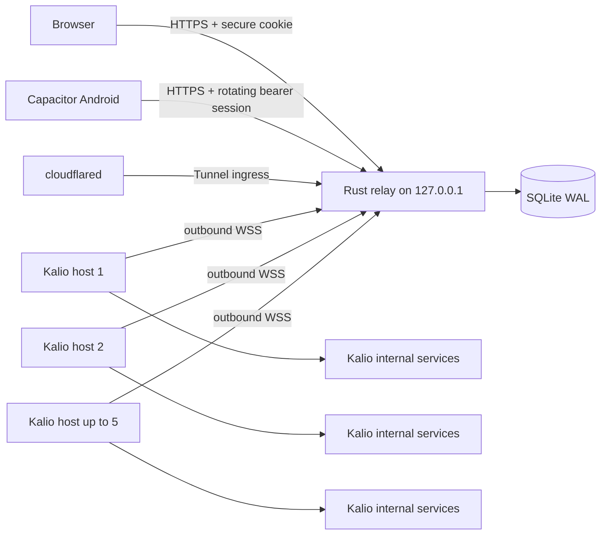

# Kalio Remote Relay Design

**Date:** 2026-09-22
**Status:** Proposed for user review
**Scope:** A single-owner public relay, a React web client, a Capacitor Android client, a narrow outbound Kalio host connector, and dev/QA/prod MCP and skill parity.

## Product decision

Build `E:\Projekty\kalio-remote` as a separate Rust service and React client. The
only public component is the relay. Every Kalio installation initiates an
outbound authenticated WebSocket connection to it; the relay never opens a
port on a Kalio host and never proxies Kalio's current REST or Socket.IO API.

The product is intentionally for one owner. The owner can register up to five
Kalio hosts, see their sessions and runtime state, create a chat on a selected
host, send messages, follow streamed output, stop a session, and resolve HITL
requests. A final emergency-stop slice adds the red button only after those
normal flows are proven.



## Goals

- One private owner account initialized from the relay machine's CLI.
- Browser and Android login with revocable device sessions.
- Up to five paired Kalio hosts with online, degraded, and offline state.
- Durable session list/history and reconnect-safe live streaming.
- Create chat, send message, stop one session, approve or reject HITL.
- Auditable, idempotent commands with explicit acknowledgement and completion.
- Cloudflare Tunnel deployment where the Rust relay binds only to loopback.
- Profile-aware Kalio MCP configuration and deterministic skill parity across
  dev, QA, and installed prod without moving secrets or whole databases.
- Emergency stop added last and scoped only to runs owned by Kalio.

## Non-goals for version one

- Multiple users, teams, roles, invitations, or tenant isolation.
- Terminal, filesystem, settings, secret, arbitrary MCP, or raw tool access.
- A generic reverse proxy to Kalio REST, Socket.IO, or the loopback MCP bridge.
- Remote operating-system process management or process-name based killing.
- Cloud-hosted LLM execution; agents continue to run on registered Kalio hosts.
- Remote editing of MCP credentials or skill prompts.
- Background access to Codex, Devin, Node, shells, or unrelated processes.

## Reference stack and repository layout

The implementation follows the proven Rust/React/Capacitor shape in
`E:\Projekty\nekko-board` while keeping Kalio Remote independent.

- Rust 1.85, edition 2024.
- Axum 0.8, Tokio 1, tower-http 0.6, serde 1, thiserror 2.
- SQLx 0.8 with SQLite, migrations, WAL, and foreign keys.
- Argon2 0.5 for the owner password.
- React 19, TypeScript 5.9.3, Vite 8.2.0, Vitest 4.1.10.
- Capacitor 7.6.8 and Android secure storage for mobile credentials.
- Playwright for browser flows and Rust integration tests for the protocol.

```text
E:\Projekty\kalio-remote\
  crates\domain\          authentication and protocol-independent rules
  crates\persistence\     SQLite repositories and migrations
  crates\relay\           Axum HTTP/WebSocket server and CLI
  packages\protocol\      generated TypeScript protocol and validators
  apps\web\               React owner UI
  android\                 Capacitor Android project
  deploy\cloudflare\      sample tunnel config and service files
  docs\                    operations, threat model, and recovery
```

## Authentication and session model

### First owner

The first owner is created only on the relay machine:

```powershell
kalio-relay init-owner --username radomiej
```

The command reads the password twice from an interactive hidden prompt, rejects
passwords shorter than 14 characters, and fails if an owner already exists.
There is no public registration or password-reset endpoint. Recovery is a local
CLI operation that revokes every existing web and mobile session.

The password is stored as an Argon2id PHC string. The server never logs a
password, session token, pairing code, host token, cookie, or Authorization
header.

### Browser session

- The browser receives a 256-bit opaque session id in an `HttpOnly`, `Secure`,
  `SameSite=Strict` cookie.
- The database stores only a SHA-256 digest of the opaque id.
- The session expires after 12 hours idle or 30 days absolute, whichever comes
  first.
- State-changing browser requests require an exact allowed `Origin` and a CSRF
  token bound to the session.
- Login is limited to five failures per source IP per 15 minutes and 20 failures
  globally per 15 minutes.

### Capacitor session

- The Android client receives a short-lived 15-minute access token and a
  rotating 30-day refresh token.
- Only token digests are persisted by the relay.
- The refresh token is stored through the Capacitor secure-storage plugin;
  `localStorage` is not permitted for credentials.
- Reuse of an already-rotated refresh token revokes that device session.

### Host pairing

1. The authenticated owner creates a single-use pairing code in the UI.
2. The code is valid for ten minutes and is displayed once.
3. Kalio submits the code over HTTPS and receives a 256-bit host credential.
4. The relay stores only the host credential digest. Kalio stores the credential
   through its existing credentials service, never in `.kalio/config.toml`.
5. The owner can rename or revoke a host. Pairing the sixth active host is
   rejected until another host is revoked.

## Narrow host protocol

The canonical protocol is defined in Rust and exported as JSON Schema. The
React client and Kalio connector consume generated TypeScript types plus runtime
validators. Both sides reject unknown protocol major versions.

Every host frame contains:

```json
{
  "protocolVersion": "1.0",
  "messageId": "01J...",
  "sentAt": "2026-09-22T12:00:00Z",
  "kind": "command|ack|event|snapshot|error",
  "payload": {}
}
```

Commands additionally contain `commandId`, a caller-supplied `idempotencyKey`,
`hostId`, `hostBootId`, and `deadline`. The relay retains command outcomes for
24 hours. Repeating an idempotency key returns the original outcome and does not
start a second turn or resolve HITL twice.

Frames are limited to 1 MiB, text fields are length-bounded, and malformed or
oversized frames close the host connection with an audited protocol error. The
host sends a heartbeat every 15 seconds; after 45 seconds without one the relay
marks it offline. Command admission requires an online host and matching
`hostBootId` so stale commands cannot cross a Kalio restart.

### Host hello and capabilities

On every connection Kalio sends:

```json
{
  "type": "host.hello",
  "hostId": "host_...",
  "hostBootId": "boot_...",
  "displayName": "Laptop QA",
  "kalioVersion": "0.1.0",
  "protocolVersion": "1.0",
  "capabilities": [
    "sessions.read",
    "sessions.create",
    "messages.send",
    "sessions.stop",
    "hitl.resolve"
  ],
  "lastAppliedEmergencyEpoch": 0
}
```

The relay responds with accepted capabilities, the current relay boot id, and
whether emergency admission is closed.

### Version-one commands

| Command | Input | Result |
| --- | --- | --- |
| `sessions.snapshot` | cursor and bounded limit | sessions, statuses, unread/pending counts |
| `session.read` | session id and message cursor | session, bounded message page, runtime snapshot |
| `session.create` | persona, project, optional title | durable session |
| `message.send` | session id, content, idempotency key | accepted turn id, then streamed events |
| `session.stop` | session id | drained root and Kalio-owned descendants |
| `hitl.resolve` | request id, revision, approve/deny, optional reason | compare-and-set outcome |

`session.create` may select only projects and personas already exposed by that
host's safe snapshot. The protocol contains identifiers and display metadata,
not filesystem paths, API keys, MCP headers, environment variables, prompts, or
tool arguments beyond the existing sanitized HITL request projection.

### Events and reconnect

The host emits session lifecycle, message, turn, runtime snapshot, HITL, and
command outcome events with monotonically increasing host event sequence
numbers. The relay stores the last sequence per host and requests replay after
reconnect. If replay is no longer available, Kalio sends a full bounded snapshot
from its durable backend state. Frontend state is always rebuildable after F5.

A command has one of these durable relay states:

```text
queued -> acknowledged -> completed
                     \-> rejected
                     \-> indeterminate
queued -> expired
```

Disconnect after acknowledgement but before completion produces
`indeterminate`, never a fabricated success. The client shows that state and
refreshes the session snapshot before allowing a retry.

## Kalio connector boundary

The connector is a new module, not an extension of the existing Telegram
`RelayModule`. It calls existing backend services directly:

- `SessionsService` for list, create, session, and message history.
- `SessionPipelineService` through a focused remote command facade for send,
  resume, status, and drain.
- The same stop cascade used by `ChatGateway`, including AgentFlow,
  architecture, CLI child, and subagent state owned by the selected session.
- `HitlRequestService` and `ChatService` for revision-checked approve/deny and
  continuation.
- `SessionEventsService` and runtime snapshots for reconnect-safe outbound
  events.

No relay command is translated into an HTTP request against localhost. This
avoids inheriting wildcard CORS, socket ownership assumptions, or the current
unauthenticated local control-plane boundary.

The module has one common admission guard. Normal start/send/resume paths call
it before work enters the runtime scheduler. The emergency slice later closes
this guard; it does not rely on timing or process enumeration.

## Emergency stop, implemented last

The red button is deliberately absent until login, host pairing, reconnect,
normal stop, and HITL are proven end to end.

When pressed, the relay:

1. Atomically closes command admission in memory for the current relay boot.
2. Records an audit event and increments a durable emergency epoch.
3. Sends `emergency.stop` to every connected host and rejects every new
   `session.create`, `message.send`, and resume command.
4. Each host closes its local admission guard before draining all active
   Kalio-owned root sessions and descendants.
5. Each host reports per-session outcomes; unreachable hosts remain visibly
   unconfirmed and the UI does not claim global success.

The central latch is cleared only by a new relay boot id after the Rust relay
process is restarted. A host that missed the emergency event must first apply
the last emergency epoch and reconcile old Kalio runs before it can accept a
new command from the restarted relay.

The stop implementation may use Kalio's runtime registries and scoped child
execution ports. It must never call `taskkill` by image name, kill all `node`,
kill all `codex`, kill all shells, or enumerate and terminate foreign processes.
Codex remains unaffected unless a specific Codex-backed child run was launched
and is owned by the Kalio session being stopped; even then only its recorded
runtime handle may be stopped.

## Relay persistence

SQLite runs in WAL mode with foreign keys and migrations. Minimum tables are:

- `owner` — username, Argon2id password hash, timestamps.
- `owner_sessions` — token digest, kind, device label, idle/absolute expiry,
  rotation family, revocation.
- `hosts` — id, display name, credential digest, revocation, last seen,
  protocol and Kalio versions.
- `commands` — idempotency key, command type, target boot id, lifecycle,
  bounded result metadata.
- `host_event_cursors` — last durable sequence and last boot id.
- `audit_events` — actor, host, command, outcome, correlation id, timestamp,
  redacted metadata.
- `emergency_events` — epoch, relay boot id, acknowledgements, clear boot id.

Database backups are documented and tested by restoring into a temporary
directory. Backups contain credential digests and audit metadata, so they are
treated as secrets and never placed under the public web root.

## Web and Android UX

The same React application serves browser and Capacitor with platform-specific
credential adapters.

- Login screen with clear offline, wrong-password, rate-limit, and expired
  session states.
- Host switcher showing name, online state, last seen, Kalio version, and
  capability mismatch.
- Conversation list, chat transcript, streaming state, pending HITL cards, and
  per-session stop.
- Create-chat flow that selects host first, then project/persona supplied by
  that host.
- Reconnect banner and explicit `indeterminate` command state.
- Responsive layouts at 360, 390, 768, and 1280 CSS pixels.
- Keyboard-visible focus, semantic labels, status announcements, 44-pixel
  mobile targets, reduced-motion support, and no color-only status meaning.
- Red button in a visually separate danger area with a typed confirmation;
  unavailable until the final emergency slice is enabled server-side.

## Cloudflare deployment

The relay listens on `127.0.0.1` only. `cloudflared` owns public ingress and
forwards HTTPS/WebSocket traffic to that loopback origin. The checked-in sample
contains no account id, tunnel credential, hostname, token, or certificate.

An exact application origin is configured through environment variables. The
relay rejects wildcard CORS and untrusted WebSocket origins. Cloudflare Access
may be enabled as a second browser defense, but relay authentication remains
canonical because the Capacitor client cannot depend on an interactive Access
flow.

Production evidence requires the real hostname, HTTPS login, WSS host
reconnect, mobile login, revoke, backup/restore, and negative authorization
tests. Local health or a connected tunnel alone is not production closure.

## MCP and skill parity across Kalio environments

Current read-only evidence on 2026-09-22:

| Environment | SQLite MCP rows | Skills |
| --- | ---: | --- |
| dev | 0 | `Architecture Agent Superpowers`, user `New Skill` |
| QA | 0 | `Architecture Agent Superpowers` |
| installed prod | 0 | `Architecture Agent Superpowers` |

The repo-managed Data Analyst MCP lives in `.kalio/config.toml`, outside those
SQLite rows. It remains the source entry and must not be reconstructed from
`~/.codex/config.toml`.

Configuration layering becomes:

1. `~/.kalio/config.toml` — private machine defaults.
2. repository `.kalio/config.toml` — checked-in safe project defaults.
3. repository `.kalio/config.<profile>.toml` — `dev`, `qa`, or `prod` overrides.
4. optional `KALIO_CONFIG_HOME` app-managed directory for packaged runtime,
   loaded before user overrides and never containing credentials.

`KALIO_INSTALL_PROFILE` is normalized to `dev`, `qa`, or `prod`; the existing
`runtime` and `desktop` values map to `prod`. Unknown values fail closed instead
of silently selecting production.

Seeded skills remain in `apps/kalio-api/src/assets/skills.json` with stable ids
and are upserted on startup in every environment. User skills are moved through
an explicit export/import command carrying id, name, description, prompt,
source, content hash, and provenance. Import previews conflicts, deduplicates by
stable id plus hash, and never executes skill text. It does not copy chats,
personas, credentials, settings, audit logs, or whole database files.

The current user skill `4Td01N0LHnml49qa5Gt6F` (`New Skill`) is the first
migration candidate. Its content is not printed in logs or reports. Applying
the migration requires all target Kalio processes to be stopped or the import
to go through the running environment's service API after local authentication
exists.

MCP parity uses sanitized manifests. URLs may be copied only when they contain
no embedded credentials; headers, environment values, and secrets are replaced
by credential references and provisioned separately. A parity report compares
server ids, transports, enabled state, endpoint origin, skill ids, and content
hashes without displaying secret values or skill prompts.

## Acceptance matrix

| Area | Required proof |
| --- | --- |
| Owner bootstrap | CLI-only first owner; second initialization rejected; password never logged |
| Browser auth | login, logout, CSRF, wrong origin, expiry, revocation, rate limit |
| Android auth | secure storage, rotation, replay revocation, cold start |
| Pairing | single use, ten-minute expiry, sixth-host rejection, revoke and reconnect denial |
| Protocol | version mismatch, malformed/oversized frames, idempotent duplicate commands, stale boot rejection |
| Sessions | list/history, create, stream, F5 rebuild, reconnect replay/snapshot |
| Stop/HITL | scoped drain, descendant handling, revision conflict, duplicate decision rejection |
| Isolation | no raw Kalio API proxy, terminal, files, settings, secrets, or arbitrary MCP |
| Cloudflare | HTTPS/WSS through real tunnel, loopback relay bind, exact origin enforcement |
| MCP/skills | dev/QA/prod parity report, no secret output, no whole-DB copy, user-skill conflict preview |
| Emergency | admission closes before drain, connected hosts accounted for, offline hosts reported, relay restart recovery |
| Codex safety | no global process kill; unrelated Codex session remains alive throughout emergency test |

## Delivery order

1. Bootstrap the new repository and freeze the protocol/security contract.
2. Implement owner auth, device sessions, host pairing, and audit.
3. Implement host WSS, registry, reconnect, and command idempotency.
4. Implement the Kalio connector and read-only snapshots.
5. Implement create/send/stream/stop/HITL end to end.
6. Implement React web UX and Capacitor credential adapter.
7. Deploy through Cloudflare Tunnel and prove negative security cases.
8. Implement and prove MCP/skill parity for dev, QA, and prod.
9. Add the red button and its restart-only recovery semantics.

The red button is therefore the last feature, not scaffolding presented as a
working safety control.
